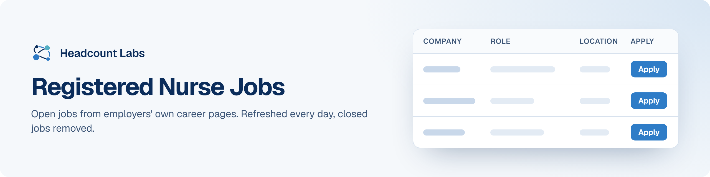

# Registered Nurse Jobs

Registered nurse (RN) jobs at US hospitals and health systems, with pay where the employer publishes it.

**400 open jobs** · 353 new since the last update · 353 removed because they closed or left the employer's board · updated October 22, 2026 at 5:57 AM EDT

This list is built and refreshed every day by [Headcount Labs](https://headcountlabs.com/?utm_source=github&utm_medium=job-list&utm_campaign=registered-nurse-jobs), which reads jobs straight from employers' own career pages and job boards. Every job here was still listed on its source board when we last read that board, within the past 3 days, and was posted in the past 30 days. Copies of the same job are merged into one row, and jobs that close are removed at the next update.

Want this data in your own app or agent? Use the [Headcount Labs jobs API](https://headcountlabs.com/docs/?utm_source=github&utm_medium=job-list&utm_campaign=registered-nurse-jobs) (free tier), the [MCP server](https://headcountlabs.com/mcp/?utm_source=github&utm_medium=job-list&utm_campaign=registered-nurse-jobs) for Claude, ChatGPT and other AI assistants, or the [public dataset subsets](https://huggingface.co/HeadcountLabs) on Hugging Face (the full dataset is coming soon).

**Full dataset.** A bigger, one-off snapshot dated 2026-10-19 (all matching jobs, not only the open jobs below) is on Hugging Face: [Jobs with posted pay](https://huggingface.co/datasets/HeadcountLabs/pay-transparency-jobs) · [Healthcare jobs](https://huggingface.co/datasets/HeadcountLabs/healthcare-jobs). It loads with `datasets.load_dataset` and is under the Open Database License (ODbL) 1.0.

**Columns.** *Apply* opens the original posting on the employer's site. *Details* opens the job on Headcount Labs, with every posting we found for it. *Remote* shows what the employer states; a dash means the posting doesn't say. *Pay* is the range the employer published.

## Posted in the last 7 days

| Company | Role | Location | Remote | Pay | Posted | Apply | Details |
| --- | --- | --- | --- | --- | --- | :---: | :---: |
| **WeCare at Avalon Springs** | RN Registered Nurse- PRN | Mercer, PA | — | $44–$46/hr | Oct 21 | <a href="https://apply-jobs.apploi.com/job/1886445?utm_campaign=integration&amp;utm_medium=job-board-search&amp;utm_source=company_profile_page&amp;language=en&amp;ajs_event=LOAD_JOB_PAGE&amp;ajs_aid=3f617530-4530-11e9-a2ca-7e775511d9e3&amp;ajs_prop_search_fetch_id=5722e4f490f64296be2c3af69d64637a&amp;ajs_prop_keyword=&amp;ajs_prop_page=1&amp;ajs_prop_city_center=Unselected&amp;ajs_prop_language=en&amp;ajs_prop_search_order=23&amp;ajs_prop_job_id=1886445&amp;ajs_prop_doc_type=job&amp;ajs_prop_job_location_lat=41.2482373&amp;ajs_prop_job_location_lon=-80.2514976&amp;ajs_prop_boosted=0&amp;ajs_prop_utm_source=company_profile_page&amp;ajs_prop_utm_medium=job-board-search&amp;ajs_prop_utm_campaign=integration"></a> | <a href="https://headcountlabs.com/catalog/jobs/3ceab623-0327-43bc-9e0e-7849e1e0f17d?utm_source=github&utm_medium=job-list&utm_campaign=registered-nurse-jobs">via Headcount Labs</a> |
| **Washington Center for Bleeding Disorders** | Registered Nurse Specialist | Seattle, WA | On-site | $100k–$125k/yr | Oct 21 |  | <a href="https://headcountlabs.com/catalog/jobs/27c81731-1d4e-4b1b-834a-2f8369b719fb?utm_source=github&utm_medium=job-list&utm_campaign=registered-nurse-jobs">via Headcount Labs</a> |
| **VOA Chesapeake and Carolinas** | Registered Nurse (Mental Health) (70589) | Lanham, MD | — | $35–$40/hr | Oct 21 |  | <a href="https://headcountlabs.com/catalog/jobs/e5a5db1f-696f-4ed4-86eb-59b0f301e912?utm_source=github&utm_medium=job-list&utm_campaign=registered-nurse-jobs">via Headcount Labs</a> |
| **VITALANT** | Registered Nurse - Hemophilia Center | Pittsburgh, PA | On-site | $55k–$70k/yr | Oct 21 |  | <a href="https://headcountlabs.com/catalog/jobs/f27990ea-255c-45eb-a770-a38f54d4ae7d?utm_source=github&utm_medium=job-list&utm_campaign=registered-nurse-jobs">via Headcount Labs</a> |
| **VisionQuest** | Registered Nurse | Woolford, MD | On-site | $70k/yr | Oct 21 |  | <a href="https://headcountlabs.com/catalog/jobs/ca7018ce-2864-4dfe-b1cc-8f68ac7ca386?utm_source=github&utm_medium=job-list&utm_campaign=registered-nurse-jobs">via Headcount Labs</a> |
| **Virtua West Jersey Health Sys** | Registered Nurse (RN) M/S Float (PT 7p-7a) | United States | On-site | $52.07–$67.94/hr | Oct 21 |  | <a href="https://headcountlabs.com/catalog/jobs/d7510dea-00e3-4a9b-ae24-fd20dcdfde02?utm_source=github&utm_medium=job-list&utm_campaign=registered-nurse-jobs">via Headcount Labs</a> |
| **Virtua West Jersey Health Sys** | Registered Nurse (RN) Mom Baby 4 (FT 7p-7a) | United States | On-site | $44.57–$60.44/hr | Oct 21 |  | <a href="https://headcountlabs.com/catalog/jobs/3e693d03-f7d4-4970-be97-ee6f2a821c49?utm_source=github&utm_medium=job-list&utm_campaign=registered-nurse-jobs">via Headcount Labs</a> |
| **Virtua West Jersey Health Sys** | Registered Nurse (RN) - Outpatient Radiology (Part Time 7:30-4) | United States | On-site | $44.57–$60.44/hr | Oct 21 |  | <a href="https://headcountlabs.com/catalog/jobs/83bb484c-d549-4d69-ad23-59464379f08d?utm_source=github&utm_medium=job-list&utm_campaign=registered-nurse-jobs">via Headcount Labs</a> |
| **Virtua Our Lady of Lourdes Hospital, Inc** | Registered Nurse, PCU 5, Full-time Days, VOLOL | United States | On-site | $47.55–$66.06/hr | Oct 21 |  | <a href="https://headcountlabs.com/catalog/jobs/e34769ec-2713-4138-934f-219b5db16683?utm_source=github&utm_medium=job-list&utm_campaign=registered-nurse-jobs">via Headcount Labs</a> |
| **Virginia Eye Consultants** | Pre-Op/PACU Registered Nurse - Ophthalmology - No weekends, evenings, or call! | Norfolk, VA | — | $36–$40/hr | Oct 21 |  | <a href="https://headcountlabs.com/catalog/jobs/3cb6c0d6-43d2-45f6-a774-b7b501850638?utm_source=github&utm_medium=job-list&utm_campaign=registered-nurse-jobs">via Headcount Labs</a> |
| **VHC Health** | Registered Nurse, Addictions: Recovery &amp; Wellness Per Diem | Arlington, VA | — | $51.75–$73.85/hr | Oct 21 |  | <a href="https://headcountlabs.com/catalog/jobs/c9e2f5e4-d474-42ce-8809-c4615cdbd802?utm_source=github&utm_medium=job-list&utm_campaign=registered-nurse-jobs">via Headcount Labs</a> |
| **VHC Health** | Recovery &amp; Wellness Registered Nurse, Per Diem | Arlington, VA | — | $51.75–$73.85/hr | Oct 21 |  | <a href="https://headcountlabs.com/catalog/jobs/0357163d-6f59-4352-9c1b-2efb31208e6e?utm_source=github&utm_medium=job-list&utm_campaign=registered-nurse-jobs">via Headcount Labs</a> |
| **Valley Health System** | Registered Nurse - Medical Oncology - Part time | Winchester, VA | — | $34–$48.87/hr | Oct 21 |  | <a href="https://headcountlabs.com/catalog/jobs/e32c0f99-16aa-4b32-9398-1c0a0968c34f?utm_source=github&utm_medium=job-list&utm_campaign=registered-nurse-jobs">via Headcount Labs</a> |
| **Valley Health System** | Registered Nurse - General Medicine - Full time | Winchester, VA | — | $34–$48.87/hr | Oct 21 |  | <a href="https://headcountlabs.com/catalog/jobs/7a4af1d5-3f4f-4b75-9b80-92b8d04a6829?utm_source=github&utm_medium=job-list&utm_campaign=registered-nurse-jobs">via Headcount Labs</a> |
| **Valley Health System** | Registered Nurse - Emergency Room - Full time | Winchester, VA | — | $34–$48.87/hr | Oct 21 |  | <a href="https://headcountlabs.com/catalog/jobs/41db1099-1a78-4e25-8db4-d202c5198a65?utm_source=github&utm_medium=job-list&utm_campaign=registered-nurse-jobs">via Headcount Labs</a> |
| **Valley Health System** | Registered Nurse - Medical Oncology - Per Diem | Winchester, VA | — | $34–$48.87/hr | Oct 21 |  | <a href="https://headcountlabs.com/catalog/jobs/3edc50fd-8a6f-49a3-bd57-04c8110a3052?utm_source=github&utm_medium=job-list&utm_campaign=registered-nurse-jobs">via Headcount Labs</a> |
| **Valley Health System** | Registered Nurse - Critical Care Step Down - Full time - 3rd Shift | Front Royal, VA | — | $34–$48.87/hr | Oct 21 |  | <a href="https://headcountlabs.com/catalog/jobs/2909f78e-2bd4-43ed-b37a-9de72659a1dd?utm_source=github&utm_medium=job-list&utm_campaign=registered-nurse-jobs">via Headcount Labs</a> |
| **Valley Health System** | Registered Nurse - Part-time - Preop/PACU - Dayshift | Winchester, VA | — | $34–$48.87/hr | Oct 21 |  | <a href="https://headcountlabs.com/catalog/jobs/0a0aebde-2141-42ed-a185-308d72ef4add?utm_source=github&utm_medium=job-list&utm_campaign=registered-nurse-jobs">via Headcount Labs</a> |
| **UROPARTNERS LLC** | Registered Nurse | Mount Prospect, IL | — | $30–$36/hr | Oct 21 |  | <a href="https://headcountlabs.com/catalog/jobs/34729204-10af-4625-88fb-d874644cca81?utm_source=github&utm_medium=job-list&utm_campaign=registered-nurse-jobs">via Headcount Labs</a> |
| **UR Medicine Thompson Health** | Registered Nurse - ICU | Canandaigua, NY | On-site | $38–$50/hr | Oct 21 |  | <a href="https://headcountlabs.com/catalog/jobs/9b4082f6-737a-4d69-846c-8f2150efcb4f?utm_source=github&utm_medium=job-list&utm_campaign=registered-nurse-jobs">via Headcount Labs</a> |
| **University Medical Center of Southern Nevada** | Registered Nurse - Adult ER | Las Vegas, NV | — | $43.53–$67.47/hr | Oct 21 |  | <a href="https://headcountlabs.com/catalog/jobs/67de7c20-c737-4e99-bd87-95fa3545f22a?utm_source=github&utm_medium=job-list&utm_campaign=registered-nurse-jobs">via Headcount Labs</a> |
| **United Vein &amp; Vascular Centers** | Registered Nurse | Bronx, NY | — | $38–$40/hr | Oct 21 |  | <a href="https://headcountlabs.com/catalog/jobs/46165cc3-0785-4656-a9e6-1b43cf457f6b?utm_source=github&utm_medium=job-list&utm_campaign=registered-nurse-jobs">via Headcount Labs</a> |
| **United Energy Workers Healthcare** | Registered Nurse (RN) | 

3 locations
Huntsville, AL Richland, WA Kansas City, MO
 | — | $60/hr | Oct 21 |  | <a href="https://headcountlabs.com/catalog/jobs/a0682eeb-c943-457c-a8b3-60b7594082d6?utm_source=github&utm_medium=job-list&utm_campaign=registered-nurse-jobs">via Headcount Labs</a> |
| **The Pavilion at Williamsburg Place, Inc.** | Mental Health Registered Nurse- Nights | United States | On-site | $45–$50/hr | Oct 21 |  | <a href="https://headcountlabs.com/catalog/jobs/8f29b673-9a0b-45eb-9e4c-2ba3ac0d3a9a?utm_source=github&utm_medium=job-list&utm_campaign=registered-nurse-jobs">via Headcount Labs</a> |
| **The Children's Hospital of Philadelphia** | Registered Nurse- Per Diem-Vascular Access Team | United States | — | $48.30–$58.15/hr | Oct 21 |  | <a href="https://headcountlabs.com/catalog/jobs/7e67df6d-a14f-437e-bf89-48b056fa9c72?utm_source=github&utm_medium=job-list&utm_campaign=registered-nurse-jobs">via Headcount Labs</a> |
| **Sun River Health** | MAT Registered Nurse (RN) Care Manager - Substance Abuse (Hudson Valley) | 

2 locations
Poughkeepsie, NY Amenia, NY
 | On-site | $45.45–$55.15/hr | Oct 21 |  | <a href="https://headcountlabs.com/catalog/jobs/6eca1fa1-8aa9-424c-ba34-1820f51e4653?utm_source=github&utm_medium=job-list&utm_campaign=registered-nurse-jobs">via Headcount Labs</a> |
| **St. Patrick's Residence - Naperville, IL** | Registered Nurse Supervisor - RN - Full-Time - Nights | Naperville, IL | On-site | $40–$42/hr | Oct 21 |  | <a href="https://headcountlabs.com/catalog/jobs/ba01d903-fb44-4e37-8d8f-204c68aabaa0?utm_source=github&utm_medium=job-list&utm_campaign=registered-nurse-jobs">via Headcount Labs</a> |
| **St. Croix Hospice** | Registered Nurse (RN) Case Manager - Hospice- $5,000 signing bonus | Moline, IL | — | $83k–$88k/yr | Oct 21 |  | <a href="https://headcountlabs.com/catalog/jobs/2b421ad1-e3d9-4e6a-9d7f-6a5fb15aa7ed?utm_source=github&utm_medium=job-list&utm_campaign=registered-nurse-jobs">via Headcount Labs</a> |
| **Springfield Memorial Hospital** | Registered Nurse (RN) Pre-Anesthesia Testing | MMC | On-site | $35.92–$57.47/hr | Oct 21 |  | <a href="https://headcountlabs.com/catalog/jobs/5f5f1dfb-db13-4c2a-88a3-ce3fbece947b?utm_source=github&utm_medium=job-list&utm_campaign=registered-nurse-jobs">via Headcount Labs</a> |
| **Sevita** | Registered Nurse | 

3 locations
Riverton, UT Jacksonville, FL Tallahassee, FL
 | On-site | $33/hr | Oct 21 |  | <a href="https://headcountlabs.com/catalog/jobs/a76e36a8-7dcd-4f3e-b939-660a640b0b64?utm_source=github&utm_medium=job-list&utm_campaign=registered-nurse-jobs">via Headcount Labs</a> |
| **Sevita** | Registered Nurse (RN) | Springfield, MA | On-site | $36–$38/hr | Oct 21 |  | <a href="https://headcountlabs.com/catalog/jobs/95915a40-40bf-49b3-8085-84f3670fc5ca?utm_source=github&utm_medium=job-list&utm_campaign=registered-nurse-jobs">via Headcount Labs</a> |
| **Seven Counties Services, Inc.** | Registered Nurse | Louisville, KY | On-site | $37.50/hr | Oct 21 |  | <a href="https://headcountlabs.com/catalog/jobs/79ba282f-54e7-4735-9747-dff7cace0eca?utm_source=github&utm_medium=job-list&utm_campaign=registered-nurse-jobs">via Headcount Labs</a> |
| **Safe Harbor Behavioral Health, LLC** | Registered Nurse (PRN) | United States | — | $43–$45/hr | Oct 21 |  | <a href="https://headcountlabs.com/catalog/jobs/4f3e154e-effe-4766-9bae-7a67fc87a79a?utm_source=github&utm_medium=job-list&utm_campaign=registered-nurse-jobs">via Headcount Labs</a> |
| **Safe Harbor Behavioral Health, LLC** | Registered Nurse RN nights | United States | — | $43–$45/hr | Oct 21 |  | <a href="https://headcountlabs.com/catalog/jobs/0ab7d62a-9df7-466b-93be-63d2929082c6?utm_source=github&utm_medium=job-list&utm_campaign=registered-nurse-jobs">via Headcount Labs</a> |
| **Rogers Memorial Hospital, Inc.** | Registered Nurse- IOP/PHP | Bellevue, WA | On-site | $34.01–$54.60/hr | Oct 21 |  | <a href="https://headcountlabs.com/catalog/jobs/1901d115-a0d6-4a0f-9810-c9004135bb17?utm_source=github&utm_medium=job-list&utm_campaign=registered-nurse-jobs">via Headcount Labs</a> |
| **Right at Home Tuscaloosa** | Registered Nurse Flexible Hours | Tuscaloosa, AL | — | $20–$25/hr | Oct 21 | <a href="https://apply-jobs.apploi.com/job/888625?utm_campaign=integration&amp;utm_medium=job-board-search&amp;utm_source=company_profile_page&amp;language=en&amp;ajs_event=LOAD_JOB_PAGE&amp;ajs_aid=3f617530-4530-11e9-a2ca-7e775511d9e3&amp;ajs_prop_search_fetch_id=ea1b176315984cd4b027e53c2289a609&amp;ajs_prop_keyword=&amp;ajs_prop_page=1&amp;ajs_prop_city_center=Unselected&amp;ajs_prop_language=en&amp;ajs_prop_search_order=1&amp;ajs_prop_job_id=888625&amp;ajs_prop_doc_type=job&amp;ajs_prop_job_location_lat=33.2098407&amp;ajs_prop_job_location_lon=-87.5691735&amp;ajs_prop_boosted=0&amp;ajs_prop_utm_source=company_profile_page&amp;ajs_prop_utm_medium=job-board-search&amp;ajs_prop_utm_campaign=integration"></a> | <a href="https://headcountlabs.com/catalog/jobs/347b547d-2573-49d3-8362-270ce592850a?utm_source=github&utm_medium=job-list&utm_campaign=registered-nurse-jobs">via Headcount Labs</a> |
| **Richmond Center** | Registered Nurse (RN) Weekend Supervisor | Staten Island, NY | — | $50–$60/hr | Oct 21 | <a href="https://apply-jobs.apploi.com/job/981393?utm_campaign=integration&amp;utm_medium=job-board-search&amp;utm_source=company_profile_page&amp;language=en&amp;ajs_event=LOAD_JOB_PAGE&amp;ajs_aid=3f617530-4530-11e9-a2ca-7e775511d9e3&amp;ajs_prop_search_fetch_id=a0177c593f744990ac3137628e603935&amp;ajs_prop_keyword=&amp;ajs_prop_page=1&amp;ajs_prop_city_center=Unselected&amp;ajs_prop_language=en&amp;ajs_prop_search_order=1&amp;ajs_prop_job_id=981393&amp;ajs_prop_doc_type=job&amp;ajs_prop_job_location_lat=40.6227009&amp;ajs_prop_job_location_lon=-74.0779978&amp;ajs_prop_boosted=0&amp;ajs_prop_utm_source=company_profile_page&amp;ajs_prop_utm_medium=job-board-search&amp;ajs_prop_utm_campaign=integration"></a> | <a href="https://headcountlabs.com/catalog/jobs/cff852db-c844-48fe-84bf-21c1eaf801a6?utm_source=github&utm_medium=job-list&utm_campaign=registered-nurse-jobs">via Headcount Labs</a> |
| **Restore Hyper Wellness Corporate Stores** | Registered Nurse | 

3 locations
Mandeville, LA Elmwood, LA Goodyear, AZ
 | — | $38–$41/hr | Oct 21 |  | <a href="https://headcountlabs.com/catalog/jobs/8287b190-072e-4dbc-8d84-3131287a8863?utm_source=github&utm_medium=job-list&utm_campaign=registered-nurse-jobs">via Headcount Labs</a> |
| **Resource 1 Homecare Staffing** | Hospice Registered Nurse (RN) Case Manager | Wichita, KS | — | $80k–$95k/yr | Oct 21 |  | <a href="https://headcountlabs.com/catalog/jobs/c8f3a48e-5d46-463b-8580-6fccda9fb306?utm_source=github&utm_medium=job-list&utm_campaign=registered-nurse-jobs">via Headcount Labs</a> |
| **Regions Hospital &amp; RHSC** | Registered Nurse, Preop PACU SDEX | Saint Paul, MN | On-site | $46.92–$81.34/hr | Oct 21 |  | <a href="https://headcountlabs.com/catalog/jobs/634fe37c-20bd-4f72-b90e-63164850a3c8?utm_source=github&utm_medium=job-list&utm_campaign=registered-nurse-jobs">via Headcount Labs</a> |
| **Recovery Centers of America** | Registered Nurse | South Amboy, NJ | — | $48/hr | Oct 21 |  | <a href="https://headcountlabs.com/catalog/jobs/ece056ed-4b95-407a-90ae-896604dbc796?utm_source=github&utm_medium=job-list&utm_campaign=registered-nurse-jobs">via Headcount Labs</a> |
| **Pullman Regional Hospital** | Registered Nurse - Same Day Services - Infusions | Pullman, WA | — | $42.43–$83.95/hr | Oct 21 |  | <a href="https://headcountlabs.com/catalog/jobs/fb909436-4306-4a6b-a6a7-d5e806ac80d3?utm_source=github&utm_medium=job-list&utm_campaign=registered-nurse-jobs">via Headcount Labs</a> |
| **Providence Life Services** | Home Health Registered Nurse (RN), Full Time | Palos Heights, IL | — | $85k–$88k/yr | Oct 21 |  | <a href="https://headcountlabs.com/catalog/jobs/42b607b4-dc6f-4bdf-9ea7-6706b30f4e24?utm_source=github&utm_medium=job-list&utm_campaign=registered-nurse-jobs">via Headcount Labs</a> |
| **Presbyterian Living** | Registered Nurse | LAKE FOREST, IL | On-site | $37.65–$56.47/hr | Oct 21 |  | <a href="https://headcountlabs.com/catalog/jobs/410570b2-980b-4548-932c-dba8da10dcfa?utm_source=github&utm_medium=job-list&utm_campaign=registered-nurse-jobs">via Headcount Labs</a> |
| **Polaris Healthcare** | REGISTERED NURSE | Albany, NY | — | $80k–$100k/yr | Oct 21 | <a href="https://apply-jobs.apploi.com/job/1114655?utm_campaign=integration&amp;utm_medium=job-board-search&amp;utm_source=company_profile_page&amp;language=en&amp;ajs_event=LOAD_JOB_PAGE&amp;ajs_aid=3f617530-4530-11e9-a2ca-7e775511d9e3&amp;ajs_prop_search_fetch_id=382833aac7f44b49bae07627763c52c4&amp;ajs_prop_keyword=&amp;ajs_prop_page=1&amp;ajs_prop_city_center=Unselected&amp;ajs_prop_language=en&amp;ajs_prop_search_order=1&amp;ajs_prop_job_id=1114655&amp;ajs_prop_doc_type=job&amp;ajs_prop_job_location_lat=42.722661&amp;ajs_prop_job_location_lon=-73.8301437&amp;ajs_prop_boosted=0&amp;ajs_prop_utm_source=company_profile_page&amp;ajs_prop_utm_medium=job-board-search&amp;ajs_prop_utm_campaign=integration"></a> | <a href="https://headcountlabs.com/catalog/jobs/a6b791fb-d5bc-465e-b336-9ba4427a87ea?utm_source=github&utm_medium=job-list&utm_campaign=registered-nurse-jobs">via Headcount Labs</a> |
| **Pinnacle Treatment Centers** | Registered Nurse (RN) - Outpatient Addiction Dispensing | Phillipsburg, NJ | On-site | $35–$40/hr | Oct 21 |  | <a href="https://headcountlabs.com/catalog/jobs/ddf557af-735b-4978-b749-fded1adf1cbd?utm_source=github&utm_medium=job-list&utm_campaign=registered-nurse-jobs">via Headcount Labs</a> |
| **Physicians Dialysis** | Registered Nurse | 

2 locations
Ocala, FL Hilliard, OH
 | — | $34–$42/hr | Oct 21 |  | <a href="https://headcountlabs.com/catalog/jobs/b4e6837c-4553-40d4-bb66-b1b233a5fcd3?utm_source=github&utm_medium=job-list&utm_campaign=registered-nurse-jobs">via Headcount Labs</a> |
| **Park Nicollet** | Registered Nurse - Home Care Resource | Saint Louis Park, MN | On-site | $41.53–$64.83/hr | Oct 21 |  | <a href="https://headcountlabs.com/catalog/jobs/05596a98-240f-441e-9a30-a26f2516742f?utm_source=github&utm_medium=job-list&utm_campaign=registered-nurse-jobs">via Headcount Labs</a> |
| **Palmetto Infusion** | Registered Nurse Clinician (RN) | 

2 locations
Macon, GA Savannah, GA
 | On-site | $38/hr | Oct 21 |  | <a href="https://headcountlabs.com/catalog/jobs/f749616e-a343-434d-b6ea-0ad63e185770?utm_source=github&utm_medium=job-list&utm_campaign=registered-nurse-jobs">via Headcount Labs</a> |
| **Oakwood Care Center** | Registered Nurse | Middle River, MD | — | $40–$45.74/hr | Oct 21 | <a href="https://apply-jobs.apploi.com/job/1131302?utm_campaign=integration&amp;utm_medium=job-board-search&amp;utm_source=company_profile_page&amp;language=en&amp;ajs_event=LOAD_JOB_PAGE&amp;ajs_aid=3f617530-4530-11e9-a2ca-7e775511d9e3&amp;ajs_prop_search_fetch_id=28e9748b14884ce486bc42c646793dc7&amp;ajs_prop_keyword=&amp;ajs_prop_page=1&amp;ajs_prop_city_center=Unselected&amp;ajs_prop_language=en&amp;ajs_prop_search_order=6&amp;ajs_prop_job_id=1131302&amp;ajs_prop_doc_type=job&amp;ajs_prop_job_location_lat=39.3366838&amp;ajs_prop_job_location_lon=-76.451157&amp;ajs_prop_boosted=0&amp;ajs_prop_utm_source=company_profile_page&amp;ajs_prop_utm_medium=job-board-search&amp;ajs_prop_utm_campaign=integration"></a> | <a href="https://headcountlabs.com/catalog/jobs/5a3442fd-0d21-4666-8ad7-2e15b1cf5243?utm_source=github&utm_medium=job-list&utm_campaign=registered-nurse-jobs">via Headcount Labs</a> |
| **NYCBS New York Cancer and Blood Specialists PLLC** | Registered Nurse - Float | 

8 locations
New York, NY Forest Hills, NY Hewlett, NY North Massapequa, NY Queens, NY Fishkill, NY Yorktown Heights, NY Poughkeepsie, NY
 | — | $55/hr | Oct 21 |  | <a href="https://headcountlabs.com/catalog/jobs/4ba5653f-0200-4d82-aa0b-cde59a75b58b?utm_source=github&utm_medium=job-list&utm_campaign=registered-nurse-jobs">via Headcount Labs</a> |
| **NYCBS New York Cancer and Blood Specialists PLLC** | Registered Nurse | 

3 locations
Newburgh, NY Brooklyn, NY Bronx, NY
 | — | $52.80/hr | Oct 21 |  | <a href="https://headcountlabs.com/catalog/jobs/8fa2c248-0132-4059-b1c8-56542b213f4d?utm_source=github&utm_medium=job-list&utm_campaign=registered-nurse-jobs">via Headcount Labs</a> |
| **Nursing** | Registered Nurse - ICU | Canandaigua, NY | On-site | $38–$50/hr | Oct 21 |  | <a href="https://headcountlabs.com/catalog/jobs/aaf5cecd-2759-440a-852b-af2f0b099528?utm_source=github&utm_medium=job-list&utm_campaign=registered-nurse-jobs">via Headcount Labs</a> |
| **NHC** | Registered Nurse / Week Night RN On Call - $6,000 Sign-On Bonus | Dickson, TN | — | $70k–$80k/yr | Oct 21 |  | <a href="https://headcountlabs.com/catalog/jobs/df924db2-e8d5-4408-8e3c-b94825ca0472?utm_source=github&utm_medium=job-list&utm_campaign=registered-nurse-jobs">via Headcount Labs</a> |
| **Naphcare, Inc.** | Registered Nurse (RN) | Pueblo, CO | — | $36–$38/hr | Oct 21 |  | <a href="https://headcountlabs.com/catalog/jobs/612ba681-ba01-40fe-b54d-a87ddfc43979?utm_source=github&utm_medium=job-list&utm_campaign=registered-nurse-jobs">via Headcount Labs</a> |
| **Montefiore St. Luke's Cornwall** | Registered Nurse | United States | — | $60.23/hr | Oct 21 |  | <a href="https://headcountlabs.com/catalog/jobs/e097daf4-c99a-4a01-a986-6631153e3e30?utm_source=github&utm_medium=job-list&utm_campaign=registered-nurse-jobs">via Headcount Labs</a> |
| **Millennium Home Care, LLC** | Registered Nurse | 

2 locations
Naples, FL Lehigh Acres, FL
 | — | $67k–$101k/yr | Oct 21 |  | <a href="https://headcountlabs.com/catalog/jobs/aa702344-3a84-4f19-bc66-adcd870b0135?utm_source=github&utm_medium=job-list&utm_campaign=registered-nurse-jobs">via Headcount Labs</a> |
| **Methodist Hospital** | Registered Nurse - Labor and Delivery | Saint Louis Park, MN | On-site | $44.52–$69.50/hr | Oct 21 |  | <a href="https://headcountlabs.com/catalog/jobs/93e95cbb-d8bf-4504-a069-1bc55878b9ac?utm_source=github&utm_medium=job-list&utm_campaign=registered-nurse-jobs">via Headcount Labs</a> |
| **MemorialCare** | Registered Nurse (RN) - Surgery Pre-Admit, Pre-Op/Hold | Long Beach, CA | — | $50.74–$77.79/hr | Oct 21 |  | <a href="https://headcountlabs.com/catalog/jobs/9662f8ad-8e37-44cb-bf1e-9f7eecde1b13?utm_source=github&utm_medium=job-list&utm_campaign=registered-nurse-jobs">via Headcount Labs</a> |
| **Memorial Hospital of Gardena** | Registered Nurse - Subacute/FT/Nights | Gardena, CA | On-site | $41.73–$61.35/hr | Oct 21 |  | <a href="https://headcountlabs.com/catalog/jobs/d61a898e-4c9d-4c17-bcda-5ec9f82544ef?utm_source=github&utm_medium=job-list&utm_campaign=registered-nurse-jobs">via Headcount Labs</a> |
| **Memorial Home Services** | Registered Nurse (RN) - Hospice | United States | On-site | $28.25–$45.21/hr | Oct 21 |  | <a href="https://headcountlabs.com/catalog/jobs/424f912f-21f4-440b-97dd-51d33cf71fa5?utm_source=github&utm_medium=job-list&utm_campaign=registered-nurse-jobs">via Headcount Labs</a> |
| **Memorial Care** | Registered Nurse (RN), Vine Street (455H) | United States | On-site | $28.25–$45.21/hr | Oct 21 |  | <a href="https://headcountlabs.com/catalog/jobs/a5c7ee6f-6030-47da-89af-852086cecc59?utm_source=github&utm_medium=job-list&utm_campaign=registered-nurse-jobs">via Headcount Labs</a> |
| **MedStar Health** | Certified Registered Nurse Anesthetist - (CRNA) - MedStar Washington Hospital Center | Washington, DC | — | $225k–$272k/yr | Oct 21 |  | <a href="https://headcountlabs.com/catalog/jobs/c6d4f36e-9230-485c-8071-577262354693?utm_source=github&utm_medium=job-list&utm_campaign=registered-nurse-jobs">via Headcount Labs</a> |
| **MedStar Health** | Certified Registered Nurse Anesthetist - CRNA - DC Metro and Northern Virginia Area | Clinton, MD | — | $250k–$280k/yr | Oct 21 |  | <a href="https://headcountlabs.com/catalog/jobs/a7b9962e-12cd-4fd6-8bb6-62dee372c1e4?utm_source=github&utm_medium=job-list&utm_campaign=registered-nurse-jobs">via Headcount Labs</a> |
| **MedStar Health** | Experienced Certified Registered Nurse Anesthetist (CRNA) | Baltimore, MD | — | $250k–$270k/yr | Oct 21 |  | <a href="https://headcountlabs.com/catalog/jobs/58b7f64e-ffc9-4bb8-af0f-4e1344a624c4?utm_source=github&utm_medium=job-list&utm_campaign=registered-nurse-jobs">via Headcount Labs</a> |
| **MedStar Health** | Registered Nurse RN Burn Trauma IMC | Washington, DC | — | $41.38–$66.93/hr | Oct 21 |  | <a href="https://headcountlabs.com/catalog/jobs/b87fb039-9d1b-4fb8-af73-ed89b69c60af?utm_source=github&utm_medium=job-list&utm_campaign=registered-nurse-jobs">via Headcount Labs</a> |
| **MedStar Health** | Registered Nurse RN Medical ICU | Washington, DC | — | $41.38–$66.93/hr | Oct 21 |  | <a href="https://headcountlabs.com/catalog/jobs/a082c2dd-4794-450b-864a-bc2f8ce67122?utm_source=github&utm_medium=job-list&utm_campaign=registered-nurse-jobs">via Headcount Labs</a> |
| **MedStar Health** | Registered Nurse RN Main Operating Room | Washington, DC | — | $41.38–$66.93/hr | Oct 21 |  | <a href="https://headcountlabs.com/catalog/jobs/90895927-b500-4563-a1c1-076413952976?utm_source=github&utm_medium=job-list&utm_campaign=registered-nurse-jobs">via Headcount Labs</a> |
| **MedStar Health** | Registered Nurse RN GI Endoscopy Day Evening | Washington, DC | — | $41.38–$66.93/hr | Oct 21 |  | <a href="https://headcountlabs.com/catalog/jobs/782947b8-81be-45cb-9949-d7956b4d4dce?utm_source=github&utm_medium=job-list&utm_campaign=registered-nurse-jobs">via Headcount Labs</a> |
| **MedStar Health** | Registered Nurse (RN) Procedural PACU | Washington, DC | — | $41.78–$63.66/hr | Oct 21 |  | <a href="https://headcountlabs.com/catalog/jobs/2ef5f211-eff7-4011-a32f-f1c2dab7874a?utm_source=github&utm_medium=job-list&utm_campaign=registered-nurse-jobs">via Headcount Labs</a> |
| **Mary Washington Healthcare** | Registered Nurse (RN)-Surgical Intermediate Care-Full Time Days | Fredericksburg | — | $42.62–$54.24/hr | Oct 21 |  | <a href="https://headcountlabs.com/catalog/jobs/c59e3d5b-11f4-495e-bf4f-b7eb360957c9?utm_source=github&utm_medium=job-list&utm_campaign=registered-nurse-jobs">via Headcount Labs</a> |
| **Mary Washington Healthcare** | R-26314 Registered Nurse (RN)-Surgical Intermediate Care-PartTime Days | Fredericksburg | — | $42.62–$54.24/hr | Oct 21 |  | <a href="https://headcountlabs.com/catalog/jobs/accffdc1-6e14-4524-91e6-b7ad72b8f4b7?utm_source=github&utm_medium=job-list&utm_campaign=registered-nurse-jobs">via Headcount Labs</a> |
| **MAINE VETERANS HOMES** | Registered Nurse (RN) Per Diem | Augusta, ME | — | $42.42/hr | Oct 21 |  | <a href="https://headcountlabs.com/catalog/jobs/50c368ff-5940-48c0-aa9e-f8701371dba5?utm_source=github&utm_medium=job-list&utm_campaign=registered-nurse-jobs">via Headcount Labs</a> |
| **LE0050 University HealthCare Alliance** | Registered Nurse I - Pediatrics | United States | — | $54.17–$71.78/hr | Oct 21 |  | <a href="https://headcountlabs.com/catalog/jobs/db76a3bd-5efe-4b84-91c3-772aaf5c1525?utm_source=github&utm_medium=job-list&utm_campaign=registered-nurse-jobs">via Headcount Labs</a> |
| **LE0030 Stanford Health Care Tri-Valley** | Registered Nurse (RN) PreOp/PACU Full Time Days | United States | — | $77.69–$95.52/hr | Oct 21 |  | <a href="https://headcountlabs.com/catalog/jobs/f9b6f5fa-7220-412e-93fb-ea7f464faf87?utm_source=github&utm_medium=job-list&utm_campaign=registered-nurse-jobs">via Headcount Labs</a> |
| **LE0030 Stanford Health Care Tri-Valley** | Registered Nurse (RN) PreOp/PACU | United States | On-site | $77.69–$95.52/hr | Oct 21 |  | <a href="https://headcountlabs.com/catalog/jobs/f2dfff56-3dd7-4321-8a31-f6872f8589aa?utm_source=github&utm_medium=job-list&utm_campaign=registered-nurse-jobs">via Headcount Labs</a> |
| **LE0030 Stanford Health Care Tri-Valley** | Registered Nurse (RN) PreOp/PACU Full Time | United States | On-site | $77.69–$95.52/hr | Oct 21 |  | <a href="https://headcountlabs.com/catalog/jobs/c9bac347-6880-44e8-9b8a-e36153bf4627?utm_source=github&utm_medium=job-list&utm_campaign=registered-nurse-jobs">via Headcount Labs</a> |
| **LE0030 Stanford Health Care Tri-Valley** | Registered Nurse (RN) PreOp/PACU Part Time Days | United States | — | $77.69–$95.52/hr | Oct 21 |  | <a href="https://headcountlabs.com/catalog/jobs/935c4c7d-02c1-487e-b691-a1ff1ecf9adf?utm_source=github&utm_medium=job-list&utm_campaign=registered-nurse-jobs">via Headcount Labs</a> |
| **LE0030 Stanford Health Care Tri-Valley** | Registered Nurse (RN) Pre-Op/PACU Full Time Days | United States | — | $77.69–$95.52/hr | Oct 21 |  | <a href="https://headcountlabs.com/catalog/jobs/8806e8ce-81eb-4348-8738-bc1344b0e606?utm_source=github&utm_medium=job-list&utm_campaign=registered-nurse-jobs">via Headcount Labs</a> |
| **LE0030 Stanford Health Care Tri-Valley** | Registered Nurse (RN) Pre-Op/PACU Full Time | United States | — | $77.69–$95.52/hr | Oct 21 |  | <a href="https://headcountlabs.com/catalog/jobs/3e5ba2ad-217b-4d97-8d3d-8a1268ae15b8?utm_source=github&utm_medium=job-list&utm_campaign=registered-nurse-jobs">via Headcount Labs</a> |
| **Jacksonville Memorial Hospital** | Registered Nurse (RN) - OB Per-Diem | PAH | On-site | $30.23–$48.37/hr | Oct 21 |  | <a href="https://headcountlabs.com/catalog/jobs/a84cba76-6c59-40e5-8c87-d68293131104?utm_source=github&utm_medium=job-list&utm_campaign=registered-nurse-jobs">via Headcount Labs</a> |
| **Ironside Human Resources** | Registered Nurse | 

5 locations
Helena, MT Fort Morgan, CO Coeur D Alene, ID Imperial, NE Lebanon, NH
 | — | $35–$52/hr | Oct 21 |  | <a href="https://headcountlabs.com/catalog/jobs/f2a78144-617d-47a2-92b2-eb4d09999a6d?utm_source=github&utm_medium=job-list&utm_campaign=registered-nurse-jobs">via Headcount Labs</a> |
| **Ironside Human Resources** | Operating Room Registered Nurse | Lebanon, NH | — | $35–$55/hr | Oct 21 |  | <a href="https://headcountlabs.com/catalog/jobs/b9b8b0a8-89f8-4ca6-a910-e6ae228e0773?utm_source=github&utm_medium=job-list&utm_campaign=registered-nurse-jobs">via Headcount Labs</a> |
| **Ironside Human Resources** | Cardiology Registered Nurse | Helena, MT | — | $28.94–$44.57/hr | Oct 21 |  | <a href="https://headcountlabs.com/catalog/jobs/9f3f682c-73f5-4988-aa7c-4c423d5fc017?utm_source=github&utm_medium=job-list&utm_campaign=registered-nurse-jobs">via Headcount Labs</a> |
| **Ironside Human Resources** | Acute Care Registered Nurse | Billings, MT | — | $27–$47/hr | Oct 21 |  | <a href="https://headcountlabs.com/catalog/jobs/b89d41ab-c036-407b-85c2-33bee2832559?utm_source=github&utm_medium=job-list&utm_campaign=registered-nurse-jobs">via Headcount Labs</a> |
| **Ironside Human Resources** | Registered Nurse Clinic Manager | Lebanon, NH | — | $40–$54/hr | Oct 21 |  | <a href="https://headcountlabs.com/catalog/jobs/1a50043e-71ba-49d7-863e-e2265b722741?utm_source=github&utm_medium=job-list&utm_campaign=registered-nurse-jobs">via Headcount Labs</a> |
| **Ironside Human Resources** | Registered Nurse Manager | Fort Morgan, CO | — | $74k–$94k/yr | Oct 21 |  | <a href="https://headcountlabs.com/catalog/jobs/31d9e809-d966-441f-9148-99f0f3741d52?utm_source=github&utm_medium=job-list&utm_campaign=registered-nurse-jobs">via Headcount Labs</a> |
| **Hospice Buffalo** | Registered Nurse (RN) - Hospice, Home Care | Buffalo, NY | — | $40–$51/hr | Oct 21 |  | <a href="https://headcountlabs.com/catalog/jobs/e3858a8e-9d71-41c5-89ef-9400c6a7c528?utm_source=github&utm_medium=job-list&utm_campaign=registered-nurse-jobs">via Headcount Labs</a> |
| **Hospice Buffalo** | Registered Nurse (RN) - Hospice After Hours, Evenings &amp; Weekends | Buffalo, NY | — | $40–$51/hr | Oct 21 |  | <a href="https://headcountlabs.com/catalog/jobs/b3b8429c-38f9-490e-b5b7-091c2af9aec6?utm_source=github&utm_medium=job-list&utm_campaign=registered-nurse-jobs">via Headcount Labs</a> |
| **Holland Hospital** | Registered Nurse (ICU/TU) Full Time, Nights | Holland, MI | — | $34–$49.18/hr | Oct 21 |  | <a href="https://headcountlabs.com/catalog/jobs/32993727-6dfe-4f47-8c34-8ba151110b73?utm_source=github&utm_medium=job-list&utm_campaign=registered-nurse-jobs">via Headcount Labs</a> |
| **Holland Hospital** | Registered Nurse (Labor &amp; Delivery) Full Time, Nights | Holland, MI | — | $34–$49.18/hr | Oct 21 |  | <a href="https://headcountlabs.com/catalog/jobs/0cd61ae7-7461-4f2a-94c7-d8a5fc5f9387?utm_source=github&utm_medium=job-list&utm_campaign=registered-nurse-jobs">via Headcount Labs</a> |
| **Highland Health and Rehabilitation** | Registered Nurse (RN)– Part-Time Night Shift (10pm–6:30am) – $48–$55/hr + Night Differential | Bellingham, WA | — | $48–$55/hr | Oct 21 |  | <a href="https://headcountlabs.com/catalog/jobs/9aa8f079-932e-4fee-b4fe-b621f4dfab85?utm_source=github&utm_medium=job-list&utm_campaign=registered-nurse-jobs">via Headcount Labs</a> |
| **Highland Health and Rehabilitation** | Registered Nurse (RN)– Full-Time Evening Shift (2pm–10:30pm) – $48–$55/hr + Full Benefits | Bellingham, WA | — | $80k–$114k/yr | Oct 21 |  | <a href="https://headcountlabs.com/catalog/jobs/51c25287-940f-4f9c-9726-f867c0e45d63?utm_source=github&utm_medium=job-list&utm_campaign=registered-nurse-jobs">via Headcount Labs</a> |
| **Highland Health and Rehabilitation** | Registered Nurse (RN)-Part-Time Day Shift (6am–2:30pm) – $48–$55/hr | Bellingham, WA | — | $40k–$68k/yr | Oct 21 |  | <a href="https://headcountlabs.com/catalog/jobs/4d0256ce-f14f-4b3f-986f-50ed8d9fbf69?utm_source=github&utm_medium=job-list&utm_campaign=registered-nurse-jobs">via Headcount Labs</a> |
| **Highland Health and Rehabilitation** | Registered Nurse (RN)-Part-Time Evening Shift (2pm–10:30pm) – $48–$55/hr | Bellingham, WA | — | $40k–$68k/yr | Oct 21 |  | <a href="https://headcountlabs.com/catalog/jobs/1c3df396-d4f6-4a95-8a5c-f2db0c0d3164?utm_source=github&utm_medium=job-list&utm_campaign=registered-nurse-jobs">via Headcount Labs</a> |
| **Highland Health and Rehabilitation** | Registered Nurse (RN)– Full-Time Night Shift (10pm–6:30am) – $48–$55/hr + Night Differential | Bellingham, WA | — | $48–$55/hr | Oct 21 |  | <a href="https://headcountlabs.com/catalog/jobs/05e5f41c-6802-4221-af78-c70d4814b0d6?utm_source=github&utm_medium=job-list&utm_campaign=registered-nurse-jobs">via Headcount Labs</a> |
| **Hema-Tec** | Acute Dialysis Registered Nurse (RN) - Full time | Appleton, WI | — | $43–$52/hr | Oct 21 |  | <a href="https://headcountlabs.com/catalog/jobs/757d1be6-2ff0-4f00-9ebb-3ceb7f0a9877?utm_source=github&utm_medium=job-list&utm_campaign=registered-nurse-jobs">via Headcount Labs</a> |
| **HealthNet** | Registered Nurse (RN) | Indianapolis, IN | — | $31.44/hr | Oct 21 |  | <a href="https://headcountlabs.com/catalog/jobs/fbe1132a-614c-40d5-941f-d04d431c4e72?utm_source=github&utm_medium=job-list&utm_campaign=registered-nurse-jobs">via Headcount Labs</a> |
| **HealthNet** | Registered Nurse - Part Time (24 hours/wk) | Indianapolis, IN | — | $31.44/hr | Oct 21 |  | <a href="https://headcountlabs.com/catalog/jobs/20e6b8bb-ab5b-4583-a184-b2915e6076e7?utm_source=github&utm_medium=job-list&utm_campaign=registered-nurse-jobs">via Headcount Labs</a> |
| **Healogics Wound Care &amp; Hyperbaric Services LLC** | Registered Nurse- RN- FT | Lakeway, TX | — | $41.98–$52.90/hr | Oct 21 |  | <a href="https://headcountlabs.com/catalog/jobs/8ca8de4d-f842-4134-9c74-4693e04ea2e7?utm_source=github&utm_medium=job-list&utm_campaign=registered-nurse-jobs">via Headcount Labs</a> |
| **Healogics Wound Care &amp; Hyperbaric Services LLC** | Outpatient Clinical Supervisor - Wound Care - Registered Nurse | Atlanta, GA | — | $83k–$112k/yr | Oct 21 |  | <a href="https://headcountlabs.com/catalog/jobs/750a1697-a575-46a9-b546-5e13ebbaf580?utm_source=github&utm_medium=job-list&utm_campaign=registered-nurse-jobs">via Headcount Labs</a> |
| **Healogics Wound Care &amp; Hyperbaric Services LLC** | Registered Nurse 32 Hours | Holyoke, MA | — | $41.98–$52.90/hr | Oct 21 |  | <a href="https://headcountlabs.com/catalog/jobs/6a712fe6-6642-4571-ac1c-168c379554dc?utm_source=github&utm_medium=job-list&utm_campaign=registered-nurse-jobs">via Headcount Labs</a> |
| **Healogics LLC** | Registered Nurse (RN) - Part/Full Time | Darby, PA | — | $44.08–$55.55/hr | Oct 21 |  | <a href="https://headcountlabs.com/catalog/jobs/a8305eee-3a9b-479c-a5a3-9f07f01fb968?utm_source=github&utm_medium=job-list&utm_campaign=registered-nurse-jobs">via Headcount Labs</a> |
| **Healogics LLC** | Registered Nurse - RN | 

2 locations
McMinnville, OR Chicago, IL
 | — | $44.08–$55.55/hr | Oct 21 |  | <a href="https://headcountlabs.com/catalog/jobs/65a84323-3b0c-438a-b140-b3000fe8ae3c?utm_source=github&utm_medium=job-list&utm_campaign=registered-nurse-jobs">via Headcount Labs</a> |
| **Golden Valley Memorial Healthcare** | Registered Nurse - Medical/Surgical &#124; $10,000 Sign-On Bonus | United States | — | $32.84–$49.26/hr | Oct 21 |  | <a href="https://headcountlabs.com/catalog/jobs/9dd048ac-4bb0-4aa2-9134-c266f81dbe60?utm_source=github&utm_medium=job-list&utm_campaign=registered-nurse-jobs">via Headcount Labs</a> |
| **Golden Valley Memorial Healthcare** | Registered Nurse-Emergency Room | United States | — | $32.84–$49.26/hr | Oct 21 |  | <a href="https://headcountlabs.com/catalog/jobs/80179878-6deb-4ef8-94d9-2f97a8f2c3e9?utm_source=github&utm_medium=job-list&utm_campaign=registered-nurse-jobs">via Headcount Labs</a> |
| **Golden Valley Memorial Healthcare** | Registered Nurse - Intensive Care Unit (ICU) | United States | — | $32.84–$49.26/hr | Oct 21 |  | <a href="https://headcountlabs.com/catalog/jobs/529a9406-fe8b-4e1a-a08f-2a243b369730?utm_source=github&utm_medium=job-list&utm_campaign=registered-nurse-jobs">via Headcount Labs</a> |
| **Golden Valley Memorial Healthcare** | Birthing Center Registered Nurse &#124; $10,000 Sign-On Bonus | United States | — | $32.84–$49.26/hr | Oct 21 |  | <a href="https://headcountlabs.com/catalog/jobs/5f376bd3-05ca-4929-a315-d5470c958ae1?utm_source=github&utm_medium=job-list&utm_campaign=registered-nurse-jobs">via Headcount Labs</a> |
| **Gastromed, LLC** | Registered Nurse Endoscopy Center | Coral Gables, FL | — | $30–$32/hr | Oct 21 |  | <a href="https://headcountlabs.com/catalog/jobs/c746d29b-00ae-4de2-8324-f967c5510abd?utm_source=github&utm_medium=job-list&utm_campaign=registered-nurse-jobs">via Headcount Labs</a> |
| **FlexStaff** | Registered Nurse (RN) – FlexStaff | 

2 locations
New Hyde Park Lake Success, NY
 | On-site | $52–$85/hr | Oct 21 |  | <a href="https://headcountlabs.com/catalog/jobs/83aaadde-2c9d-47af-97e9-35a06742640c?utm_source=github&utm_medium=job-list&utm_campaign=registered-nurse-jobs">via Headcount Labs</a> |
| **Fairview Health Services** | Registered Nurse (RN) - Critical Care Float Pool | Burnsville, MN | — | $44.68/hr | Oct 21 |  | <a href="https://headcountlabs.com/catalog/jobs/f138eec8-3783-4137-bbc5-281b7b6ffffc?utm_source=github&utm_medium=job-list&utm_campaign=registered-nurse-jobs">via Headcount Labs</a> |
| **Eye Care Partners Career Opportunities** | Pre-Op/PACU Registered Nurse - Ophthalmology - No weekends, evenings, or call! | Norfolk, VA | — | $36–$40/hr | Oct 21 |  | <a href="https://headcountlabs.com/catalog/jobs/76ce74de-7df2-4d7b-983b-c94a98c579e2?utm_source=github&utm_medium=job-list&utm_campaign=registered-nurse-jobs">via Headcount Labs</a> |
| **Elder Care of Bemidji Inc.** | Registered Nurse - ASSISTED LIVING - RN UPDATED WAGE SCALE - UP TO $1,000 SCHOLARSHIP/LOAN REIMBURSEMENT/ MONTH | Bemidji, MN | — | $36–$45/hr | Oct 21 |  | <a href="https://headcountlabs.com/catalog/jobs/ec7a775f-e85d-4f82-afa2-89bb93432f9a?utm_source=github&utm_medium=job-list&utm_campaign=registered-nurse-jobs">via Headcount Labs</a> |
| **Elder Care of Bemidji Inc.** | Registered Nurse (RN) | Bemidji, MN | — | $38–$47/hr | Oct 21 |  | <a href="https://headcountlabs.com/catalog/jobs/68a9521d-41d2-47b3-8efa-422304a5468a?utm_source=github&utm_medium=job-list&utm_campaign=registered-nurse-jobs">via Headcount Labs</a> |
| **Ecumen** | Registered Nurse, RN | Saint Cloud, MN | — | $39–$44/hr | Oct 21 |  | <a href="https://headcountlabs.com/catalog/jobs/bcedb374-58ec-4b66-9d79-5497b90c5032?utm_source=github&utm_medium=job-list&utm_campaign=registered-nurse-jobs">via Headcount Labs</a> |
| **Ecumen** | RN, Registered Nurse | Saint Cloud, MN | — | $39–$44/hr | Oct 21 |  | <a href="https://headcountlabs.com/catalog/jobs/2a2259d2-c631-4727-99c8-1d92226ab377?utm_source=github&utm_medium=job-list&utm_campaign=registered-nurse-jobs">via Headcount Labs</a> |
| **Dover Health** | PRN Home Health Registered Nurse (RN) | Shorewood, IL | — | $40–$45/hr | Oct 21 |  | <a href="https://headcountlabs.com/catalog/jobs/3a7f24df-e573-4849-94ab-1fad1bf36e50?utm_source=github&utm_medium=job-list&utm_campaign=registered-nurse-jobs">via Headcount Labs</a> |
| **Dover Health** | Home Health Registered Nurse (RN) | Woodridge, IL | — | $45–$51/hr | Oct 21 |  | <a href="https://headcountlabs.com/catalog/jobs/29a3a3fa-f387-4e2e-b715-f294faed1e96?utm_source=github&utm_medium=job-list&utm_campaign=registered-nurse-jobs">via Headcount Labs</a> |
| **Denver Health and Hospital Authority** | Registered Nurse (RN) Park Hill Family Practice - P/T | Denver, CO | — | $35.55–$55.09/hr | Oct 21 |  | <a href="https://headcountlabs.com/catalog/jobs/ce317cf2-4fdf-4766-bd62-336bcf984b8f?utm_source=github&utm_medium=job-list&utm_campaign=registered-nurse-jobs">via Headcount Labs</a> |
| **Denver Health and Hospital Authority** | RN Registered Nurse- Corrections PRN | Denver, CO | — | $43.68–$67.70/hr | Oct 21 |  | <a href="https://headcountlabs.com/catalog/jobs/67e6a45d-5075-4768-bf73-eaee96b64dcd?utm_source=github&utm_medium=job-list&utm_campaign=registered-nurse-jobs">via Headcount Labs</a> |
| **Denver Health and Hospital Authority** | Registered Nurse (RN) - Surgical ICU (SICU) - PRN | Denver, CO | — | $36–$57.77/hr | Oct 21 |  | <a href="https://headcountlabs.com/catalog/jobs/330225fa-bc7d-43f2-91f4-e7e6f640de72?utm_source=github&utm_medium=job-list&utm_campaign=registered-nurse-jobs">via Headcount Labs</a> |
| **Denver Health and Hospital Authority** | Registered Nurse (RN) - Clinical Decision Unit/Short Stay - F/T - Nights | Denver, CO | — | $36–$57.77/hr | Oct 21 |  | <a href="https://headcountlabs.com/catalog/jobs/15788ce4-918e-4f2a-9cf2-7ab58e83f289?utm_source=github&utm_medium=job-list&utm_campaign=registered-nurse-jobs">via Headcount Labs</a> |
| **Decatur Memorial Hospital** | Registered Nurse (RN) - Same Day Surgery | Decatur | On-site | $30.23–$48.37/hr | Oct 21 |  | <a href="https://headcountlabs.com/catalog/jobs/bf033865-e24b-47e0-96be-582b2ec954de?utm_source=github&utm_medium=job-list&utm_campaign=registered-nurse-jobs">via Headcount Labs</a> |
| **Decatur Memorial Hospital** | Registered Nurse (RN), Cardiology (455D) | United States | On-site | $28.25–$45.21/hr | Oct 21 |  | <a href="https://headcountlabs.com/catalog/jobs/586b1bc1-af07-4e44-8de7-b2dd90fccc23?utm_source=github&utm_medium=job-list&utm_campaign=registered-nurse-jobs">via Headcount Labs</a> |
| **Crown Care Center** | RN / Registered Nurse | Harrisonville, MO | — | $39–$43/hr | Oct 21 | <a href="https://apply-jobs.apploi.com/job/866523?utm_campaign=integration&amp;utm_medium=job-board-search&amp;utm_source=company_profile_page&amp;language=en&amp;ajs_event=LOAD_JOB_PAGE&amp;ajs_aid=3f617530-4530-11e9-a2ca-7e775511d9e3&amp;ajs_prop_search_fetch_id=2c120c4ce85b4bfaa749fbfb2f36a702&amp;ajs_prop_keyword=&amp;ajs_prop_page=1&amp;ajs_prop_city_center=Unselected&amp;ajs_prop_language=en&amp;ajs_prop_search_order=1&amp;ajs_prop_job_id=866523&amp;ajs_prop_doc_type=job&amp;ajs_prop_job_location_lat=38.6569488&amp;ajs_prop_job_location_lon=-94.3332314&amp;ajs_prop_boosted=0&amp;ajs_prop_utm_source=company_profile_page&amp;ajs_prop_utm_medium=job-board-search&amp;ajs_prop_utm_campaign=integration"></a> | <a href="https://headcountlabs.com/catalog/jobs/34dcb5e8-758f-4d50-bb9d-a7119d88e52c?utm_source=github&utm_medium=job-list&utm_campaign=registered-nurse-jobs">via Headcount Labs</a> |
| **Critical Nurse Staffing** | Registered Nurse- RN | 

2 locations
Oak Ridge, TN Trampas, NM
 | — | $42–$46/hr | Oct 21 |  | <a href="https://headcountlabs.com/catalog/jobs/d0b59608-f10c-445f-acb3-3f83f97c7be1?utm_source=github&utm_medium=job-list&utm_campaign=registered-nurse-jobs">via Headcount Labs</a> |
| **Conifer Park Inc.** | Registered Nurse RN | Liverpool, NY | — | $35–$47.01/hr | Oct 21 |  | <a href="https://headcountlabs.com/catalog/jobs/9c3b173f-4d37-4c2a-85da-ae40dedccd15?utm_source=github&utm_medium=job-list&utm_campaign=registered-nurse-jobs">via Headcount Labs</a> |
| **Complete Care at Wheaton** | RN Registered Nurse | Silver Spring, MD | — | $40–$52.25/hr | Oct 21 | <a href="https://apply-jobs.apploi.com/job/1875945?utm_campaign=integration&amp;utm_medium=job-board-search&amp;utm_source=company_profile_page&amp;language=en&amp;ajs_event=LOAD_JOB_PAGE&amp;ajs_aid=3f617530-4530-11e9-a2ca-7e775511d9e3&amp;ajs_prop_search_fetch_id=a394f8b12a324815b946e306ade6f2bd&amp;ajs_prop_keyword=&amp;ajs_prop_page=1&amp;ajs_prop_city_center=Unselected&amp;ajs_prop_language=en&amp;ajs_prop_search_order=7&amp;ajs_prop_job_id=1875945&amp;ajs_prop_doc_type=job&amp;ajs_prop_job_location_lat=39.0579932&amp;ajs_prop_job_location_lon=-77.0797973&amp;ajs_prop_boosted=0&amp;ajs_prop_utm_source=company_profile_page&amp;ajs_prop_utm_medium=job-board-search&amp;ajs_prop_utm_campaign=integration"></a> | <a href="https://headcountlabs.com/catalog/jobs/a5f75702-781e-4efd-873c-d4d029eae202?utm_source=github&utm_medium=job-list&utm_campaign=registered-nurse-jobs">via Headcount Labs</a> |
| **Complete Care at Barn Hill** | (RN) Registered Nurse | Newton, NJ | — | $42–$49.75/hr | Oct 21 | <a href="https://apply-jobs.apploi.com/job/1989506?utm_campaign=integration&amp;utm_medium=job-board-search&amp;utm_source=company_profile_page&amp;language=en&amp;ajs_event=LOAD_JOB_PAGE&amp;ajs_aid=3f617530-4530-11e9-a2ca-7e775511d9e3&amp;ajs_prop_search_fetch_id=a394f8b12a324815b946e306ade6f2bd&amp;ajs_prop_keyword=&amp;ajs_prop_page=1&amp;ajs_prop_city_center=Unselected&amp;ajs_prop_language=en&amp;ajs_prop_search_order=8&amp;ajs_prop_job_id=1989506&amp;ajs_prop_doc_type=job&amp;ajs_prop_job_location_lat=41.0548436&amp;ajs_prop_job_location_lon=-74.7687872&amp;ajs_prop_boosted=0&amp;ajs_prop_utm_source=company_profile_page&amp;ajs_prop_utm_medium=job-board-search&amp;ajs_prop_utm_campaign=integration"></a> | <a href="https://headcountlabs.com/catalog/jobs/edaeb545-189b-47e9-ad29-5d2a29628afc?utm_source=github&utm_medium=job-list&utm_campaign=registered-nurse-jobs">via Headcount Labs</a> |
| **Communitas, Inc.** | Residential Registered Nurse | Wakefield, MA | On-site | $69k/yr | Oct 21 |  | <a href="https://headcountlabs.com/catalog/jobs/178a46a5-aea5-4f19-a3b7-b22e7b0eb13b?utm_source=github&utm_medium=job-list&utm_campaign=registered-nurse-jobs">via Headcount Labs</a> |
| **Coast Plaza Hospital** | Registered Nurse II-ICU/FT/Nights | Norwalk, CA | On-site | $45.16–$66.40/hr | Oct 21 |  | <a href="https://headcountlabs.com/catalog/jobs/565f1c6e-d60b-4ee0-91e0-dcd404c0bdd4?utm_source=github&utm_medium=job-list&utm_campaign=registered-nurse-jobs">via Headcount Labs</a> |
| **Coast Plaza Hospital** | Registered Nurse II-ER/PT/Days | Norwalk, CA | On-site | $45.16–$66.40/hr | Oct 21 |  | <a href="https://headcountlabs.com/catalog/jobs/2f2661fb-0cf9-48b0-92de-651f8f0411b3?utm_source=github&utm_medium=job-list&utm_campaign=registered-nurse-jobs">via Headcount Labs</a> |
| **Coast Plaza Hospital** | Registered Nurse II-ED/Per Diem/Nights | Norwalk, CA | On-site | $45.16–$66.40/hr | Oct 21 |  | <a href="https://headcountlabs.com/catalog/jobs/6d63dd6b-bb57-4eda-b78b-6655cea54adb?utm_source=github&utm_medium=job-list&utm_campaign=registered-nurse-jobs">via Headcount Labs</a> |
| **Centurion Health** | Registered Nurse (RN) (85055) | Vienna, IL | — | $49.68/hr | Oct 21 |  | <a href="https://headcountlabs.com/catalog/jobs/4a7d773a-fc9b-49be-8414-45c0952b0f26?utm_source=github&utm_medium=job-list&utm_campaign=registered-nurse-jobs">via Headcount Labs</a> |
| **Centurion Health** | FT Night Registered Nurse NWCX (85019) | Tiptonville, TN | — | $40–$50/hr | Oct 21 |  | <a href="https://headcountlabs.com/catalog/jobs/c46b1397-85e2-47f8-92c8-56b8f08bedeb?utm_source=github&utm_medium=job-list&utm_campaign=registered-nurse-jobs">via Headcount Labs</a> |
| **Centurion Health** | Registered Nurse - Full-Time (85005) | Galesburg, IL | — | $49.68/hr | Oct 21 |  | <a href="https://headcountlabs.com/catalog/jobs/9501eb82-8ea8-44c7-9e77-d6d7b5925ff8?utm_source=github&utm_medium=job-list&utm_campaign=registered-nurse-jobs">via Headcount Labs</a> |
| **Centurion Health** | Registered Nurse Med (84860) | Westover, MD | — | $55.43/hr | Oct 21 |  | <a href="https://headcountlabs.com/catalog/jobs/41165db4-2cf7-47e8-afe8-c42fdb68a30d?utm_source=github&utm_medium=job-list&utm_campaign=registered-nurse-jobs">via Headcount Labs</a> |
| **Centurion Health** | Registered Nurse - Full Time Shift (85053) | Pocatello, ID | — | $42–$49.50/hr | Oct 21 |  | <a href="https://headcountlabs.com/catalog/jobs/3f90d23e-9b35-4b82-8a45-822d0b79f1ce?utm_source=github&utm_medium=job-list&utm_campaign=registered-nurse-jobs">via Headcount Labs</a> |
| **Central Vermont Medical Center, Inc.** | Registered Nurse - Clinical Coordinator II - Ambulatory Orthopedics and Sports Clinic | Berlin, VT | — | $41.98–$64.81/hr | Oct 21 |  | <a href="https://headcountlabs.com/catalog/jobs/fbd59d0f-18e4-470f-895b-1f923ab42062?utm_source=github&utm_medium=job-list&utm_campaign=registered-nurse-jobs">via Headcount Labs</a> |
| **CentraCare** | Registered Nurse &#124; Allergy &amp; Asthma Clinic | Saint Cloud, MN | On-site | $38.76–$60.48/hr | Oct 21 |  | <a href="https://headcountlabs.com/catalog/jobs/653a0612-bb6e-435e-9db4-936e7bb61548?utm_source=github&utm_medium=job-list&utm_campaign=registered-nurse-jobs">via Headcount Labs</a> |
| **CentraCare** | Registered Nurse &#124; Imaging | Saint Cloud, MN | On-site | $44.57–$74.37/hr | Oct 21 |  | <a href="https://headcountlabs.com/catalog/jobs/5af584f2-6589-4906-9d9e-a9fdefb94921?utm_source=github&utm_medium=job-list&utm_campaign=registered-nurse-jobs">via Headcount Labs</a> |
| **Careage** | Registered Nurse (RN)&#124; Home Health Seattle | Bellevue, WA | — | $50–$62.05/hr | Oct 21 |  | <a href="https://headcountlabs.com/catalog/jobs/5dfa67dc-9762-48ec-b1e8-8599bcc485b8?utm_source=github&utm_medium=job-list&utm_campaign=registered-nurse-jobs">via Headcount Labs</a> |
| **Baystate Medical Center** | Registered Nurse, South Wing 6 Adult Surgical FT Nights | Springfield, MA | — | $43.16–$65/hr | Oct 21 |  | <a href="https://headcountlabs.com/catalog/jobs/4dc95467-d4fe-4b20-a152-fe8967423165?utm_source=github&utm_medium=job-list&utm_campaign=registered-nurse-jobs">via Headcount Labs</a> |
| **Baystate Medical Center** | Registered Nurse, Springfield 6400 Med Surg Per Diem Nights | Springfield, MA | — | $41.82–$66.30/hr | Oct 21 |  | <a href="https://headcountlabs.com/catalog/jobs/bb465f50-d5cd-4e3b-be0a-102a097e20c0?utm_source=github&utm_medium=job-list&utm_campaign=registered-nurse-jobs">via Headcount Labs</a> |
| **Baystate Medical Center** | Registered Nurse, South Wing 6 Adult Surgical Per Diem | Springfield, MA | — | $43.16–$65/hr | Oct 21 |  | <a href="https://headcountlabs.com/catalog/jobs/55c60676-0b99-4eec-8283-987740919331?utm_source=github&utm_medium=job-list&utm_campaign=registered-nurse-jobs">via Headcount Labs</a> |
| **Baystate Medical Center** | Registered Nurse, Springfield 2 Med Surg Tele FT Days | Springfield, MA | — | $43.16–$65/hr | Oct 21 |  | <a href="https://headcountlabs.com/catalog/jobs/92c86eac-8d96-405b-93e4-a588f5df4dcf?utm_source=github&utm_medium=job-list&utm_campaign=registered-nurse-jobs">via Headcount Labs</a> |
| **Baystate Medical Center** | Registered Nurse, Springfield 2 Med Surg Tele FT Nights | Springfield, MA | — | $43.16–$65/hr | Oct 21 |  | <a href="https://headcountlabs.com/catalog/jobs/4cd7be1a-d5b9-4656-9f51-8dbe041630c1?utm_source=github&utm_medium=job-list&utm_campaign=registered-nurse-jobs">via Headcount Labs</a> |
| **Baystate Medical Center** | Registered Nurse, South Wing 6 Adult Surgical PT Nights | Springfield, MA | — | $43.16–$65/hr | Oct 21 |  | <a href="https://headcountlabs.com/catalog/jobs/f0a5cd41-4902-41a6-b87b-932ea09bd532?utm_source=github&utm_medium=job-list&utm_campaign=registered-nurse-jobs">via Headcount Labs</a> |
| **Baystate Medical Center** | Registered Nurse, Springfield 2 Med Surg Tele PT Nights | Springfield, MA | — | $41.82–$66.30/hr | Oct 21 |  | <a href="https://headcountlabs.com/catalog/jobs/dc06861e-e11e-4c09-8c94-c7906ba8c3e8?utm_source=github&utm_medium=job-list&utm_campaign=registered-nurse-jobs">via Headcount Labs</a> |
| **Aviata at Countryside** | Registered Nurse, (RN) | Palm Harbor, FL | — | $42/hr | Oct 21 | <a href="https://apply-jobs.apploi.com/job/1149051?utm_campaign=integration&amp;utm_medium=job-board-search&amp;utm_source=company_profile_page&amp;language=en&amp;ajs_event=LOAD_JOB_PAGE&amp;ajs_aid=3f617530-4530-11e9-a2ca-7e775511d9e3&amp;ajs_prop_search_fetch_id=b59ee484adcd41108712742f66f117a7&amp;ajs_prop_keyword=&amp;ajs_prop_page=1&amp;ajs_prop_city_center=Unselected&amp;ajs_prop_language=en&amp;ajs_prop_search_order=1&amp;ajs_prop_job_id=1149051&amp;ajs_prop_doc_type=job&amp;ajs_prop_job_location_lat=28.0570951&amp;ajs_prop_job_location_lon=-82.7128644&amp;ajs_prop_boosted=0&amp;ajs_prop_utm_source=company_profile_page&amp;ajs_prop_utm_medium=job-board-search&amp;ajs_prop_utm_campaign=integration"></a> | <a href="https://headcountlabs.com/catalog/jobs/7cc360b9-f81e-4efb-9ea8-a750997624f4?utm_source=github&utm_medium=job-list&utm_campaign=registered-nurse-jobs">via Headcount Labs</a> |
| **AristaCare At Whiting** | Registered Nurse (RN) | Whiting, NJ | — | $40–$50/hr | Oct 21 | <a href="https://apply-jobs.apploi.com/job/1387404?utm_campaign=integration&amp;utm_medium=job-board-search&amp;utm_source=company_profile_page&amp;language=en&amp;ajs_event=LOAD_JOB_PAGE&amp;ajs_aid=3f617530-4530-11e9-a2ca-7e775511d9e3&amp;ajs_prop_search_fetch_id=d1da3e33458e43fe8ccebfefeb313808&amp;ajs_prop_keyword=&amp;ajs_prop_page=1&amp;ajs_prop_city_center=Unselected&amp;ajs_prop_language=en&amp;ajs_prop_search_order=9&amp;ajs_prop_job_id=1387404&amp;ajs_prop_doc_type=job&amp;ajs_prop_job_location_lat=39.9354741&amp;ajs_prop_job_location_lon=-74.3428657&amp;ajs_prop_boosted=0&amp;ajs_prop_utm_source=company_profile_page&amp;ajs_prop_utm_medium=job-board-search&amp;ajs_prop_utm_campaign=integration"></a> | <a href="https://headcountlabs.com/catalog/jobs/0a078bac-cf0d-49a2-bf59-c77e53f09901?utm_source=github&utm_medium=job-list&utm_campaign=registered-nurse-jobs">via Headcount Labs</a> |
| **AristaCare At Meadow Springs** | Registered Nurse (RN) | Plymouth Meeting, PA | — | $42–$48/hr | Oct 21 | <a href="https://apply-jobs.apploi.com/job/1388971?utm_campaign=integration&amp;utm_medium=job-board-search&amp;utm_source=company_profile_page&amp;language=en&amp;ajs_event=LOAD_JOB_PAGE&amp;ajs_aid=3f617530-4530-11e9-a2ca-7e775511d9e3&amp;ajs_prop_search_fetch_id=279b521f3acc44de9721aea738040b1a&amp;ajs_prop_keyword=&amp;ajs_prop_page=1&amp;ajs_prop_city_center=Unselected&amp;ajs_prop_language=en&amp;ajs_prop_search_order=5&amp;ajs_prop_job_id=1388971&amp;ajs_prop_doc_type=job&amp;ajs_prop_job_location_lat=40.1244314&amp;ajs_prop_job_location_lon=-75.2952866&amp;ajs_prop_boosted=0&amp;ajs_prop_utm_source=company_profile_page&amp;ajs_prop_utm_medium=job-board-search&amp;ajs_prop_utm_campaign=integration"></a> | <a href="https://headcountlabs.com/catalog/jobs/8a86541f-2016-4e40-852f-f3416075e893?utm_source=github&utm_medium=job-list&utm_campaign=registered-nurse-jobs">via Headcount Labs</a> |
| **Apex Rehabilitation and Healthcare** | Registered Nurse (RN) Supervisor | Huntington Station, NY | — | $52–$53/hr | Oct 21 | <a href="https://apply-jobs.apploi.com/job/953406?utm_campaign=integration&amp;utm_medium=job-board-search&amp;utm_source=company_profile_page&amp;language=en&amp;ajs_event=LOAD_JOB_PAGE&amp;ajs_aid=3f617530-4530-11e9-a2ca-7e775511d9e3&amp;ajs_prop_search_fetch_id=85e4fa1493b441f6a78390037bbe21bb&amp;ajs_prop_keyword=&amp;ajs_prop_page=1&amp;ajs_prop_city_center=Unselected&amp;ajs_prop_language=en&amp;ajs_prop_search_order=1&amp;ajs_prop_job_id=953406&amp;ajs_prop_doc_type=job&amp;ajs_prop_job_location_lat=40.8268303&amp;ajs_prop_job_location_lon=-73.39478&amp;ajs_prop_boosted=0&amp;ajs_prop_utm_source=company_profile_page&amp;ajs_prop_utm_medium=job-board-search&amp;ajs_prop_utm_campaign=integration"></a> | <a href="https://headcountlabs.com/catalog/jobs/58bcd06c-7f0a-4a91-b9ae-ee65569269bc?utm_source=github&utm_medium=job-list&utm_campaign=registered-nurse-jobs">via Headcount Labs</a> |
| **Anacortes of Cascadia, LLC** | Registered Nurse | Anacortes, WA | — | $42–$50/hr | Oct 21 |  | <a href="https://headcountlabs.com/catalog/jobs/3aeff6b4-a752-46fe-817c-c8554169916e?utm_source=github&utm_medium=job-list&utm_campaign=registered-nurse-jobs">via Headcount Labs</a> |
| **American Oncology Partners of Hawaii, LLC** | Registered Nurse | Maui, HI | — | $35.38–$51.32/hr | Oct 21 |  | <a href="https://headcountlabs.com/catalog/jobs/61d748b8-c52f-483d-9b99-77697cc7113c?utm_source=github&utm_medium=job-list&utm_campaign=registered-nurse-jobs">via Headcount Labs</a> |
| **AGING WELL HEALTH CARE LLC** | Registered Nurse (RN ), Preceptor, Home Health | Saint Louis, MO | — | $45–$50/hr | Oct 21 |  | <a href="https://headcountlabs.com/catalog/jobs/632d7350-5059-4de7-b54b-e9a676f0000b?utm_source=github&utm_medium=job-list&utm_campaign=registered-nurse-jobs">via Headcount Labs</a> |
| **Advanced Correctional Healthcare** | Registered Nurse - Full Time - Days | West Bend, WI | — | $44–$47/hr | Oct 21 |  | <a href="https://headcountlabs.com/catalog/jobs/5137494e-e858-489e-bda7-30ed79cf838a?utm_source=github&utm_medium=job-list&utm_campaign=registered-nurse-jobs">via Headcount Labs</a> |
| **Acts Retirement-Life Communities** | Registered Nurse (RN) | 

4 locations
Sykesville, MD Hockessin, DE Southampton, PA Seaford, DE
 | — | $35.02–$51.69/hr | Oct 21 |  | <a href="https://headcountlabs.com/catalog/jobs/622f3f9c-f901-41bf-a8a4-a79a97542874?utm_source=github&utm_medium=job-list&utm_campaign=registered-nurse-jobs">via Headcount Labs</a> |
| **Accelecare Wound Centers LLC** | Registered Nurse- RN PT 24 hours | Dallas, TX | — | $41.98–$52.90/hr | Oct 21 |  | <a href="https://headcountlabs.com/catalog/jobs/c92ed527-b828-4784-9575-3542a4b96fc1?utm_source=github&utm_medium=job-list&utm_campaign=registered-nurse-jobs">via Headcount Labs</a> |
| **A Circle Of Love Home Care** | Registered Nurse RN Case Manager | Lawrenceville, GA | — | $80/hr | Oct 21 |  | <a href="https://headcountlabs.com/catalog/jobs/d823937e-aaea-4d51-a0b7-be9f92a7f02c?utm_source=github&utm_medium=job-list&utm_campaign=registered-nurse-jobs">via Headcount Labs</a> |
| **15 Gundersen Lutheran Admin Svcs** | RN, Registered Nurse &#124; Cardiology Device Clinic | La Crosse, WI | — | $35.52/hr | Oct 21 |  | <a href="https://headcountlabs.com/catalog/jobs/beb08002-8b5e-43e1-85d6-22cbbeb17228?utm_source=github&utm_medium=job-list&utm_campaign=registered-nurse-jobs">via Headcount Labs</a> |
| **15 Gundersen Lutheran Admin Svcs** | RN, Registered Nurse &#124; Outpatient Behavioral Health | La Crosse, WI | — | $34.65/hr | Oct 21 |  | <a href="https://headcountlabs.com/catalog/jobs/2e547891-f38f-46fd-9fd7-ed564d8904fe?utm_source=github&utm_medium=job-list&utm_campaign=registered-nurse-jobs">via Headcount Labs</a> |
| **11 Seattle Children's Hospital** | Registered Nurse - PICU (0.9FTE, Nights) | Seattle, WA | On-site | $51.60–$91.30/hr | Oct 21 |  | <a href="https://headcountlabs.com/catalog/jobs/be280ce8-c578-4728-a7c8-0b55bbe28526?utm_source=github&utm_medium=job-list&utm_campaign=registered-nurse-jobs">via Headcount Labs</a> |
| **10 Mary Free Bed Rehabilitation Hospital** | Registered Nurse - Days/Nights PRN | Saginaw, MI | — | $45/hr | Oct 21 |  | <a href="https://headcountlabs.com/catalog/jobs/3641b25e-b4d9-4377-ae72-10289636722c?utm_source=github&utm_medium=job-list&utm_campaign=registered-nurse-jobs">via Headcount Labs</a> |
| **Westgate Hills Rehabilitation and Nursing Center** | (RN) Registered Nurse PRN | Havertown, PA | — | $32–$44/hr | Oct 20 | <a href="https://apply-jobs.apploi.com/job/1988428?utm_campaign=integration&amp;utm_medium=job-board-search&amp;utm_source=company_profile_page&amp;language=en&amp;ajs_event=LOAD_JOB_PAGE&amp;ajs_aid=3f617530-4530-11e9-a2ca-7e775511d9e3&amp;ajs_prop_search_fetch_id=1faa72f8215b4e34b56e6ec9e7d40efa&amp;ajs_prop_keyword=&amp;ajs_prop_page=1&amp;ajs_prop_city_center=Unselected&amp;ajs_prop_language=en&amp;ajs_prop_search_order=1&amp;ajs_prop_job_id=1988428&amp;ajs_prop_doc_type=job&amp;ajs_prop_job_location_lat=39.9742239&amp;ajs_prop_job_location_lon=-75.3351929&amp;ajs_prop_boosted=0&amp;ajs_prop_utm_source=company_profile_page&amp;ajs_prop_utm_medium=job-board-search&amp;ajs_prop_utm_campaign=integration"></a> | <a href="https://headcountlabs.com/catalog/jobs/e29f9b31-c70f-43c0-9f82-569b4e32c7ad?utm_source=github&utm_medium=job-list&utm_campaign=registered-nurse-jobs">via Headcount Labs</a> |
| **Westfields Hospital &amp; Clinic** | Registered Nurse - Med/Surg | New Richmond, WI | On-site | $42.65–$66.58/hr | Oct 20 |  | <a href="https://headcountlabs.com/catalog/jobs/d5880f74-622b-4c0c-9754-96c4f987962e?utm_source=github&utm_medium=job-list&utm_campaign=registered-nurse-jobs">via Headcount Labs</a> |
| **Westfields Hospital &amp; Clinic** | Registered Nurse – Perioperative/OR Circulator | New Richmond, WI | On-site | $44.20–$68.12/hr | Oct 20 |  | <a href="https://headcountlabs.com/catalog/jobs/91cfa79e-848b-41b1-a069-ddb54146247a?utm_source=github&utm_medium=job-list&utm_campaign=registered-nurse-jobs">via Headcount Labs</a> |
| **Vynca** | Registered Nurse | Los Angeles, CA | Hybrid | $48–$52/hr | Oct 20 |  | <a href="https://headcountlabs.com/catalog/jobs/8786b102-b114-4af1-bb28-bc72bb467a20?utm_source=github&utm_medium=job-list&utm_campaign=registered-nurse-jobs">via Headcount Labs</a> |
| **VNA Health Group** | Registered Nurse Homecare | 

4 locations
Jersey City, NJ Newark, NJ Hamilton Township, NJ Piscataway, NJ
 | — | $42–$50/hr | Oct 20 | <a href="https://apply-jobs.apploi.com/job/1988908?utm_campaign=integration&amp;utm_medium=job-board-search&amp;utm_source=company_profile_page&amp;language=en&amp;ajs_event=LOAD_JOB_PAGE&amp;ajs_aid=3f617530-4530-11e9-a2ca-7e775511d9e3&amp;ajs_prop_search_fetch_id=731d1f9110a041f0a4770e29cd0f045c&amp;ajs_prop_keyword=&amp;ajs_prop_page=1&amp;ajs_prop_city_center=Unselected&amp;ajs_prop_language=en&amp;ajs_prop_search_order=7&amp;ajs_prop_job_id=1988908&amp;ajs_prop_doc_type=job&amp;ajs_prop_job_location_lat=40.5500011&amp;ajs_prop_job_location_lon=-74.475777&amp;ajs_prop_boosted=0&amp;ajs_prop_utm_source=company_profile_page&amp;ajs_prop_utm_medium=job-board-search&amp;ajs_prop_utm_campaign=integration"></a> | <a href="https://headcountlabs.com/catalog/jobs/7627a210-34c6-4248-88ff-52358f14d06f?utm_source=github&utm_medium=job-list&utm_campaign=registered-nurse-jobs">via Headcount Labs</a> |
| **Virtua Willingboro Hospital, Inc** | Behavioral Health Registered Nurse-Per Diem Night Shift BHU | United States | On-site | $56.41/hr | Oct 20 |  | <a href="https://headcountlabs.com/catalog/jobs/ee77fe81-2c57-4b4b-a735-f84d3366b430?utm_source=github&utm_medium=job-list&utm_campaign=registered-nurse-jobs">via Headcount Labs</a> |
| **Virtua Willingboro Hospital, Inc** | Behavioral Health Registered Nurse- Per Diem Tier 3 BHU | United States | On-site | $66.52/hr | Oct 20 |  | <a href="https://headcountlabs.com/catalog/jobs/cab17981-7076-4f8e-aa9d-9d49f4ef6b0c?utm_source=github&utm_medium=job-list&utm_campaign=registered-nurse-jobs">via Headcount Labs</a> |
| **Virtua West Jersey Health Sys** | Registered Nurse (RN) M/S 5AB (FT 7a-7p) | United States | On-site | $44.57–$60.44/hr | Oct 20 |  | <a href="https://headcountlabs.com/catalog/jobs/201c6fc1-2d70-4218-82b8-41e4e81e006c?utm_source=github&utm_medium=job-list&utm_campaign=registered-nurse-jobs">via Headcount Labs</a> |
| **Virtua West Jersey Health Sys** | Registered Nurse (RN) High Risk OB - Per Diem Level 1 (7p-7a) | United States | On-site | $56.17/hr | Oct 20 |  | <a href="https://headcountlabs.com/catalog/jobs/2a34dea8-83c2-4c17-810c-3a1a4020aa2a?utm_source=github&utm_medium=job-list&utm_campaign=registered-nurse-jobs">via Headcount Labs</a> |
| **Virtua Our Lady of Lourdes Hospital, Inc** | Registered Nurse, Med Surg/Tele (6N), Part-time Days, VOLOL Camden | United States | On-site | $47.55–$66.06/hr | Oct 20 |  | <a href="https://headcountlabs.com/catalog/jobs/dd2a84c8-2fc3-4d42-98db-3bec6b582af3?utm_source=github&utm_medium=job-list&utm_campaign=registered-nurse-jobs">via Headcount Labs</a> |
| **Virtua Our Lady of Lourdes Hospital, Inc** | Registered Nurse, Med Surg/Tele Transplant (2EW) Unit, Tier I Per Diem Days, VOLOL | United States | On-site | $58.37/hr | Oct 20 |  | <a href="https://headcountlabs.com/catalog/jobs/d2eb59dd-8356-4d1e-aa82-e1c853137c17?utm_source=github&utm_medium=job-list&utm_campaign=registered-nurse-jobs">via Headcount Labs</a> |
| **Virtua Our Lady of Lourdes Hospital, Inc** | Registered Nurse, Med Surg/Tele Transplant Unit (2EW), Part-time Days, VOLOL | United States | On-site | $47.55–$66.06/hr | Oct 20 |  | <a href="https://headcountlabs.com/catalog/jobs/c709b0af-e84e-493f-8496-5a36fafbb3bd?utm_source=github&utm_medium=job-list&utm_campaign=registered-nurse-jobs">via Headcount Labs</a> |
| **Virtua Our Lady of Lourdes Hospital, Inc** | Registered Nurse, Med/Surg Tele Interventional Cardiology (3EW), Part-time Days, VOLOL | United States | On-site | $47.55–$66.06/hr | Oct 20 |  | <a href="https://headcountlabs.com/catalog/jobs/ae0a9891-2b59-46df-92e5-9cca2dab49c3?utm_source=github&utm_medium=job-list&utm_campaign=registered-nurse-jobs">via Headcount Labs</a> |
| **Virtua Our Lady of Lourdes Hospital, Inc** | Registered Nurse, Med Surg/Tele Transplant Unit (2EW), Full-time Nights, VOLOL | United States | On-site | $47.55–$66.06/hr | Oct 20 |  | <a href="https://headcountlabs.com/catalog/jobs/96aef890-e73e-40a6-b68e-db49d5cbd264?utm_source=github&utm_medium=job-list&utm_campaign=registered-nurse-jobs">via Headcount Labs</a> |
| **Virtua Our Lady of Lourdes Hospital, Inc** | Registered Nurse, Labor &amp; Delivery, Part-time Nights, VOLOL | United States | On-site | $47.55–$66.06/hr | Oct 20 |  | <a href="https://headcountlabs.com/catalog/jobs/58fc866d-ffc0-44b5-97fb-d03254492ef9?utm_source=github&utm_medium=job-list&utm_campaign=registered-nurse-jobs">via Headcount Labs</a> |
| **Virtua Our Lady of Lourdes Hospital, Inc** | Registered Nurse, Med Surg/Tele (6N), Part-time Nights, VOLOL | United States | On-site | $47.55–$66.06/hr | Oct 20 |  | <a href="https://headcountlabs.com/catalog/jobs/340e031f-2df4-4b41-8b21-c32738dc4080?utm_source=github&utm_medium=job-list&utm_campaign=registered-nurse-jobs">via Headcount Labs</a> |
| **Virtua Memorial Hospital** | Ortho/Stroke Registered Nurse - Part Time Day Shift | United States | On-site | $46.31–$64.17/hr | Oct 20 |  | <a href="https://headcountlabs.com/catalog/jobs/dd8750b3-01ee-466b-a3d4-d2deeb7c7e6f?utm_source=github&utm_medium=job-list&utm_campaign=registered-nurse-jobs">via Headcount Labs</a> |
| **Virtua Memorial Hospital** | Infectious Disease Registered Nurse - Full Time Night Shift | United States | On-site | $46.31–$64.17/hr | Oct 20 |  | <a href="https://headcountlabs.com/catalog/jobs/bd754529-5fdd-4f5d-b3ed-95757fe6fc9d?utm_source=github&utm_medium=job-list&utm_campaign=registered-nurse-jobs">via Headcount Labs</a> |
| **Virtua Memorial Hospital** | Post Surgical/Medical Registered Nurse- Per Diem | United States | On-site | $59.47/hr | Oct 20 |  | <a href="https://headcountlabs.com/catalog/jobs/1b109e33-9cb9-468b-bacb-ee6787eb6601?utm_source=github&utm_medium=job-list&utm_campaign=registered-nurse-jobs">via Headcount Labs</a> |
| **Virginia Home Care Services** | SKILLED HOME HEALTH FIELD REGISTERED NURSE | Vienna, VA | — | $95k–$105k/yr | Oct 20 |  | <a href="https://headcountlabs.com/catalog/jobs/ed8a4f72-506c-4658-b8cd-30d2ffda4d66?utm_source=github&utm_medium=job-list&utm_campaign=registered-nurse-jobs">via Headcount Labs</a> |
| **Vinfen** | Registered Nurse (RN) (Restoration Center) | Lowell, MA | — | $69k/yr | Oct 20 |  | <a href="https://headcountlabs.com/catalog/jobs/d9c789eb-f9f7-4b7e-9cf7-0ca875f8ebb2?utm_source=github&utm_medium=job-list&utm_campaign=registered-nurse-jobs">via Headcount Labs</a> |
| **UVA Community Health** | Registered Nurse Emergency Servicess | Manassas, VA | On-site | $38.61–$63.94/hr | Oct 20 |  | <a href="https://headcountlabs.com/catalog/jobs/731fc0e1-a823-490f-9d05-b1897a634c04?utm_source=github&utm_medium=job-list&utm_campaign=registered-nurse-jobs">via Headcount Labs</a> |
| **UVA Community Health** | Registered Nurse Surgical Services-PACU-PRN | Culpeper, VA | On-site | $50.44/hr | Oct 20 |  | <a href="https://headcountlabs.com/catalog/jobs/10807e10-9dbc-4895-98ff-408b7ed6467c?utm_source=github&utm_medium=job-list&utm_campaign=registered-nurse-jobs">via Headcount Labs</a> |
| **University of Virginia** | Registered Nurse (RN) - Neonatal and Pediatric Specialty Units (NICU) (PICU) | Charlottesville, VA | — | $41.05–$54.15/hr | Oct 20 |  | <a href="https://headcountlabs.com/catalog/jobs/f7629c9e-964e-4b90-9615-a4b384dcdf3c?utm_source=github&utm_medium=job-list&utm_campaign=registered-nurse-jobs">via Headcount Labs</a> |
| **United Energy Workers Healthcare** | Registered Nurse in Lakewood, CO | Lakewood, CO | — | $40–$45/hr | Oct 20 |  | <a href="https://headcountlabs.com/catalog/jobs/a5c4e3fa-2150-4680-9ba3-af5d976a50cd?utm_source=github&utm_medium=job-list&utm_campaign=registered-nurse-jobs">via Headcount Labs</a> |
| **TriHealth** | Registered Nurse - CVICU | Montgomery, OH | On-site | $4/hr | Oct 20 |  | <a href="https://headcountlabs.com/catalog/jobs/3626ef0f-bf26-48bd-b566-350d6ef477bd?utm_source=github&utm_medium=job-list&utm_campaign=registered-nurse-jobs">via Headcount Labs</a> |
| **Transitions Group LLC** | Registered Nurse RN / Hospice | 

2 locations
Peoria, IL Oak Park, IL
 | — | $85k–$95k/yr | Oct 20 |  | <a href="https://headcountlabs.com/catalog/jobs/298123cf-9f63-438d-a7c5-5eabf5eef98d?utm_source=github&utm_medium=job-list&utm_campaign=registered-nurse-jobs">via Headcount Labs</a> |
| **Transitions Group LLC** | Registered Nurse RN / Hospice Visit (PRN) | Illinois | — | $40–$45/hr | Oct 20 |  | <a href="https://headcountlabs.com/catalog/jobs/fa8b58e8-d222-4e83-b492-d8e891fbd7fc?utm_source=github&utm_medium=job-list&utm_campaign=registered-nurse-jobs">via Headcount Labs</a> |
| **Transitions Group LLC** | Registered Nurse RN / Hospice (After Hours) / PRN | Aurora, IL | — | $40–$45/hr | Oct 20 |  | <a href="https://headcountlabs.com/catalog/jobs/31193adc-9c9e-4f29-b595-255da24af4cf?utm_source=github&utm_medium=job-list&utm_campaign=registered-nurse-jobs">via Headcount Labs</a> |
| **The GEO Group** | Registered Nurse, Coordinator of Infectious Disease (CID) and Quality Assurance (QA) | Golden Valley, AZ | — | $44–$51.01/hr | Oct 20 |  | <a href="https://headcountlabs.com/catalog/jobs/93c054cd-5948-46e3-9a43-69bae4b70796?utm_source=github&utm_medium=job-list&utm_campaign=registered-nurse-jobs">via Headcount Labs</a> |
| **The GEO Group** | REGISTERED NURSE (RN)- Part-Time | Florence, AZ | — | $48–$52.04/hr | Oct 20 |  | <a href="https://headcountlabs.com/catalog/jobs/16e3eb0f-230d-4df1-ad61-a03c758cecb2?utm_source=github&utm_medium=job-list&utm_campaign=registered-nurse-jobs">via Headcount Labs</a> |
| **Sunrise Community, Inc.** | Registered Nurse Supervisor | Greentree Court | — | $75k/yr | Oct 20 |  | <a href="https://headcountlabs.com/catalog/jobs/a85f14c1-a2a0-4740-acd2-6858c8d70420?utm_source=github&utm_medium=job-list&utm_campaign=registered-nurse-jobs">via Headcount Labs</a> |
| **Suncrest Hospice** | On-Call Registered Nurse (RN) - 7 on 7 off | Dayton, OH | — | $87k–$89k/yr | Oct 20 |  | <a href="https://headcountlabs.com/catalog/jobs/bc7de994-50e2-433d-8fbc-b02a8a6f6a7f?utm_source=github&utm_medium=job-list&utm_campaign=registered-nurse-jobs">via Headcount Labs</a> |
| **Sun River Health** | Registered Nurse | Bronx, NY | On-site | $45.45–$55.15/hr | Oct 20 |  | <a href="https://headcountlabs.com/catalog/jobs/036bdb4c-2280-4490-b943-c50ad9171703?utm_source=github&utm_medium=job-list&utm_campaign=registered-nurse-jobs">via Headcount Labs</a> |
| **St. James Hospital** | Registered Nurse - ED, FT (Days) | Hornell, NY | — | $38.50–$47.87/hr | Oct 20 |  | <a href="https://headcountlabs.com/catalog/jobs/9711cd9e-af38-4000-b8f8-8e28675ec487?utm_source=github&utm_medium=job-list&utm_campaign=registered-nurse-jobs">via Headcount Labs</a> |
| **Spring Valley Health and Rehabilitation Center** | Registered Nurse | Spring Valley, WI | — | $35.44–$41.13/hr | Oct 20 | <a href="https://apply-jobs.apploi.com/job/1988842?utm_campaign=integration&amp;utm_medium=job-board-search&amp;utm_source=company_profile_page&amp;language=en&amp;ajs_event=LOAD_JOB_PAGE&amp;ajs_aid=3f617530-4530-11e9-a2ca-7e775511d9e3&amp;ajs_prop_search_fetch_id=fb1114d42a754ca9bd4648e19d0d5d99&amp;ajs_prop_keyword=&amp;ajs_prop_page=1&amp;ajs_prop_city_center=Unselected&amp;ajs_prop_language=en&amp;ajs_prop_search_order=5&amp;ajs_prop_job_id=1988842&amp;ajs_prop_doc_type=job&amp;ajs_prop_job_location_lat=44.8367486&amp;ajs_prop_job_location_lon=-92.2690847&amp;ajs_prop_boosted=0&amp;ajs_prop_utm_source=company_profile_page&amp;ajs_prop_utm_medium=job-board-search&amp;ajs_prop_utm_campaign=integration"></a> | <a href="https://headcountlabs.com/catalog/jobs/8e637a35-8016-4003-9aa9-ebc62c76d019?utm_source=github&utm_medium=job-list&utm_campaign=registered-nurse-jobs">via Headcount Labs</a> |
| **Spokane Urology PS** | Interventional Radiology (IR) Registered Nurse | Spokane, WA | — | $40.43–$49.53/hr | Oct 20 |  | <a href="https://headcountlabs.com/catalog/jobs/cd1b0ea0-00de-433c-b3c6-317ee6d3486a?utm_source=github&utm_medium=job-list&utm_campaign=registered-nurse-jobs">via Headcount Labs</a> |
| **Sound** | Registered Nurse (RN) - On-Call | Seattle, WA | — | $56.18–$59.05/hr | Oct 20 |  | <a href="https://headcountlabs.com/catalog/jobs/04214161-ea11-4462-8ff9-60b0467aab83?utm_source=github&utm_medium=job-list&utm_campaign=registered-nurse-jobs">via Headcount Labs</a> |
| **Skyview Springs Rehab &amp; Nursing** | Registered Nurse | Luray, VA | — | $38–$43/hr | Oct 20 | <a href="https://apply-jobs.apploi.com/job/1541067?utm_campaign=integration&amp;utm_medium=job-board-search&amp;utm_source=company_profile_page&amp;language=en&amp;ajs_event=LOAD_JOB_PAGE&amp;ajs_aid=3f617530-4530-11e9-a2ca-7e775511d9e3&amp;ajs_prop_search_fetch_id=d23f2206d3ed4debad859bb64a887a95&amp;ajs_prop_keyword=&amp;ajs_prop_page=1&amp;ajs_prop_city_center=Unselected&amp;ajs_prop_language=en&amp;ajs_prop_search_order=1&amp;ajs_prop_job_id=1541067&amp;ajs_prop_doc_type=job&amp;ajs_prop_job_location_lat=38.6626254&amp;ajs_prop_job_location_lon=-78.473101&amp;ajs_prop_boosted=0&amp;ajs_prop_utm_source=company_profile_page&amp;ajs_prop_utm_medium=job-board-search&amp;ajs_prop_utm_campaign=integration"></a> | <a href="https://headcountlabs.com/catalog/jobs/98a8981f-04be-421c-b6ff-101dfb451742?utm_source=github&utm_medium=job-list&utm_campaign=registered-nurse-jobs">via Headcount Labs</a> |
| **Silver Cross Hospital and Medical Centers** | Registered Nurse - Cardiac Stepdown (6-7)-2 | New Lenox, IL | — | $35–$42.50/hr | Oct 20 |  | <a href="https://headcountlabs.com/catalog/jobs/0d6b6c69-eadc-485d-a88e-75d276f421fe?utm_source=github&utm_medium=job-list&utm_campaign=registered-nurse-jobs">via Headcount Labs</a> |
| **Shirley Ryan AbilityLab** | Registered Nurse - Registry - Day Shift (7a-7p) | Chicago, IL | — | $36.50–$58/hr | Oct 20 |  | <a href="https://headcountlabs.com/catalog/jobs/304bf6b0-c394-4d03-a0bb-43b8844913a7?utm_source=github&utm_medium=job-list&utm_campaign=registered-nurse-jobs">via Headcount Labs</a> |
| **Senior Lifestyle** | Registered Nurse (RN) Skilled Community 7AM-7P Part-Time | Cincinnati, OH | — | $38–$42/hr | Oct 20 |  | <a href="https://headcountlabs.com/catalog/jobs/3ee54652-044c-47b8-af04-3831f130f237?utm_source=github&utm_medium=job-list&utm_campaign=registered-nurse-jobs">via Headcount Labs</a> |
| **San Francisco Campus for Jewish Living** | Registered Nurse (On-Call/Per Diem, PM Shifts on Weekends; Unit: F2) | San Francisco, CA | — | $62.37/hr | Oct 20 |  | <a href="https://headcountlabs.com/catalog/jobs/ef3d2aba-d8ff-4e6d-ad14-2e91ceaaf203?utm_source=github&utm_medium=job-list&utm_campaign=registered-nurse-jobs">via Headcount Labs</a> |
| **San Francisco Campus for Jewish Living** | Registered Nurse (On-Call/Per Diem, AM Shifts on Weekends; Unit: F2) | San Francisco, CA | — | $62.37/hr | Oct 20 |  | <a href="https://headcountlabs.com/catalog/jobs/4fa84ab6-4d77-49e9-a85c-d24e191e18aa?utm_source=github&utm_medium=job-list&utm_campaign=registered-nurse-jobs">via Headcount Labs</a> |
| **San Francisco Campus for Jewish Living** | Registered Nurse (On-Call/Per Diem, AM Shifts on Weekends; Unit: F3) | San Francisco, CA | — | $62.37/hr | Oct 20 |  | <a href="https://headcountlabs.com/catalog/jobs/8efa8758-0c17-4f06-a8be-ffb230fa15d4?utm_source=github&utm_medium=job-list&utm_campaign=registered-nurse-jobs">via Headcount Labs</a> |
| **San Francisco Campus for Jewish Living** | Registered Nurse (On-Call/Per Diem, PM Shifts on Weekends; Unit: F3) | San Francisco, CA | — | $62.37/hr | Oct 20 |  | <a href="https://headcountlabs.com/catalog/jobs/74912ca1-32b4-49e5-97e6-cd9516f80acd?utm_source=github&utm_medium=job-list&utm_campaign=registered-nurse-jobs">via Headcount Labs</a> |
| **Private Medical** | Registered Nurse (RN) Concierge Primary Care | Miami Beach, FL | On-site | $62.50–$67.30/hr | Oct 20 |  | <a href="https://headcountlabs.com/catalog/jobs/f6572c1b-6234-40e3-9148-b132dd5f8cf1?utm_source=github&utm_medium=job-list&utm_campaign=registered-nurse-jobs">via Headcount Labs</a> |
| **Presbyterian Homes &amp; Services** | Registered Nurse / RN - LTC &amp; TCU | Roseville, MN | — | $39.25–$43/hr | Oct 20 |  | <a href="https://headcountlabs.com/catalog/jobs/3bc095fc-46b7-4057-b840-3b2ee2c2a708?utm_source=github&utm_medium=job-list&utm_campaign=registered-nurse-jobs">via Headcount Labs</a> |
| **PREMIER MEDICAL TRANSPORT INC** | CCT Registered Nurse | BREA, CA | — | $100k–$185k/yr | Oct 20 |  | <a href="https://headcountlabs.com/catalog/jobs/794880df-c084-4c55-92a9-8591c2698c38?utm_source=github&utm_medium=job-list&utm_campaign=registered-nurse-jobs">via Headcount Labs</a> |
| **Platinum Dermatology Partners LLC** | Registered Nurse (53027) | Thousand Oaks, CA | — | $40–$55/hr | Oct 20 |  | <a href="https://headcountlabs.com/catalog/jobs/764e47b7-fa0e-4b8a-bd4e-8019c51abf7f?utm_source=github&utm_medium=job-list&utm_campaign=registered-nurse-jobs">via Headcount Labs</a> |
| **Planned Parenthood of Orange and San Bernardino Counties** | Surgical Registered Nurse | Orange, CA | — | $50.85–$62.83/hr | Oct 20 |  | <a href="https://headcountlabs.com/catalog/jobs/ebf4b939-bd08-4ce1-a8e7-9c8177d513ff?utm_source=github&utm_medium=job-list&utm_campaign=registered-nurse-jobs">via Headcount Labs</a> |
| **Planned Parenthood of Central &amp; Western New York** | Registered Nurse (FT) | 

2 locations
Rochester, NY Brighton, NY
 | — | $32.30–$39.46/hr | Oct 20 |  | <a href="https://headcountlabs.com/catalog/jobs/9cc7ee3b-e6ed-4946-9e7e-0952950208f4?utm_source=github&utm_medium=job-list&utm_campaign=registered-nurse-jobs">via Headcount Labs</a> |
| **Pivotal Health Care** | RN - Registered Nurse (PRN) (88130) | Marion, IA | — | $32.86–$44.52/hr | Oct 20 |  | <a href="https://headcountlabs.com/catalog/jobs/0c22eee9-af80-4421-96ba-9e80d6bae8db?utm_source=github&utm_medium=job-list&utm_campaign=registered-nurse-jobs">via Headcount Labs</a> |
| **Pinnacle Fertility** | Fertility Care Registered Nurse | Spokane Valley, WA | On-site | $30–$50/hr | Oct 20 |  | <a href="https://headcountlabs.com/catalog/jobs/e2c52fc7-2699-46d4-a12f-8c3ad6030d78?utm_source=github&utm_medium=job-list&utm_campaign=registered-nurse-jobs">via Headcount Labs</a> |
| **Park Nicollet** | Registered Nurse, Ambulatory Clinic | Plymouth, MN | On-site | $36.37–$54.55/hr | Oct 20 |  | <a href="https://headcountlabs.com/catalog/jobs/a2edeecc-b244-46f4-a083-070c84c18e9a?utm_source=github&utm_medium=job-list&utm_campaign=registered-nurse-jobs">via Headcount Labs</a> |
| **Otterbein SeniorLife** | Registered Nurse (RN) - PRN | Perrysburg, OH | — | $35/hr | Oct 20 |  | <a href="https://headcountlabs.com/catalog/jobs/c051f91f-3033-4141-98b6-c14167ea591f?utm_source=github&utm_medium=job-list&utm_campaign=registered-nurse-jobs">via Headcount Labs</a> |
| **Oak Park Oasis** | Registered Nurse (RN) | Oak Park, IL | — | $39–$43.08/hr | Oct 20 | <a href="https://apply-jobs.apploi.com/job/986703?utm_campaign=integration&amp;utm_medium=job-board-search&amp;utm_source=company_profile_page&amp;language=en&amp;ajs_event=LOAD_JOB_PAGE&amp;ajs_aid=3f617530-4530-11e9-a2ca-7e775511d9e3&amp;ajs_prop_search_fetch_id=ab8e8309a080441c92414aef19dcfc7d&amp;ajs_prop_keyword=&amp;ajs_prop_page=1&amp;ajs_prop_city_center=Unselected&amp;ajs_prop_language=en&amp;ajs_prop_search_order=2&amp;ajs_prop_job_id=986703&amp;ajs_prop_doc_type=job&amp;ajs_prop_job_location_lat=41.8927695&amp;ajs_prop_job_location_lon=-87.8048415&amp;ajs_prop_boosted=0&amp;ajs_prop_utm_source=company_profile_page&amp;ajs_prop_utm_medium=job-board-search&amp;ajs_prop_utm_campaign=integration"></a> | <a href="https://headcountlabs.com/catalog/jobs/e9976eab-5959-41ba-a13f-fe265124c919?utm_source=github&utm_medium=job-list&utm_campaign=registered-nurse-jobs">via Headcount Labs</a> |
| **NATIONAL HEALTH- WHITE OAK GROUP** | License Practical Nurse/Registered Nurse as needed PRN | Charlotte, NC | — | $32–$42/hr | Oct 20 |  | <a href="https://headcountlabs.com/catalog/jobs/b020f9d4-b119-4311-9884-ee1f57867282?utm_source=github&utm_medium=job-list&utm_campaign=registered-nurse-jobs">via Headcount Labs</a> |
| **NATIONAL HEALTH- WHITE OAK GROUP** | Registered Nurse (RN) | Charlotte, NC | — | $35–$39/hr | Oct 20 |  | <a href="https://headcountlabs.com/catalog/jobs/c27342c6-2167-4c29-8520-aa6faddf8fa9?utm_source=github&utm_medium=job-list&utm_campaign=registered-nurse-jobs">via Headcount Labs</a> |
| **NATIONAL HEALTH - WHITE OAK LLC** | Registered Nurse (RN) | Charlotte, NC | — | $35–$39/hr | Oct 20 |  | <a href="https://headcountlabs.com/catalog/jobs/a7f6f66d-63b2-4f25-8222-b732c8944f6a?utm_source=github&utm_medium=job-list&utm_campaign=registered-nurse-jobs">via Headcount Labs</a> |
| **Naphcare, Inc.** | Registered Nurse | Phoenix, AZ | — | $40–$45/hr | Oct 20 |  | <a href="https://headcountlabs.com/catalog/jobs/db275cc9-4b7e-4aa7-b30d-4b9bdead8fda?utm_source=github&utm_medium=job-list&utm_campaign=registered-nurse-jobs">via Headcount Labs</a> |
| **Methodist Hospital** | Registered Nurse - Cardiac Telemetry | Saint Louis Park, MN | On-site | $44.52–$69.50/hr | Oct 20 |  | <a href="https://headcountlabs.com/catalog/jobs/4a84f49d-cc43-476c-83a9-f8d5760588e8?utm_source=github&utm_medium=job-list&utm_campaign=registered-nurse-jobs">via Headcount Labs</a> |
| **Methodist Hospital** | Registered Nurse - Cardiovascular Adv. Care | Saint Louis Park, MN | On-site | $46.06–$71.91/hr | Oct 20 |  | <a href="https://headcountlabs.com/catalog/jobs/332cd7ed-a254-4748-8b54-2b56ebe4eb5c?utm_source=github&utm_medium=job-list&utm_campaign=registered-nurse-jobs">via Headcount Labs</a> |
| **Medical Suites at Oak Creek** | Registered Nurse | Oak Creek, WI | — | $37–$47.58/hr | Oct 20 | <a href="https://apply-jobs.apploi.com/job/1931616?utm_campaign=integration&amp;utm_medium=job-board-search&amp;utm_source=company_profile_page&amp;language=en&amp;ajs_event=LOAD_JOB_PAGE&amp;ajs_aid=3f617530-4530-11e9-a2ca-7e775511d9e3&amp;ajs_prop_search_fetch_id=986f61452fe845169866eedecd38b5df&amp;ajs_prop_keyword=&amp;ajs_prop_page=1&amp;ajs_prop_city_center=Unselected&amp;ajs_prop_language=en&amp;ajs_prop_search_order=1&amp;ajs_prop_job_id=1931616&amp;ajs_prop_doc_type=job&amp;ajs_prop_job_location_lat=42.8921802&amp;ajs_prop_job_location_lon=-87.9496037&amp;ajs_prop_boosted=0&amp;ajs_prop_utm_source=company_profile_page&amp;ajs_prop_utm_medium=job-board-search&amp;ajs_prop_utm_campaign=integration"></a> | <a href="https://headcountlabs.com/catalog/jobs/1e0eb0f2-4ce5-4cc8-800b-5ff3ff22a86c?utm_source=github&utm_medium=job-list&utm_campaign=registered-nurse-jobs">via Headcount Labs</a> |
| **Lifespark** | Valora St. Anthony - Registered Nurse, RN | Minneapolis, MN | On-site | $34–$39/hr | Oct 20 |  | <a href="https://headcountlabs.com/catalog/jobs/f07dd605-c23a-486e-a9ab-fd178ec7ed78?utm_source=github&utm_medium=job-list&utm_campaign=registered-nurse-jobs">via Headcount Labs</a> |
| **Liberty Pointe** | Registered Nurse (RN) Supervisor | Doylestown, PA | — | $45–$48/hr | Oct 20 | <a href="https://apply-jobs.apploi.com/job/1931337?utm_campaign=integration&amp;utm_medium=job-board-search&amp;utm_source=company_profile_page&amp;language=en&amp;ajs_event=LOAD_JOB_PAGE&amp;ajs_aid=3f617530-4530-11e9-a2ca-7e775511d9e3&amp;ajs_prop_search_fetch_id=eb2cdcd163484d66aad4989fe090d916&amp;ajs_prop_keyword=&amp;ajs_prop_page=1&amp;ajs_prop_city_center=Unselected&amp;ajs_prop_language=en&amp;ajs_prop_search_order=1&amp;ajs_prop_job_id=1931337&amp;ajs_prop_doc_type=job&amp;ajs_prop_job_location_lat=40.3142891&amp;ajs_prop_job_location_lon=-75.1244856&amp;ajs_prop_boosted=0&amp;ajs_prop_utm_source=company_profile_page&amp;ajs_prop_utm_medium=job-board-search&amp;ajs_prop_utm_campaign=integration"></a> | <a href="https://headcountlabs.com/catalog/jobs/41aab994-4ad7-42f1-954e-d1bb319bf2c2?utm_source=github&utm_medium=job-list&utm_campaign=registered-nurse-jobs">via Headcount Labs</a> |
| **La Rabida Children's Hospital** | Registered Nurse Inpatient Unit - Part-Time - (Nights) | Chicago, IL | — | $37.35–$65/hr | Oct 20 |  | <a href="https://headcountlabs.com/catalog/jobs/1edd41df-5972-479a-a867-1195f00ae2d0?utm_source=github&utm_medium=job-list&utm_campaign=registered-nurse-jobs">via Headcount Labs</a> |
| **La Rabida Children's Hospital** | Registered Nurse- Inpatient Unit (Nights) | Chicago, IL | — | $37.35–$65/hr | Oct 20 |  | <a href="https://headcountlabs.com/catalog/jobs/da079c37-1736-4343-b27a-4dbc2b520641?utm_source=github&utm_medium=job-list&utm_campaign=registered-nurse-jobs">via Headcount Labs</a> |
| **Imagine Pediatrics** | In-Home Registered Nurse, Acute Care (Hybrid) | Memphis, TN | Hybrid | $44–$48/hr | Oct 20 |  | <a href="https://headcountlabs.com/catalog/jobs/a8feefab-cad3-4cc9-a4d7-bf6409dd7122?utm_source=github&utm_medium=job-list&utm_campaign=registered-nurse-jobs">via Headcount Labs</a> |
| **Hospice of the Piedmont Inc.** | Hospice Registered Nurse (RN) | Charlottesville, VA | — | $78k–$91k/yr | Oct 20 |  | <a href="https://headcountlabs.com/catalog/jobs/8aeea3f3-b0f1-4dcb-a3e3-d0d44aad1299?utm_source=github&utm_medium=job-list&utm_campaign=registered-nurse-jobs">via Headcount Labs</a> |
| **HealthPartners** | Registered Nurse Float - Urgent Care | 

4 locations
Woodbury, MN Arden Hills, MN Apple Valley, MN Saint Paul, MN
 | On-site | $35.27–$48.38/hr | Oct 20 |  | <a href="https://headcountlabs.com/catalog/jobs/70cf6bb8-c1b4-453c-89e8-9028840b2497?utm_source=github&utm_medium=job-list&utm_campaign=registered-nurse-jobs">via Headcount Labs</a> |
| **HealthPartners** | Registered Nurse, Gastroenterology and Endoscopy | Burnsville, MN | On-site | $44.47–$69.42/hr | Oct 20 |  | <a href="https://headcountlabs.com/catalog/jobs/65066fc2-c8c7-4387-a664-c0e07e9eb13a?utm_source=github&utm_medium=job-list&utm_campaign=registered-nurse-jobs">via Headcount Labs</a> |
| **Hawaii Pacific Health** | Registered Nurse - Emergency Room | Lihue, HI | — | $49.62–$70.89/hr | Oct 20 |  | <a href="https://headcountlabs.com/catalog/jobs/83ee1d62-b718-4f35-ab39-e8555918f981?utm_source=github&utm_medium=job-list&utm_campaign=registered-nurse-jobs">via Headcount Labs</a> |
| **Hawaii Pacific Health** | Registered Nurse - Cardiac Cath Lab | Aiea, HI | — | $56.36–$75.15/hr | Oct 20 |  | <a href="https://headcountlabs.com/catalog/jobs/71e7049e-b575-4d15-9869-855b8db2fe34?utm_source=github&utm_medium=job-list&utm_campaign=registered-nurse-jobs">via Headcount Labs</a> |
| **Hawaii Pacific Health** | Registered Nurse - Mother Baby Care Unit | Honolulu, HI | — | $55.30–$73.73/hr | Oct 20 |  | <a href="https://headcountlabs.com/catalog/jobs/604469c5-eeb9-45d0-a172-dcf6292332ea?utm_source=github&utm_medium=job-list&utm_campaign=registered-nurse-jobs">via Headcount Labs</a> |
| **Hawaii Pacific Health** | Registered Nurse - Pediatric Intensive Care | Honolulu, HI | — | $55.30–$73.73/hr | Oct 20 |  | <a href="https://headcountlabs.com/catalog/jobs/2962d870-0f2b-4bbc-bd13-792eb23f65c0?utm_source=github&utm_medium=job-list&utm_campaign=registered-nurse-jobs">via Headcount Labs</a> |
| **Hawaii Pacific Health** | Registered Nurse, Telemetry - Critical Care Intermediary Unit | Honolulu, HI | — | $53.17–$70.89/hr | Oct 20 |  | <a href="https://headcountlabs.com/catalog/jobs/22b14740-ffda-4517-bd56-311f86a76731?utm_source=github&utm_medium=job-list&utm_campaign=registered-nurse-jobs">via Headcount Labs</a> |
| **Hawaii Pacific Health** | Registered Nurse, Telemetry - Oncology Care Unit | Honolulu, HI | — | $53.17–$70.89/hr | Oct 20 |  | <a href="https://headcountlabs.com/catalog/jobs/1f046b93-f8c3-4da2-87bb-0807a4db4823?utm_source=github&utm_medium=job-list&utm_campaign=registered-nurse-jobs">via Headcount Labs</a> |
| **Hawaii Pacific Health** | Registered Nurse - Family Birth Center | Honolulu, HI | — | $55.30–$73.73/hr | Oct 20 |  | <a href="https://headcountlabs.com/catalog/jobs/0c980472-31f1-408f-b56a-696058e4a47b?utm_source=github&utm_medium=job-list&utm_campaign=registered-nurse-jobs">via Headcount Labs</a> |
| **Harmon House Health &amp; Rehab Center** | Registered Nurse (RN) | Mount Pleasant, PA | — | $39–$44/hr | Oct 20 | <a href="https://apply-jobs.apploi.com/job/1988254?utm_campaign=integration&amp;utm_medium=job-board-search&amp;utm_source=company_profile_page&amp;language=en&amp;ajs_event=LOAD_JOB_PAGE&amp;ajs_aid=3f617530-4530-11e9-a2ca-7e775511d9e3&amp;ajs_prop_search_fetch_id=e45f41654f204daf8d1de7b329a9ac28&amp;ajs_prop_keyword=&amp;ajs_prop_page=1&amp;ajs_prop_city_center=Unselected&amp;ajs_prop_language=en&amp;ajs_prop_search_order=12&amp;ajs_prop_job_id=1988254&amp;ajs_prop_doc_type=job&amp;ajs_prop_job_location_lat=40.1453294&amp;ajs_prop_job_location_lon=-79.5469529&amp;ajs_prop_boosted=0&amp;ajs_prop_utm_source=company_profile_page&amp;ajs_prop_utm_medium=job-board-search&amp;ajs_prop_utm_campaign=integration"></a> | <a href="https://headcountlabs.com/catalog/jobs/d16a478a-b7ed-4c2a-8f9b-5155d9767a02?utm_source=github&utm_medium=job-list&utm_campaign=registered-nurse-jobs">via Headcount Labs</a> |
| **Glens Falls Hospital** | Registered Nurse (RN) - Malta Cancer Treatment Center | 

2 locations
NY Ballston Spa, NY
 | On-site | $36.50–$62.74/hr | Oct 20 |  | <a href="https://headcountlabs.com/catalog/jobs/d19fe914-251a-41d4-a084-60b653323050?utm_source=github&utm_medium=job-list&utm_campaign=registered-nurse-jobs">via Headcount Labs</a> |
| **Glens Falls Hospital** | Registered Nurse (RN) - Care Lane Hematology/Oncology Clinic | Saratoga Springs, NY | On-site | $36.50–$61.24/hr | Oct 20 |  | <a href="https://headcountlabs.com/catalog/jobs/c40673eb-652d-494e-b234-b48a917e5383?utm_source=github&utm_medium=job-list&utm_campaign=registered-nurse-jobs">via Headcount Labs</a> |
| **Glens Falls Hospital** | Registered Nurse (RN) - Med-Surg Nurse Residency (September 2027) | Glens Falls, NY | On-site | $38–$43/hr | Oct 20 |  | <a href="https://headcountlabs.com/catalog/jobs/a7e972d7-e5e0-4fc6-a0e8-f59481ae5b4e?utm_source=github&utm_medium=job-list&utm_campaign=registered-nurse-jobs">via Headcount Labs</a> |
| **Glens Falls Hospital** | Registered Nurse (RN) Case Manager - Care Management (Acute Care) | Glens Falls, NY | On-site | $40.83–$60.74/hr | Oct 20 |  | <a href="https://headcountlabs.com/catalog/jobs/8a1e61c1-cf94-48ff-b5dd-5c31fef25f53?utm_source=github&utm_medium=job-list&utm_campaign=registered-nurse-jobs">via Headcount Labs</a> |
| **Glens Falls Hospital** | Registered Nurse (RN) - Intensive Care Unit (ICU) | Glens Falls, NY | On-site | $38–$62.74/hr | Oct 20 |  | <a href="https://headcountlabs.com/catalog/jobs/8734ceb2-05b3-4b0f-aead-c3b15a5d8410?utm_source=github&utm_medium=job-list&utm_campaign=registered-nurse-jobs">via Headcount Labs</a> |
| **Glens Falls Hospital** | Registered Nurse (RN) - Emergency Department | Glens Falls, NY | On-site | $38–$62.74/hr | Oct 20 |  | <a href="https://headcountlabs.com/catalog/jobs/7af2b55c-d867-410c-a85b-326c0309036a?utm_source=github&utm_medium=job-list&utm_campaign=registered-nurse-jobs">via Headcount Labs</a> |
| **Glens Falls Hospital** | Registered Nurse (RN) - Med-Surg Nurse Residency (June 2027) | Glens Falls, NY | On-site | $38–$43/hr | Oct 20 |  | <a href="https://headcountlabs.com/catalog/jobs/743eec9a-45e2-409e-a1c7-3dd5bc37c356?utm_source=github&utm_medium=job-list&utm_campaign=registered-nurse-jobs">via Headcount Labs</a> |
| **Glens Falls Hospital** | Registered Nurse (RN) Utilization Review - Care Management (Acute Care) | Glens Falls, NY | On-site | $35.50–$60.24/hr | Oct 20 |  | <a href="https://headcountlabs.com/catalog/jobs/2e5c90c1-2c9d-490c-bc7a-59d8492c470f?utm_source=github&utm_medium=job-list&utm_campaign=registered-nurse-jobs">via Headcount Labs</a> |
| **GENESEE HEALTH SYSTEM** | Registered Nurse RN Floater- Medication Clinic/Temporary | Flint, MI | — | $29.15–$39.46/hr | Oct 20 |  | <a href="https://headcountlabs.com/catalog/jobs/ad691059-242c-425b-a296-e0688b1f5aef?utm_source=github&utm_medium=job-list&utm_campaign=registered-nurse-jobs">via Headcount Labs</a> |
| **Fred Hutchinson Cancer Center** | Registered Nurse - Transplant Clinic | Seattle, WA | — | $51.06–$93.04/hr | Oct 20 |  | <a href="https://headcountlabs.com/catalog/jobs/03f2d83b-d184-45ac-bbe3-5465cd2c05e4?utm_source=github&utm_medium=job-list&utm_campaign=registered-nurse-jobs">via Headcount Labs</a> |
| **Framingham Union Hospital** | Registered Nurse (RN) - Operating Room | Framingham, MA | On-site | $33.50–$73.31/hr | Oct 20 |  | <a href="https://headcountlabs.com/catalog/jobs/149e2cc5-577a-4112-a3d0-24b1f6de91ae?utm_source=github&utm_medium=job-list&utm_campaign=registered-nurse-jobs">via Headcount Labs</a> |
| **EYE-Q VISION CARE** | Registered Nurse (Part-Time) | Fresno, CA | — | $49–$59/hr | Oct 20 |  | <a href="https://headcountlabs.com/catalog/jobs/c75f6c12-6f17-4b94-aa16-addd57825572?utm_source=github&utm_medium=job-list&utm_campaign=registered-nurse-jobs">via Headcount Labs</a> |
| **Eisenhower Medical Center** | Registered Nurse (RN) | United States | On-site | $60/hr | Oct 20 |  | <a href="https://headcountlabs.com/catalog/jobs/e236c490-25d8-4fba-bb58-2a6066948c8d?utm_source=github&utm_medium=job-list&utm_campaign=registered-nurse-jobs">via Headcount Labs</a> |
| **East End Health &amp; Rehab Center** | Registered Nurse (RN) | Pittsburgh, PA | — | $45/hr | Oct 20 | <a href="https://apply-jobs.apploi.com/job/1988193?utm_campaign=integration&amp;utm_medium=job-board-search&amp;utm_source=company_profile_page&amp;language=en&amp;ajs_event=LOAD_JOB_PAGE&amp;ajs_aid=3f617530-4530-11e9-a2ca-7e775511d9e3&amp;ajs_prop_search_fetch_id=e45f41654f204daf8d1de7b329a9ac28&amp;ajs_prop_keyword=&amp;ajs_prop_page=1&amp;ajs_prop_city_center=Unselected&amp;ajs_prop_language=en&amp;ajs_prop_search_order=13&amp;ajs_prop_job_id=1988193&amp;ajs_prop_doc_type=job&amp;ajs_prop_job_location_lat=40.4694304&amp;ajs_prop_job_location_lon=-79.9216441&amp;ajs_prop_boosted=0&amp;ajs_prop_utm_source=company_profile_page&amp;ajs_prop_utm_medium=job-board-search&amp;ajs_prop_utm_campaign=integration"></a> | <a href="https://headcountlabs.com/catalog/jobs/1b6567e1-5924-4ea5-a4b4-293662e07f3f?utm_source=github&utm_medium=job-list&utm_campaign=registered-nurse-jobs">via Headcount Labs</a> |
| **Diversified Clinical Services LLC** | PRN Registered Nurse- RN | Arlington, WA | — | $46.18–$58.19/hr | Oct 20 |  | <a href="https://headcountlabs.com/catalog/jobs/4422ee72-1af2-4fec-bd7d-5848a3a4a36d?utm_source=github&utm_medium=job-list&utm_campaign=registered-nurse-jobs">via Headcount Labs</a> |
| **Dialysis Clinic, Inc.** | Dialysis Registered Nurse (RN) | 

3 locations
East Greenbush, NY Montrose, CO Rapid City, SD
 | — | $37–$48/hr | Oct 20 |  | <a href="https://headcountlabs.com/catalog/jobs/6f5caf89-e9dc-490c-811a-0ebedcb36b68?utm_source=github&utm_medium=job-list&utm_campaign=registered-nurse-jobs">via Headcount Labs</a> |
| **Crouse-Community Center Inc** | Registered Nurse Manager Full Time or Part Time | Morrisville, NY | — | $37–$45/hr | Oct 20 |  | <a href="https://headcountlabs.com/catalog/jobs/84ba58ea-7292-42b2-97fe-7d64cfb2e744?utm_source=github&utm_medium=job-list&utm_campaign=registered-nurse-jobs">via Headcount Labs</a> |
| **Crouse-Community Center Inc** | Overnight Registered Nurse (RN) Full Time or Part Time (11pm - 7am) | Morrisville, NY | — | $33–$40/hr | Oct 20 |  | <a href="https://headcountlabs.com/catalog/jobs/406d2f3f-27dc-42a8-81b8-10b11238ff02?utm_source=github&utm_medium=job-list&utm_campaign=registered-nurse-jobs">via Headcount Labs</a> |
| **Crouse-Community Center Inc** | Registered Nurse MADC | Morrisville, NY | — | $35–$40/hr | Oct 20 |  | <a href="https://headcountlabs.com/catalog/jobs/18a57073-f55a-4caa-90f5-2292fe1e67ba?utm_source=github&utm_medium=job-list&utm_campaign=registered-nurse-jobs">via Headcount Labs</a> |
| **Critical Nurse Staffing** | Registered Nurse | Allendale, SC | — | $42–$45/hr | Oct 20 |  | <a href="https://headcountlabs.com/catalog/jobs/e5ddbc0b-667e-4f0b-b225-ce196f38d33a?utm_source=github&utm_medium=job-list&utm_campaign=registered-nurse-jobs">via Headcount Labs</a> |
| **Core Civic** | Psych Registered Nurse - Psych RN- $10,000 Bonus! | LEAVENWORTH, KS | — | $41.42–$52.89/hr | Oct 20 |  | <a href="https://headcountlabs.com/catalog/jobs/2c57eb80-0617-41cd-995a-a125994749cf?utm_source=github&utm_medium=job-list&utm_campaign=registered-nurse-jobs">via Headcount Labs</a> |
| **Community Hospital** | Medical-Surgical Unit (MSU) Registered Nurse (RN), Nights, Part-Time | Grand Junction, CO | On-site | $36/hr | Oct 20 |  | <a href="https://headcountlabs.com/catalog/jobs/41e4d804-4383-4ac7-880e-4fc2bf00d00d?utm_source=github&utm_medium=job-list&utm_campaign=registered-nurse-jobs">via Headcount Labs</a> |
| **CO39 St. Lukes Hospital** | Registered Nurse Opportunities - Warren Campus, NJ (Full Time, Part Time, Per Diem) | Phillipsburg, NJ | — | $41.40–$60.31/hr | Oct 20 |  | <a href="https://headcountlabs.com/catalog/jobs/c6a0daff-ed33-479b-a835-f97cc18b7209?utm_source=github&utm_medium=job-list&utm_campaign=registered-nurse-jobs">via Headcount Labs</a> |
| **CHR** | Registered Nurse: Roots to Recovery- Per Diem- 7363 | Willimantic, CT | On-site | $40/hr | Oct 20 |  | <a href="https://headcountlabs.com/catalog/jobs/8da09c1d-e9b1-47ae-8deb-07b01ae7815e?utm_source=github&utm_medium=job-list&utm_campaign=registered-nurse-jobs">via Headcount Labs</a> |
| **CHR** | Registered Nurse: Milestone- Per Diem- 7365 | Putnam, CT | On-site | $40/hr | Oct 20 |  | <a href="https://headcountlabs.com/catalog/jobs/232216ea-1b39-4602-891d-66b82d012ad3?utm_source=github&utm_medium=job-list&utm_campaign=registered-nurse-jobs">via Headcount Labs</a> |
| **CentraCare** | Registered Nurse &#124; Post Anesthesia Care Unit | Saint Cloud, MN | On-site | $44.57–$74.37/hr | Oct 20 |  | <a href="https://headcountlabs.com/catalog/jobs/ac4fec87-cd7b-4a29-9f44-ec9660dc9c87?utm_source=github&utm_medium=job-list&utm_campaign=registered-nurse-jobs">via Headcount Labs</a> |
| **CentraCare** | Registered Nurse &#124; Emergency Trauma Center | Saint Cloud, MN | On-site | $44.57–$74.37/hr | Oct 20 |  | <a href="https://headcountlabs.com/catalog/jobs/7699926a-58b6-445a-ae7d-0c17d6e56479?utm_source=github&utm_medium=job-list&utm_campaign=registered-nurse-jobs">via Headcount Labs</a> |
| **CENTER FOR HUMAN SERVICES INC** | Community Registered Nurse Coordinator | Kirksville, MO | — | $33.50/hr | Oct 20 |  | <a href="https://headcountlabs.com/catalog/jobs/17e86514-d616-47aa-8638-37b54e840c92?utm_source=github&utm_medium=job-list&utm_campaign=registered-nurse-jobs">via Headcount Labs</a> |
| **Center For Alcohol &amp; Drug Treatment** | Registered Nurse (RN) | Duluth, MN | On-site | $33–$44/hr | Oct 20 |  | <a href="https://headcountlabs.com/catalog/jobs/69e0e3a2-7d79-4dd4-a2db-27c944937e21?utm_source=github&utm_medium=job-list&utm_campaign=registered-nurse-jobs">via Headcount Labs</a> |
| **Catholic Health** | Registered Nurse ( RN ) | 

3 locations
Port Jefferson, NY Farmingdale, NY Smithtown, NY
 | — | $54.97–$64.20/hr | Oct 20 |  | <a href="https://headcountlabs.com/catalog/jobs/8b37f4dc-01a2-4eaa-bf85-f0da07499a17?utm_source=github&utm_medium=job-list&utm_campaign=registered-nurse-jobs">via Headcount Labs</a> |
| **Catholic Health** | Registered Nurse (RN) - Per Visit | Farmingdale, NY | — | $62–$135/hr | Oct 20 |  | <a href="https://headcountlabs.com/catalog/jobs/57befbfb-5621-4822-b69b-1c4290c22165?utm_source=github&utm_medium=job-list&utm_campaign=registered-nurse-jobs">via Headcount Labs</a> |
| **Catholic Health** | Registered Nurse (RN) - Maternal Fetal Medicine | West Islip, NY | — | $56.39–$73.66/hr | Oct 20 |  | <a href="https://headcountlabs.com/catalog/jobs/3f210e86-b86b-4fe7-81d0-3f217799a8f3?utm_source=github&utm_medium=job-list&utm_campaign=registered-nurse-jobs">via Headcount Labs</a> |
| **Cancer Care Northwest** | Registered Nurse - Valley location | Spokane Valley, WA | — | $37.96–$58.84/hr | Oct 20 |  | <a href="https://headcountlabs.com/catalog/jobs/97c7097d-2c82-4a4a-999a-ceda37af4e44?utm_source=github&utm_medium=job-list&utm_campaign=registered-nurse-jobs">via Headcount Labs</a> |
| **Campbell Health &amp; Rehab Center** | Registered Nurse (RN) | Clinton, NC | — | $35.50–$45.25/hr | Oct 20 | <a href="https://apply-jobs.apploi.com/job/1988212?utm_campaign=integration&amp;utm_medium=job-board-search&amp;utm_source=company_profile_page&amp;language=en&amp;ajs_event=LOAD_JOB_PAGE&amp;ajs_aid=3f617530-4530-11e9-a2ca-7e775511d9e3&amp;ajs_prop_search_fetch_id=e45f41654f204daf8d1de7b329a9ac28&amp;ajs_prop_keyword=&amp;ajs_prop_page=1&amp;ajs_prop_city_center=Unselected&amp;ajs_prop_language=en&amp;ajs_prop_search_order=7&amp;ajs_prop_job_id=1988212&amp;ajs_prop_doc_type=job&amp;ajs_prop_job_location_lat=34.9979453&amp;ajs_prop_job_location_lon=-78.3233325&amp;ajs_prop_boosted=0&amp;ajs_prop_utm_source=company_profile_page&amp;ajs_prop_utm_medium=job-board-search&amp;ajs_prop_utm_campaign=integration"></a> | <a href="https://headcountlabs.com/catalog/jobs/16772a83-67f1-4706-8ff7-cd205f02fb91?utm_source=github&utm_medium=job-list&utm_campaign=registered-nurse-jobs">via Headcount Labs</a> |
| **Brooks Rehabilitation** | Premium Registered Nurse, Brooks Rehab University Inpatient-Full Time (3670) | Jacksonville, FL | — | $55/hr | Oct 20 |  | <a href="https://headcountlabs.com/catalog/jobs/a5465a7b-1446-4b37-8bba-e1dac801980b?utm_source=github&utm_medium=job-list&utm_campaign=registered-nurse-jobs">via Headcount Labs</a> |
| **BRISTOL HOSPITAL GROUP** | Registered Nurse Med-Surg- 36 hours 7a-7pm | Bristol, CT | — | $38–$56.49/hr | Oct 20 |  | <a href="https://headcountlabs.com/catalog/jobs/487cbb53-4ce8-4ee1-a5a7-5b21a8b8bb3c?utm_source=github&utm_medium=job-list&utm_campaign=registered-nurse-jobs">via Headcount Labs</a> |
| **BrightStar Care of Louisville** | Assessment and Field Support Nurse (Registered Nurse / RN) | Louisville, KY | — | $32–$38/hr | Oct 20 |  | <a href="https://headcountlabs.com/catalog/jobs/b7a23982-0a8e-45d5-a361-d5bd766d8c34?utm_source=github&utm_medium=job-list&utm_campaign=registered-nurse-jobs">via Headcount Labs</a> |
| **Benton Rehabilitation and Health Care Center** | Registered Nurse &#124; RN | Benton, IL | — | $42/hr | Oct 20 |  | <a href="https://headcountlabs.com/catalog/jobs/3757eccd-7cef-4f42-bf09-70a4efae05d1?utm_source=github&utm_medium=job-list&utm_campaign=registered-nurse-jobs">via Headcount Labs</a> |
| **Benchmark Senior Living** | RN Registered Nurse Part Time | Danvers, MA | On-site | $35–$39/hr | Oct 20 |  | <a href="https://headcountlabs.com/catalog/jobs/f927f17f-6fd2-459e-9f49-727c837b2ec4?utm_source=github&utm_medium=job-list&utm_campaign=registered-nurse-jobs">via Headcount Labs</a> |
| **Benchmark Senior Living** | RN Registered Nurse Full Time 2nd Shift | Danvers, MA | On-site | $35–$39/hr | Oct 20 |  | <a href="https://headcountlabs.com/catalog/jobs/85751117-0fe4-4ab8-bfc3-da2f90418d6e?utm_source=github&utm_medium=job-list&utm_campaign=registered-nurse-jobs">via Headcount Labs</a> |
| **Aviata at Santa Barbara** | Registered Nurse, RN | Cape Coral, FL | — | $40/hr | Oct 20 | <a href="https://apply-jobs.apploi.com/job/1720525?utm_campaign=integration&amp;utm_medium=job-board-search&amp;utm_source=company_profile_page&amp;language=en&amp;ajs_event=LOAD_JOB_PAGE&amp;ajs_aid=3f617530-4530-11e9-a2ca-7e775511d9e3&amp;ajs_prop_search_fetch_id=b59ee484adcd41108712742f66f117a7&amp;ajs_prop_keyword=&amp;ajs_prop_page=1&amp;ajs_prop_city_center=Unselected&amp;ajs_prop_language=en&amp;ajs_prop_search_order=3&amp;ajs_prop_job_id=1720525&amp;ajs_prop_doc_type=job&amp;ajs_prop_job_location_lat=26.6472138&amp;ajs_prop_job_location_lon=-81.9753854&amp;ajs_prop_boosted=0&amp;ajs_prop_utm_source=company_profile_page&amp;ajs_prop_utm_medium=job-board-search&amp;ajs_prop_utm_campaign=integration"></a> | <a href="https://headcountlabs.com/catalog/jobs/48a9aec6-08fc-4ae1-b600-311e4bc199f0?utm_source=github&utm_medium=job-list&utm_campaign=registered-nurse-jobs">via Headcount Labs</a> |
| **Aviata at Rosewood** | Registered Nurse (RN) | Orlando, FL | — | $38–$40/hr | Oct 20 | <a href="https://apply-jobs.apploi.com/job/1882644?utm_campaign=integration&amp;utm_medium=job-board-search&amp;utm_source=company_profile_page&amp;language=en&amp;ajs_event=LOAD_JOB_PAGE&amp;ajs_aid=3f617530-4530-11e9-a2ca-7e775511d9e3&amp;ajs_prop_search_fetch_id=b59ee484adcd41108712742f66f117a7&amp;ajs_prop_keyword=&amp;ajs_prop_page=1&amp;ajs_prop_city_center=Unselected&amp;ajs_prop_language=en&amp;ajs_prop_search_order=2&amp;ajs_prop_job_id=1882644&amp;ajs_prop_doc_type=job&amp;ajs_prop_job_location_lat=28.6070753&amp;ajs_prop_job_location_lon=-81.427906&amp;ajs_prop_boosted=0&amp;ajs_prop_utm_source=company_profile_page&amp;ajs_prop_utm_medium=job-board-search&amp;ajs_prop_utm_campaign=integration"></a> | <a href="https://headcountlabs.com/catalog/jobs/8e7b90ca-0711-4453-9e4e-2c54cd51beff?utm_source=github&utm_medium=job-list&utm_campaign=registered-nurse-jobs">via Headcount Labs</a> |
| **Avardis Health** | Registered Nurse - RN | Knightdale, NC | Remote | $36–$40/hr | Oct 20 |  | <a href="https://headcountlabs.com/catalog/jobs/ebb0051a-6c71-4c69-9be6-dce2057b774f?utm_source=github&utm_medium=job-list&utm_campaign=registered-nurse-jobs">via Headcount Labs</a> |
| **ASIAN PACIFIC HEALTH CARE VENTURE** | Triage Registered Nurse | Los Angeles, CA | — | $47/hr | Oct 20 |  | <a href="https://headcountlabs.com/catalog/jobs/77577737-e163-4103-8393-63216c147236?utm_source=github&utm_medium=job-list&utm_campaign=registered-nurse-jobs">via Headcount Labs</a> |
| **AMSURG** | Registered Nurse- Per Diem-Pre, Intra and Post procedure Care Endoscopy (Bilingual in Spanish/Cantonese/Mandarin or Vietnamese Preferred) | Oakland, CA | On-site | $55/hr | Oct 20 |  | <a href="https://headcountlabs.com/catalog/jobs/9e689464-7778-40f4-8dc6-2d2253916aac?utm_source=github&utm_medium=job-list&utm_campaign=registered-nurse-jobs">via Headcount Labs</a> |
| **Ambulatory Surgery Center** | Registered Nurse- Per Diem-Pre, Intra and Post procedure Care Endoscopy (Bilingual in Spanish/Cantonese/Mandarin or Vietnamese Preferred) | Oakland, CA | On-site | $55/hr | Oct 20 |  | <a href="https://headcountlabs.com/catalog/jobs/67d890d6-eb6a-4eff-9064-d31c245c2038?utm_source=github&utm_medium=job-list&utm_campaign=registered-nurse-jobs">via Headcount Labs</a> |
| **ALOMERE HEALTH** | Registered Nurse Clinic- Dermatology (3665) | Alexandria, MN | — | $33.64–$47.10/hr | Oct 20 |  | <a href="https://headcountlabs.com/catalog/jobs/f5122a48-5f08-44c0-93d8-8d57d2dc24fb?utm_source=github&utm_medium=job-list&utm_campaign=registered-nurse-jobs">via Headcount Labs</a> |
| **Aldersly** | Registered Nurse - Health Center - Full-time | Naples, FL | On-site | $36–$42.79/hr | Oct 20 |  | <a href="https://headcountlabs.com/catalog/jobs/5e32cbff-f541-4429-987d-683af0f23a43?utm_source=github&utm_medium=job-list&utm_campaign=registered-nurse-jobs">via Headcount Labs</a> |
| **ALC Health Care Services - Illinois** | Clinical Hospice Registered Nurse (RN) PRN - Addison | Addison, IL | — | $75–$135/hr | Oct 20 | <a href="https://apply-jobs.apploi.com/job/1956831?utm_campaign=integration&amp;utm_medium=job-board-search&amp;utm_source=company_profile_page&amp;language=en&amp;ajs_event=LOAD_JOB_PAGE&amp;ajs_aid=3f617530-4530-11e9-a2ca-7e775511d9e3&amp;ajs_prop_search_fetch_id=b0f262b3416c4309a97919763a056061&amp;ajs_prop_keyword=&amp;ajs_prop_page=1&amp;ajs_prop_city_center=Unselected&amp;ajs_prop_language=en&amp;ajs_prop_search_order=1&amp;ajs_prop_job_id=1956831&amp;ajs_prop_doc_type=job&amp;ajs_prop_job_location_lat=41.9320859&amp;ajs_prop_job_location_lon=-88.0020589&amp;ajs_prop_boosted=0&amp;ajs_prop_utm_source=company_profile_page&amp;ajs_prop_utm_medium=job-board-search&amp;ajs_prop_utm_campaign=integration"></a> | <a href="https://headcountlabs.com/catalog/jobs/bc6bad90-c66f-4b0a-93ab-1b81faef4ca3?utm_source=github&utm_medium=job-list&utm_campaign=registered-nurse-jobs">via Headcount Labs</a> |
| **ALC Health Care Services - Illinois** | Clinical Hospice Registered Nurse (RN) PRN - River Grove | River Grove, IL | — | $75–$135/hr | Oct 20 | <a href="https://apply-jobs.apploi.com/job/1956828?utm_campaign=integration&amp;utm_medium=job-board-search&amp;utm_source=company_profile_page&amp;language=en&amp;ajs_event=LOAD_JOB_PAGE&amp;ajs_aid=3f617530-4530-11e9-a2ca-7e775511d9e3&amp;ajs_prop_search_fetch_id=b0f262b3416c4309a97919763a056061&amp;ajs_prop_keyword=&amp;ajs_prop_page=1&amp;ajs_prop_city_center=Unselected&amp;ajs_prop_language=en&amp;ajs_prop_search_order=2&amp;ajs_prop_job_id=1956828&amp;ajs_prop_doc_type=job&amp;ajs_prop_job_location_lat=41.9266405&amp;ajs_prop_job_location_lon=-87.8377842&amp;ajs_prop_boosted=0&amp;ajs_prop_utm_source=company_profile_page&amp;ajs_prop_utm_medium=job-board-search&amp;ajs_prop_utm_campaign=integration"></a> | <a href="https://headcountlabs.com/catalog/jobs/37ac039a-7016-4236-afe3-ff8fa7e32cd2?utm_source=github&utm_medium=job-list&utm_campaign=registered-nurse-jobs">via Headcount Labs</a> |
| **AHMC Healthcare** | Registered Nurse | Riverside, CA | — | $63.10/hr | Oct 20 |  | <a href="https://headcountlabs.com/catalog/jobs/454a1b6d-5274-4a72-8a07-d82eb119a113?utm_source=github&utm_medium=job-list&utm_campaign=registered-nurse-jobs">via Headcount Labs</a> |
| **Ageless Mens Health** | Registered Nurse (RN) | Denver, CO | On-site | $90k/yr | Oct 20 |  | <a href="https://headcountlabs.com/catalog/jobs/b964fe4b-1cbe-43da-832a-9d8dad5ca8a5?utm_source=github&utm_medium=job-list&utm_campaign=registered-nurse-jobs">via Headcount Labs</a> |
| **Ageless Mens Health** | Registered Nurse (RN), per diem | Staten Island, NY | On-site | $43/hr | Oct 20 |  | <a href="https://headcountlabs.com/catalog/jobs/2084f4b9-c25d-4173-8400-e1a56369a875?utm_source=github&utm_medium=job-list&utm_campaign=registered-nurse-jobs">via Headcount Labs</a> |
| **Advanced Correctional Healthcare** | Registered Nurse - Full-Time Nights | Sioux City, IA | — | $47/hr | Oct 20 |  | <a href="https://headcountlabs.com/catalog/jobs/0920ed8c-adee-4e8c-b9de-a2958ddcd60a?utm_source=github&utm_medium=job-list&utm_campaign=registered-nurse-jobs">via Headcount Labs</a> |
| **Act for Health, Inc** | Registered Nurse - RN - Home Health | Belen, NM | — | $42–$44.50/hr | Oct 20 |  | <a href="https://headcountlabs.com/catalog/jobs/995e041d-8700-44ac-b0b8-0850d22aeaa6?utm_source=github&utm_medium=job-list&utm_campaign=registered-nurse-jobs">via Headcount Labs</a> |
| **AccentCare, Inc.** | Registered Nurse, Home Health, Weekend, PRN | Clarksville, TN | Remote | $75k–$84k/yr | Oct 20 |  | <a href="https://headcountlabs.com/catalog/jobs/dc4e9b61-0bc8-45e6-9296-d17ca5f4881f?utm_source=github&utm_medium=job-list&utm_campaign=registered-nurse-jobs">via Headcount Labs</a> |
| **AccentCare, Inc.** | Registered Nurse, Home Health | 

14 locations
Pottsville, PA Orange Park, FL Petaluma, CA Napa, CA Calistoga, CA American Canyon, CA Dixon, CA Vacaville, CA Fairfield, CA Rio Vista, CA Vallejo, CA Harrisburg, PA +2 more
 | — | $87k–$101k/yr | Oct 20 |  | <a href="https://headcountlabs.com/catalog/jobs/db73a907-3314-4afe-8d89-02abcc5b222b?utm_source=github&utm_medium=job-list&utm_campaign=registered-nurse-jobs">via Headcount Labs</a> |
| **15 Gundersen Lutheran Admin Svcs** | RN, Registered Nurse &#124; Obstetrics &amp; Nursery | La Crosse, WI | — | $38.96/hr | Oct 20 |  | <a href="https://headcountlabs.com/catalog/jobs/fc72a5c7-4140-40aa-88b6-15931dd1dada?utm_source=github&utm_medium=job-list&utm_campaign=registered-nurse-jobs">via Headcount Labs</a> |
| **15 Gundersen Lutheran Admin Svcs** | RN, Registered Nurse &#124; Inpatient Behavioral Health | La Crosse, WI | — | $38.96/hr | Oct 20 |  | <a href="https://headcountlabs.com/catalog/jobs/b8c9559e-ca0e-46cd-9d8d-71dbb446fb8c?utm_source=github&utm_medium=job-list&utm_campaign=registered-nurse-jobs">via Headcount Labs</a> |
| **10 Mary Free Bed Rehabilitation Hospital** | House Supervisor Registered Nurse (RN) - Sign-on Bonus | Grand Rapids, MI | — | $5/hr | Oct 20 |  | <a href="https://headcountlabs.com/catalog/jobs/e2705dbc-6a66-4479-96d2-c068a96ec66f?utm_source=github&utm_medium=job-list&utm_campaign=registered-nurse-jobs">via Headcount Labs</a> |
| **Wayne Hospital Company** | Emergency Dept - Registered Nurse | Greenville, OH | — | $32.55–$47.60/hr | Oct 19 |  | <a href="https://headcountlabs.com/catalog/jobs/191139e6-fd75-4638-ab0f-e46bb73259bd?utm_source=github&utm_medium=job-list&utm_campaign=registered-nurse-jobs">via Headcount Labs</a> |
| **Virtua West Jersey Health Sys** | Registered Nurse (RN) - Home Health Care - Part Time Weekend Premium | United States | On-site | $44.57–$60.44/hr | Oct 19 |  | <a href="https://headcountlabs.com/catalog/jobs/a990f94a-dc75-4ae2-b0f8-721fc575a286?utm_source=github&utm_medium=job-list&utm_campaign=registered-nurse-jobs">via Headcount Labs</a> |
| **Virtua West Jersey Health Sys** | Registered Nurse (RN) – MCH Float (FT 7a-7p) | United States | On-site | $52.07–$67.94/hr | Oct 19 |  | <a href="https://headcountlabs.com/catalog/jobs/1bc05d30-9a0a-4a78-9782-f4352d6b8e32?utm_source=github&utm_medium=job-list&utm_campaign=registered-nurse-jobs">via Headcount Labs</a> |
| **Virtua West Jersey Health Sys** | Registered Nurse (RN), Hospice - Per Diem | United States | On-site | $56.41/hr | Oct 19 |  | <a href="https://headcountlabs.com/catalog/jobs/c30cc181-726f-40c2-a863-e51159f9ee03?utm_source=github&utm_medium=job-list&utm_campaign=registered-nurse-jobs">via Headcount Labs</a> |
| **Virtua Memorial Hospital** | MedSurg/Infectious Registered Nurse- Part Time Night Shift | United States | On-site | $46.31–$64.17/hr | Oct 19 |  | <a href="https://headcountlabs.com/catalog/jobs/673f8abb-a03d-4c16-bae5-951a148fbef3?utm_source=github&utm_medium=job-list&utm_campaign=registered-nurse-jobs">via Headcount Labs</a> |
| **Tygart Valley Health &amp; Rehabilitation** | Registered Nurse | Belington, WV | — | $35–$38/hr | Oct 19 | <a href="https://apply-jobs.apploi.com/job/1326685?utm_campaign=integration&amp;utm_medium=job-board-search&amp;utm_source=company_profile_page&amp;language=en&amp;ajs_event=LOAD_JOB_PAGE&amp;ajs_aid=3f617530-4530-11e9-a2ca-7e775511d9e3&amp;ajs_prop_search_fetch_id=acb5a8c09edb4f6f943c791e15c152b1&amp;ajs_prop_keyword=&amp;ajs_prop_page=1&amp;ajs_prop_city_center=Unselected&amp;ajs_prop_language=en&amp;ajs_prop_search_order=1&amp;ajs_prop_job_id=1326685&amp;ajs_prop_doc_type=job&amp;ajs_prop_job_location_lat=39.0355454&amp;ajs_prop_job_location_lon=-79.9496978&amp;ajs_prop_boosted=0&amp;ajs_prop_utm_source=company_profile_page&amp;ajs_prop_utm_medium=job-board-search&amp;ajs_prop_utm_campaign=integration"></a> | <a href="https://headcountlabs.com/catalog/jobs/a98c0d0a-27b0-492e-9427-c17277ca3a6e?utm_source=github&utm_medium=job-list&utm_campaign=registered-nurse-jobs">via Headcount Labs</a> |
| **Tonganoxie Terrace** | Registered Nurse (RN) | Tonganoxie, KS | — | $32–$42/hr | Oct 19 | <a href="https://apply-jobs.apploi.com/job/1697078?utm_campaign=integration&amp;utm_medium=job-board-search&amp;utm_source=company_profile_page&amp;language=en&amp;ajs_event=LOAD_JOB_PAGE&amp;ajs_aid=3f617530-4530-11e9-a2ca-7e775511d9e3&amp;ajs_prop_search_fetch_id=6f2f89ffa792446d9218f05493df1dc7&amp;ajs_prop_keyword=&amp;ajs_prop_page=1&amp;ajs_prop_city_center=Unselected&amp;ajs_prop_language=en&amp;ajs_prop_search_order=2&amp;ajs_prop_job_id=1697078&amp;ajs_prop_doc_type=job&amp;ajs_prop_job_location_lat=39.109724&amp;ajs_prop_job_location_lon=-95.0877465&amp;ajs_prop_boosted=0&amp;ajs_prop_utm_source=company_profile_page&amp;ajs_prop_utm_medium=job-board-search&amp;ajs_prop_utm_campaign=integration"></a> | <a href="https://headcountlabs.com/catalog/jobs/dfc18e3f-9578-4882-97eb-c71504b9c6cb?utm_source=github&utm_medium=job-list&utm_campaign=registered-nurse-jobs">via Headcount Labs</a> |
| **The Hamlet Rehabilitation and Healthcare Center at Nesconset** | Registered Nurse (RN)/Adult Day Care Center | Middle Island, NY | — | $47–$50/hr | Oct 19 | <a href="https://apply-jobs.apploi.com/job/503819?utm_campaign=integration&amp;utm_medium=job-board-search&amp;utm_source=company_profile_page&amp;language=en&amp;ajs_event=LOAD_JOB_PAGE&amp;ajs_aid=3f617530-4530-11e9-a2ca-7e775511d9e3&amp;ajs_prop_search_fetch_id=075d4b69548d47218fdb30e0601b8f0b&amp;ajs_prop_keyword=&amp;ajs_prop_page=1&amp;ajs_prop_city_center=Unselected&amp;ajs_prop_language=en&amp;ajs_prop_search_order=2&amp;ajs_prop_job_id=503819&amp;ajs_prop_doc_type=job&amp;ajs_prop_job_location_lat=40.899735&amp;ajs_prop_job_location_lon=-72.9456343&amp;ajs_prop_boosted=0&amp;ajs_prop_utm_source=company_profile_page&amp;ajs_prop_utm_medium=job-board-search&amp;ajs_prop_utm_campaign=integration"></a> | <a href="https://headcountlabs.com/catalog/jobs/b78a8433-d997-408e-b847-c9c574cee5ce?utm_source=github&utm_medium=job-list&utm_campaign=registered-nurse-jobs">via Headcount Labs</a> |
| **State of Iowa** | Registered Nurse- Part Time | Iowa | — | $64k–$99k/yr | Oct 19 |  | <a href="https://headcountlabs.com/catalog/jobs/2cb1b094-dfea-463e-bc8c-831ffa3fd077?utm_source=github&utm_medium=job-list&utm_campaign=registered-nurse-jobs">via Headcount Labs</a> |
| **Samaritan Daytop Village** | Registered Nurse | Ellenville, NY | — | $46.70–$55.35/hr | Oct 19 |  | <a href="https://headcountlabs.com/catalog/jobs/44325ad6-09ca-4d36-9313-4fa998feb434?utm_source=github&utm_medium=job-list&utm_campaign=registered-nurse-jobs">via Headcount Labs</a> |
| **Samaritan Daytop Village** | Registered Nurse- Part Time | Huntington Station, NY | — | $47.25–$51.52/hr | Oct 19 |  | <a href="https://headcountlabs.com/catalog/jobs/9810d2a9-4e93-45cd-9b66-1c12d35b4d9c?utm_source=github&utm_medium=job-list&utm_campaign=registered-nurse-jobs">via Headcount Labs</a> |
| **Regions Hospital** | Registered Nurse - Trauma &amp; Surgical Care | Saint Paul, MN | On-site | $45.34–$78.57/hr | Oct 19 |  | <a href="https://headcountlabs.com/catalog/jobs/df8e5e83-36cf-4f07-83f4-9db07bdd6819?utm_source=github&utm_medium=job-list&utm_campaign=registered-nurse-jobs">via Headcount Labs</a> |
| **RedBank Center for Rehabilitation and Healing** | Registered Nurse (RN) Supervisor | Red Bank, NJ | — | $45–$50/hr | Oct 19 | <a href="https://apply-jobs.apploi.com/job/1930066?utm_campaign=integration&amp;utm_medium=job-board-search&amp;utm_source=company_profile_page&amp;language=en&amp;ajs_event=LOAD_JOB_PAGE&amp;ajs_aid=3f617530-4530-11e9-a2ca-7e775511d9e3&amp;ajs_prop_search_fetch_id=760bef9cb53744c7a44a2a55abc6878a&amp;ajs_prop_keyword=&amp;ajs_prop_page=1&amp;ajs_prop_city_center=Unselected&amp;ajs_prop_language=en&amp;ajs_prop_search_order=4&amp;ajs_prop_job_id=1930066&amp;ajs_prop_doc_type=job&amp;ajs_prop_job_location_lat=40.3381517&amp;ajs_prop_job_location_lon=-74.0873344&amp;ajs_prop_boosted=0&amp;ajs_prop_utm_source=company_profile_page&amp;ajs_prop_utm_medium=job-board-search&amp;ajs_prop_utm_campaign=integration"></a> | <a href="https://headcountlabs.com/catalog/jobs/df093c42-d845-426a-9072-dbb669d6ee0a?utm_source=github&utm_medium=job-list&utm_campaign=registered-nurse-jobs">via Headcount Labs</a> |
| **PRECISION ORTHOPEDICS AND SPORTS MEDICINE LLC** | Pre-Op/PACU Registered Nurse - PRN | Laurel, MD | — | $41–$47/hr | Oct 19 |  | <a href="https://headcountlabs.com/catalog/jobs/5c9d556a-c147-4839-912a-22e241c22161?utm_source=github&utm_medium=job-list&utm_campaign=registered-nurse-jobs">via Headcount Labs</a> |
| **NYCBS New York Cancer and Blood Specialists PLLC** | Registered Nurse (RN)- Experience Only | New York, NY | — | $52/hr | Oct 19 |  | <a href="https://headcountlabs.com/catalog/jobs/a1d4b0f2-9e24-4dfc-962e-1f7757f77afb?utm_source=github&utm_medium=job-list&utm_campaign=registered-nurse-jobs">via Headcount Labs</a> |
| **Misericordia Home** | Registered Nurse Trainer | Chicago, IL | — | $39.50–$42/hr | Oct 19 |  | <a href="https://headcountlabs.com/catalog/jobs/a1ae80b2-8894-44e8-9eef-e7b6c75d2a22?utm_source=github&utm_medium=job-list&utm_campaign=registered-nurse-jobs">via Headcount Labs</a> |
| **Madison Health and Rehabilitation Center** | Registered Nurse (RN) | Madison, WI | — | $41–$50.60/hr | Oct 19 | <a href="https://apply-jobs.apploi.com/job/1930689?utm_campaign=integration&amp;utm_medium=job-board-search&amp;utm_source=company_profile_page&amp;language=en&amp;ajs_event=LOAD_JOB_PAGE&amp;ajs_aid=3f617530-4530-11e9-a2ca-7e775511d9e3&amp;ajs_prop_search_fetch_id=5e2de74bba9043e69287a5f166106498&amp;ajs_prop_keyword=&amp;ajs_prop_page=1&amp;ajs_prop_city_center=Unselected&amp;ajs_prop_language=en&amp;ajs_prop_search_order=1&amp;ajs_prop_job_id=1930689&amp;ajs_prop_doc_type=job&amp;ajs_prop_job_location_lat=43.0954311&amp;ajs_prop_job_location_lon=-89.3142176&amp;ajs_prop_boosted=0&amp;ajs_prop_utm_source=company_profile_page&amp;ajs_prop_utm_medium=job-board-search&amp;ajs_prop_utm_campaign=integration"></a> | <a href="https://headcountlabs.com/catalog/jobs/7c29c08e-7e63-4d5f-8675-2a98e12ca333?utm_source=github&utm_medium=job-list&utm_campaign=registered-nurse-jobs">via Headcount Labs</a> |
| **Madera Rehabilitation &amp; Nursing Center** | Registered Nurse RN | Madera, CA | — | $40–$47/hr | Oct 19 | <a href="https://apply-jobs.apploi.com/job/925178?utm_campaign=integration&amp;utm_medium=job-board-search&amp;utm_source=company_profile_page&amp;language=en&amp;ajs_event=LOAD_JOB_PAGE&amp;ajs_aid=3f617530-4530-11e9-a2ca-7e775511d9e3&amp;ajs_prop_search_fetch_id=aec80e0005e44acabaaddbdc03103c92&amp;ajs_prop_keyword=&amp;ajs_prop_page=1&amp;ajs_prop_city_center=Unselected&amp;ajs_prop_language=en&amp;ajs_prop_search_order=1&amp;ajs_prop_job_id=925178&amp;ajs_prop_doc_type=job&amp;ajs_prop_job_location_lat=36.9609512&amp;ajs_prop_job_location_lon=-120.0503641&amp;ajs_prop_boosted=0&amp;ajs_prop_utm_source=company_profile_page&amp;ajs_prop_utm_medium=job-board-search&amp;ajs_prop_utm_campaign=integration"></a> | <a href="https://headcountlabs.com/catalog/jobs/ac8e63ea-8e69-476e-9074-0e9904f3f7c6?utm_source=github&utm_medium=job-list&utm_campaign=registered-nurse-jobs">via Headcount Labs</a> |
| **Luminis Health** | Registered Nurse - MD Primary Care | Annapolis, MD | — | $30–$39.99/hr | Oct 19 |  | <a href="https://headcountlabs.com/catalog/jobs/752b0950-feb3-4a5d-a217-d190bc1dff79?utm_source=github&utm_medium=job-list&utm_campaign=registered-nurse-jobs">via Headcount Labs</a> |
| **Keswick Multicare Inc** | Registered Nurse, RN: Rehab/Sub-Acute | Baltimore, MD | — | $36–$50/hr | Oct 19 |  | <a href="https://headcountlabs.com/catalog/jobs/4acf2dd8-d6f2-49b8-b75e-2a0bbb211b7c?utm_source=github&utm_medium=job-list&utm_campaign=registered-nurse-jobs">via Headcount Labs</a> |
| **Inova** | Registered Nurse (RN) Trauma Acute Care Surgery | Falls Church, VA | Hybrid | $39–$64.25/hr | Oct 19 |  | <a href="https://headcountlabs.com/catalog/jobs/56eb2c67-c82b-4ed5-a5c3-8ce2521c5cf5?utm_source=github&utm_medium=job-list&utm_campaign=registered-nurse-jobs">via Headcount Labs</a> |
| **Healogics LLC** | Registered Nurse (RN) - Part Time - 24 Hours | Glen Ridge, NJ | — | $40–$45/hr | Oct 19 |  | <a href="https://headcountlabs.com/catalog/jobs/ee6cbde9-374c-499a-bdc6-ae685207d7fc?utm_source=github&utm_medium=job-list&utm_campaign=registered-nurse-jobs">via Headcount Labs</a> |
| **Goldwater Care Pontiac** | Registered Nurse | Pontiac, IL | — | $40–$44/hr | Oct 19 | <a href="https://apply-jobs.apploi.com/job/1094220?utm_campaign=integration&amp;utm_medium=job-board-search&amp;utm_source=company_profile_page&amp;language=en&amp;ajs_event=LOAD_JOB_PAGE&amp;ajs_aid=3f617530-4530-11e9-a2ca-7e775511d9e3&amp;ajs_prop_search_fetch_id=5a5bb5b019ec4933ae9ce33299e22e82&amp;ajs_prop_keyword=&amp;ajs_prop_page=1&amp;ajs_prop_city_center=Unselected&amp;ajs_prop_language=en&amp;ajs_prop_search_order=1&amp;ajs_prop_job_id=1094220&amp;ajs_prop_doc_type=job&amp;ajs_prop_job_location_lat=40.8679099&amp;ajs_prop_job_location_lon=-88.6779474&amp;ajs_prop_boosted=0&amp;ajs_prop_utm_source=company_profile_page&amp;ajs_prop_utm_medium=job-board-search&amp;ajs_prop_utm_campaign=integration"></a> | <a href="https://headcountlabs.com/catalog/jobs/da0ac10c-b9bc-4910-b7ff-7238fdb22ab7?utm_source=github&utm_medium=job-list&utm_campaign=registered-nurse-jobs">via Headcount Labs</a> |
| **Flagstar Nursing** | Registered Nurse/ RN - Crafton, PA | Crafton, PA | — | $50/hr | Oct 19 | <a href="https://apply-jobs.apploi.com/job/1005459?utm_campaign=integration&amp;utm_medium=job-board-search&amp;utm_source=company_profile_page&amp;language=en&amp;ajs_event=LOAD_JOB_PAGE&amp;ajs_aid=3f617530-4530-11e9-a2ca-7e775511d9e3&amp;ajs_prop_search_fetch_id=b7b87d3456e64d01bf83564e55f97600&amp;ajs_prop_keyword=&amp;ajs_prop_page=1&amp;ajs_prop_city_center=Unselected&amp;ajs_prop_language=en&amp;ajs_prop_search_order=28&amp;ajs_prop_job_id=1005459&amp;ajs_prop_doc_type=job&amp;ajs_prop_job_location_lat=40.435069&amp;ajs_prop_job_location_lon=-80.066166&amp;ajs_prop_boosted=0&amp;ajs_prop_utm_source=company_profile_page&amp;ajs_prop_utm_medium=job-board-search&amp;ajs_prop_utm_campaign=integration"></a> | <a href="https://headcountlabs.com/catalog/jobs/be52ca32-3a5a-4bb1-8e12-cc1e1100739c?utm_source=github&utm_medium=job-list&utm_campaign=registered-nurse-jobs">via Headcount Labs</a> |
| **Flagstar Nursing** | Registered Nurse / RN - Coraopolis, PA | Coraopolis, PA | — | $50/hr | Oct 19 | <a href="https://apply-jobs.apploi.com/job/1005461?utm_campaign=integration&amp;utm_medium=job-board-search&amp;utm_source=company_profile_page&amp;language=en&amp;ajs_event=LOAD_JOB_PAGE&amp;ajs_aid=3f617530-4530-11e9-a2ca-7e775511d9e3&amp;ajs_prop_search_fetch_id=b7b87d3456e64d01bf83564e55f97600&amp;ajs_prop_keyword=&amp;ajs_prop_page=1&amp;ajs_prop_city_center=Unselected&amp;ajs_prop_language=en&amp;ajs_prop_search_order=26&amp;ajs_prop_job_id=1005461&amp;ajs_prop_doc_type=job&amp;ajs_prop_job_location_lat=40.5184013&amp;ajs_prop_job_location_lon=-80.1667247&amp;ajs_prop_boosted=0&amp;ajs_prop_utm_source=company_profile_page&amp;ajs_prop_utm_medium=job-board-search&amp;ajs_prop_utm_campaign=integration"></a> | <a href="https://headcountlabs.com/catalog/jobs/a2f4b2f7-a6d5-467a-8ced-1aa45f4f8244?utm_source=github&utm_medium=job-list&utm_campaign=registered-nurse-jobs">via Headcount Labs</a> |
| **Flagstar Nursing** | Registered Nurse / RN - Hummelstown, PA | Hummelstown, PA | — | $50/hr | Oct 19 | <a href="https://apply-jobs.apploi.com/job/1118955?utm_campaign=integration&amp;utm_medium=job-board-search&amp;utm_source=company_profile_page&amp;language=en&amp;ajs_event=LOAD_JOB_PAGE&amp;ajs_aid=3f617530-4530-11e9-a2ca-7e775511d9e3&amp;ajs_prop_search_fetch_id=b7b87d3456e64d01bf83564e55f97600&amp;ajs_prop_keyword=&amp;ajs_prop_page=1&amp;ajs_prop_city_center=Unselected&amp;ajs_prop_language=en&amp;ajs_prop_search_order=24&amp;ajs_prop_job_id=1118955&amp;ajs_prop_doc_type=job&amp;ajs_prop_job_location_lat=40.2653681&amp;ajs_prop_job_location_lon=-76.7083033&amp;ajs_prop_boosted=0&amp;ajs_prop_utm_source=company_profile_page&amp;ajs_prop_utm_medium=job-board-search&amp;ajs_prop_utm_campaign=integration"></a> | <a href="https://headcountlabs.com/catalog/jobs/70030cb5-4ddb-4e06-8465-4a6c96fada33?utm_source=github&utm_medium=job-list&utm_campaign=registered-nurse-jobs">via Headcount Labs</a> |
| **Core Civic** | Registered Nurse Cibola | MILAN, NM | — | $45.50–$58.80/hr | Oct 19 |  | <a href="https://headcountlabs.com/catalog/jobs/d9f7f7a1-a04f-4ae2-97d1-f13fa11d2d64?utm_source=github&utm_medium=job-list&utm_campaign=registered-nurse-jobs">via Headcount Labs</a> |
| **Core Civic** | Registered Nurse - Nights | LAKE CITY, FL | — | $36.30–$47.67/hr | Oct 19 |  | <a href="https://headcountlabs.com/catalog/jobs/4d0b47f9-aa27-4212-87e1-008cd1d2f0ca?utm_source=github&utm_medium=job-list&utm_campaign=registered-nurse-jobs">via Headcount Labs</a> |
| **Complete Care at Shorrock Gardens** | Registered Nurse Supervisor (RN) | Brick Township, NJ | — | $85k–$98k/yr | Oct 19 | <a href="https://apply-jobs.apploi.com/job/1904414?utm_campaign=integration&amp;utm_medium=job-board-search&amp;utm_source=company_profile_page&amp;language=en&amp;ajs_event=LOAD_JOB_PAGE&amp;ajs_aid=3f617530-4530-11e9-a2ca-7e775511d9e3&amp;ajs_prop_search_fetch_id=a394f8b12a324815b946e306ade6f2bd&amp;ajs_prop_keyword=&amp;ajs_prop_page=1&amp;ajs_prop_city_center=Unselected&amp;ajs_prop_language=en&amp;ajs_prop_search_order=43&amp;ajs_prop_job_id=1904414&amp;ajs_prop_doc_type=job&amp;ajs_prop_job_location_lat=40.0251467&amp;ajs_prop_job_location_lon=-74.1588597&amp;ajs_prop_boosted=0&amp;ajs_prop_utm_source=company_profile_page&amp;ajs_prop_utm_medium=job-board-search&amp;ajs_prop_utm_campaign=integration"></a> | <a href="https://headcountlabs.com/catalog/jobs/a3d444c2-44bc-4520-9ee0-65c0b7622e7a?utm_source=github&utm_medium=job-list&utm_campaign=registered-nurse-jobs">via Headcount Labs</a> |
| **ComForCare Home Health Care - Northern CO** | Registered Nurse In home care | home care in Greeley, CO | — | $47–$52/hr | Oct 19 |  | <a href="https://headcountlabs.com/catalog/jobs/daf08987-74c3-42e6-9174-7aa9847e4bbe?utm_source=github&utm_medium=job-list&utm_campaign=registered-nurse-jobs">via Headcount Labs</a> |
| **ComForCare Home Health Care - Northern CO** | Registered Nurse Case Manager | Fort Collins, CO | — | $47–$52/hr | Oct 19 |  | <a href="https://headcountlabs.com/catalog/jobs/c2b9221d-2234-452d-84d6-85469e2a3a3a?utm_source=github&utm_medium=job-list&utm_campaign=registered-nurse-jobs">via Headcount Labs</a> |
| **Centurion Health** | Registered Nurse (RN) &#124; Washington State Prison &#124; $41 to $46 an hour &#124; Day Shift &#124; Part-time (84886) | Davisboro, GA | — | $41–$46/hr | Oct 19 |  | <a href="https://headcountlabs.com/catalog/jobs/0b8c3139-c6b3-4e70-add1-201f09b3acad?utm_source=github&utm_medium=job-list&utm_campaign=registered-nurse-jobs">via Headcount Labs</a> |
| **BrightStar Care of La Crosse** | Registered Nurse - Infusion RN Per Diem | Onalaska, WI | — | $47–$50/hr | Oct 19 |  | <a href="https://headcountlabs.com/catalog/jobs/022eb6df-613f-45dd-9093-5076e68a6fdb?utm_source=github&utm_medium=job-list&utm_campaign=registered-nurse-jobs">via Headcount Labs</a> |
| **Arc at Hickory Point** | Registered Nurse (RN) | Forsyth, IL | — | $40–$45/hr | Oct 19 | <a href="https://apply-jobs.apploi.com/job/1985868?utm_campaign=integration&amp;utm_medium=job-board-search&amp;utm_source=company_profile_page&amp;language=en&amp;ajs_event=LOAD_JOB_PAGE&amp;ajs_aid=3f617530-4530-11e9-a2ca-7e775511d9e3&amp;ajs_prop_search_fetch_id=231a4c00dde4402c86619a8e2557d663&amp;ajs_prop_keyword=&amp;ajs_prop_page=1&amp;ajs_prop_city_center=Unselected&amp;ajs_prop_language=en&amp;ajs_prop_search_order=3&amp;ajs_prop_job_id=1985868&amp;ajs_prop_doc_type=job&amp;ajs_prop_job_location_lat=39.921&amp;ajs_prop_job_location_lon=-88.9641292&amp;ajs_prop_boosted=0&amp;ajs_prop_utm_source=company_profile_page&amp;ajs_prop_utm_medium=job-board-search&amp;ajs_prop_utm_campaign=integration"></a> | <a href="https://headcountlabs.com/catalog/jobs/a1ec2869-c15a-4994-8d93-cddf7db85b82?utm_source=github&utm_medium=job-list&utm_campaign=registered-nurse-jobs">via Headcount Labs</a> |
| **ALC Health Care Services - Illinois** | Clinical Hospice Registered Nurse (RN) PRN - Oak Brook | Oak Brook, IL | — | $75–$135/hr | Oct 19 | <a href="https://apply-jobs.apploi.com/job/1956825?utm_campaign=integration&amp;utm_medium=job-board-search&amp;utm_source=company_profile_page&amp;language=en&amp;ajs_event=LOAD_JOB_PAGE&amp;ajs_aid=3f617530-4530-11e9-a2ca-7e775511d9e3&amp;ajs_prop_search_fetch_id=b0f262b3416c4309a97919763a056061&amp;ajs_prop_keyword=&amp;ajs_prop_page=1&amp;ajs_prop_city_center=Unselected&amp;ajs_prop_language=en&amp;ajs_prop_search_order=3&amp;ajs_prop_job_id=1956825&amp;ajs_prop_doc_type=job&amp;ajs_prop_job_location_lat=41.8397865&amp;ajs_prop_job_location_lon=-87.9535534&amp;ajs_prop_boosted=0&amp;ajs_prop_utm_source=company_profile_page&amp;ajs_prop_utm_medium=job-board-search&amp;ajs_prop_utm_campaign=integration"></a> | <a href="https://headcountlabs.com/catalog/jobs/7fabeacb-8c42-494f-aeca-5f015602f98d?utm_source=github&utm_medium=job-list&utm_campaign=registered-nurse-jobs">via Headcount Labs</a> |
| **ALC Health Care Services - Illinois** | Clinical Hospice Registered Nurse (RN) PRN - Downers Grove | Downers Grove, IL | — | $75–$135/hr | Oct 19 | <a href="https://apply-jobs.apploi.com/job/1956823?utm_campaign=integration&amp;utm_medium=job-board-search&amp;utm_source=company_profile_page&amp;language=en&amp;ajs_event=LOAD_JOB_PAGE&amp;ajs_aid=3f617530-4530-11e9-a2ca-7e775511d9e3&amp;ajs_prop_search_fetch_id=b0f262b3416c4309a97919763a056061&amp;ajs_prop_keyword=&amp;ajs_prop_page=1&amp;ajs_prop_city_center=Unselected&amp;ajs_prop_language=en&amp;ajs_prop_search_order=4&amp;ajs_prop_job_id=1956823&amp;ajs_prop_doc_type=job&amp;ajs_prop_job_location_lat=41.8132909&amp;ajs_prop_job_location_lon=-88.0216334&amp;ajs_prop_boosted=0&amp;ajs_prop_utm_source=company_profile_page&amp;ajs_prop_utm_medium=job-board-search&amp;ajs_prop_utm_campaign=integration"></a> | <a href="https://headcountlabs.com/catalog/jobs/5e714b31-02b8-45fb-8a98-c8269f836f34?utm_source=github&utm_medium=job-list&utm_campaign=registered-nurse-jobs">via Headcount Labs</a> |
| **AccentCare, Inc.** | Registered Nurse / RN, Home Health | 

3 locations
Lynnwood, WA Bothell, WA College Station, TX
 | Remote | $83k–$102k/yr | Oct 19 |  | <a href="https://headcountlabs.com/catalog/jobs/3a81a271-bc37-4121-9019-852f464ff598?utm_source=github&utm_medium=job-list&utm_campaign=registered-nurse-jobs">via Headcount Labs</a> |
| **AccentCare, Inc.** | Registered Nurse, Home Health $10,000 Bonus | York, PA | Remote | $91k–$101k/yr | Oct 19 |  | <a href="https://headcountlabs.com/catalog/jobs/3aa43b1e-2981-4e1a-87f3-c08410cccfbb?utm_source=github&utm_medium=job-list&utm_campaign=registered-nurse-jobs">via Headcount Labs</a> |
| **11 Seattle Children's Hospital** | Registered Nurse - Surgical RC5/FB8 (0.9 FTE, day shift) | Seattle, WA | — | $51.60–$91.30/hr | Oct 19 |  | <a href="https://headcountlabs.com/catalog/jobs/6bfdd21f-075d-4318-a829-d5c247f37ecb?utm_source=github&utm_medium=job-list&utm_campaign=registered-nurse-jobs">via Headcount Labs</a> |
| **11 Seattle Children's Hospital** | Registered Nurse, Rehab 0.9 FTE, Day/Night Shift | Seattle, WA | On-site | $51.60–$91.30/hr | Oct 19 |  | <a href="https://headcountlabs.com/catalog/jobs/0f44d567-7e89-46c8-beb8-9d2945a66ea9?utm_source=github&utm_medium=job-list&utm_campaign=registered-nurse-jobs">via Headcount Labs</a> |
| **Uniontown Nursing and Rehab** | Registered Nurse (RN) | Uniontown, PA | — | $37.75–$41.75/hr | Oct 18 | <a href="https://apply-jobs.apploi.com/job/1427913?utm_campaign=integration&amp;utm_medium=job-board-search&amp;utm_source=company_profile_page&amp;language=en&amp;ajs_event=LOAD_JOB_PAGE&amp;ajs_aid=3f617530-4530-11e9-a2ca-7e775511d9e3&amp;ajs_prop_search_fetch_id=67cf8a21edf747b8baebf214b39b75e3&amp;ajs_prop_keyword=&amp;ajs_prop_page=1&amp;ajs_prop_city_center=Unselected&amp;ajs_prop_language=en&amp;ajs_prop_search_order=4&amp;ajs_prop_job_id=1427913&amp;ajs_prop_doc_type=job&amp;ajs_prop_job_location_lat=39.8803469&amp;ajs_prop_job_location_lon=-79.7393127&amp;ajs_prop_boosted=0&amp;ajs_prop_utm_source=company_profile_page&amp;ajs_prop_utm_medium=job-board-search&amp;ajs_prop_utm_campaign=integration"></a> | <a href="https://headcountlabs.com/catalog/jobs/b4a1df1e-5149-4416-9153-b3cc455c5541?utm_source=github&utm_medium=job-list&utm_campaign=registered-nurse-jobs">via Headcount Labs</a> |
| **Richland Nursing and Rehab** | Registered Nurse (RN) | Johnstown, PA | — | $35–$38/hr | Oct 18 | <a href="https://apply-jobs.apploi.com/job/1449189?utm_campaign=integration&amp;utm_medium=job-board-search&amp;utm_source=company_profile_page&amp;language=en&amp;ajs_event=LOAD_JOB_PAGE&amp;ajs_aid=3f617530-4530-11e9-a2ca-7e775511d9e3&amp;ajs_prop_search_fetch_id=3efa4eab83cc440f9ec9527860997c7b&amp;ajs_prop_keyword=&amp;ajs_prop_page=1&amp;ajs_prop_city_center=Unselected&amp;ajs_prop_language=en&amp;ajs_prop_search_order=2&amp;ajs_prop_job_id=1449189&amp;ajs_prop_doc_type=job&amp;ajs_prop_job_location_lat=40.2774502&amp;ajs_prop_job_location_lon=-78.8355194&amp;ajs_prop_boosted=0&amp;ajs_prop_utm_source=company_profile_page&amp;ajs_prop_utm_medium=job-board-search&amp;ajs_prop_utm_campaign=integration"></a> | <a href="https://headcountlabs.com/catalog/jobs/f688feaf-74d5-4901-bfef-184cf613f280?utm_source=github&utm_medium=job-list&utm_campaign=registered-nurse-jobs">via Headcount Labs</a> |
| **Ontario Healthcare Center** | Registered Nurse RN | Ontario, CA | — | $42–$48/hr | Oct 18 | <a href="https://apply-jobs.apploi.com/job/926328?utm_campaign=integration&amp;utm_medium=job-board-search&amp;utm_source=company_profile_page&amp;language=en&amp;ajs_event=LOAD_JOB_PAGE&amp;ajs_aid=3f617530-4530-11e9-a2ca-7e775511d9e3&amp;ajs_prop_search_fetch_id=3e703560b6a242f39460e7854038dcda&amp;ajs_prop_keyword=&amp;ajs_prop_page=1&amp;ajs_prop_city_center=Unselected&amp;ajs_prop_language=en&amp;ajs_prop_search_order=2&amp;ajs_prop_job_id=926328&amp;ajs_prop_doc_type=job&amp;ajs_prop_job_location_lat=34.0427427&amp;ajs_prop_job_location_lon=-117.6504633&amp;ajs_prop_boosted=0&amp;ajs_prop_utm_source=company_profile_page&amp;ajs_prop_utm_medium=job-board-search&amp;ajs_prop_utm_campaign=integration"></a> | <a href="https://headcountlabs.com/catalog/jobs/9aeae230-f75c-43b8-8d58-f7c00ee5dc52?utm_source=github&utm_medium=job-list&utm_campaign=registered-nurse-jobs">via Headcount Labs</a> |
| **Oil City Nursing and Rehab** | Registered Nurse (RN) | Oil City, PA | — | $38–$43/hr | Oct 18 | <a href="https://apply-jobs.apploi.com/job/1856876?utm_campaign=integration&amp;utm_medium=job-board-search&amp;utm_source=company_profile_page&amp;language=en&amp;ajs_event=LOAD_JOB_PAGE&amp;ajs_aid=3f617530-4530-11e9-a2ca-7e775511d9e3&amp;ajs_prop_search_fetch_id=d88b398669324409a9676cc87af8d664&amp;ajs_prop_keyword=&amp;ajs_prop_page=1&amp;ajs_prop_city_center=Unselected&amp;ajs_prop_language=en&amp;ajs_prop_search_order=4&amp;ajs_prop_job_id=1856876&amp;ajs_prop_doc_type=job&amp;ajs_prop_job_location_lat=41.4618126&amp;ajs_prop_job_location_lon=-79.6663644&amp;ajs_prop_boosted=0&amp;ajs_prop_utm_source=company_profile_page&amp;ajs_prop_utm_medium=job-board-search&amp;ajs_prop_utm_campaign=integration"></a> | <a href="https://headcountlabs.com/catalog/jobs/5dedfb87-e436-4277-a349-4926b7fc958c?utm_source=github&utm_medium=job-list&utm_campaign=registered-nurse-jobs">via Headcount Labs</a> |
| **North Ridge Health and Rehabilitation Center** | Registered Nurse (RN) | Manitowoc, WI | — | $42–$50.60/hr | Oct 18 | <a href="https://apply-jobs.apploi.com/job/1955781?utm_campaign=integration&amp;utm_medium=job-board-search&amp;utm_source=company_profile_page&amp;language=en&amp;ajs_event=LOAD_JOB_PAGE&amp;ajs_aid=3f617530-4530-11e9-a2ca-7e775511d9e3&amp;ajs_prop_search_fetch_id=8b8cecaaa8c349aebc07c05ca4aefd16&amp;ajs_prop_keyword=&amp;ajs_prop_page=1&amp;ajs_prop_city_center=Unselected&amp;ajs_prop_language=en&amp;ajs_prop_search_order=2&amp;ajs_prop_job_id=1955781&amp;ajs_prop_doc_type=job&amp;ajs_prop_job_location_lat=44.1155414&amp;ajs_prop_job_location_lon=-87.6558483&amp;ajs_prop_boosted=0&amp;ajs_prop_utm_source=company_profile_page&amp;ajs_prop_utm_medium=job-board-search&amp;ajs_prop_utm_campaign=integration"></a> | <a href="https://headcountlabs.com/catalog/jobs/cd5b89ce-5882-4ac4-a0b1-745eceb7fc41?utm_source=github&utm_medium=job-list&utm_campaign=registered-nurse-jobs">via Headcount Labs</a> |
| **Heritage Pointe Rehabilitation And Nursing Center** | Registered Nurse Assessment Coordinator RNAC | Doylestown, PA | — | $50/hr | Oct 18 | <a href="https://apply-jobs.apploi.com/job/1955751?utm_campaign=integration&amp;utm_medium=job-board-search&amp;utm_source=company_profile_page&amp;language=en&amp;ajs_event=LOAD_JOB_PAGE&amp;ajs_aid=3f617530-4530-11e9-a2ca-7e775511d9e3&amp;ajs_prop_search_fetch_id=8d3474b0765d4b29b0e5fe45b6a67820&amp;ajs_prop_keyword=&amp;ajs_prop_page=1&amp;ajs_prop_city_center=Unselected&amp;ajs_prop_language=en&amp;ajs_prop_search_order=1&amp;ajs_prop_job_id=1955751&amp;ajs_prop_doc_type=job&amp;ajs_prop_job_location_lat=40.3019178&amp;ajs_prop_job_location_lon=-75.1293174&amp;ajs_prop_boosted=0&amp;ajs_prop_utm_source=company_profile_page&amp;ajs_prop_utm_medium=job-board-search&amp;ajs_prop_utm_campaign=integration"></a> | <a href="https://headcountlabs.com/catalog/jobs/39f67001-bc48-4e51-b342-8289606c72cc?utm_source=github&utm_medium=job-list&utm_campaign=registered-nurse-jobs">via Headcount Labs</a> |
| **Harmony West Des Moines** | Travel Registered Nurse (RN) | West Des Moines, IA | — | $42–$50/hr | Oct 18 | <a href="https://apply-jobs.apploi.com/job/1944497?utm_campaign=integration&amp;utm_medium=job-board-search&amp;utm_source=company_profile_page&amp;language=en&amp;ajs_event=LOAD_JOB_PAGE&amp;ajs_aid=3f617530-4530-11e9-a2ca-7e775511d9e3&amp;ajs_prop_search_fetch_id=347c5fb878944424994e95fa3dce276f&amp;ajs_prop_keyword=&amp;ajs_prop_page=1&amp;ajs_prop_city_center=Unselected&amp;ajs_prop_language=en&amp;ajs_prop_search_order=1&amp;ajs_prop_job_id=1944497&amp;ajs_prop_doc_type=job&amp;ajs_prop_job_location_lat=41.5426736&amp;ajs_prop_job_location_lon=-93.7664508&amp;ajs_prop_boosted=0&amp;ajs_prop_utm_source=company_profile_page&amp;ajs_prop_utm_medium=job-board-search&amp;ajs_prop_utm_campaign=integration"></a> | <a href="https://headcountlabs.com/catalog/jobs/e8ec5cd8-4254-4686-b8c3-1dc6e8bc5af9?utm_source=github&utm_medium=job-list&utm_campaign=registered-nurse-jobs">via Headcount Labs</a> |
| **Harmony Waterloo** | Travel Registered Nurse (RN) | Waterloo, IA | — | $42–$50/hr | Oct 18 | <a href="https://apply-jobs.apploi.com/job/1944526?utm_campaign=integration&amp;utm_medium=job-board-search&amp;utm_source=company_profile_page&amp;language=en&amp;ajs_event=LOAD_JOB_PAGE&amp;ajs_aid=3f617530-4530-11e9-a2ca-7e775511d9e3&amp;ajs_prop_search_fetch_id=e38617890e174edd8df0f95de71ddbbc&amp;ajs_prop_keyword=&amp;ajs_prop_page=1&amp;ajs_prop_city_center=Unselected&amp;ajs_prop_language=en&amp;ajs_prop_search_order=2&amp;ajs_prop_job_id=1944526&amp;ajs_prop_doc_type=job&amp;ajs_prop_job_location_lat=42.4686103&amp;ajs_prop_job_location_lon=-92.3585708&amp;ajs_prop_boosted=0&amp;ajs_prop_utm_source=company_profile_page&amp;ajs_prop_utm_medium=job-board-search&amp;ajs_prop_utm_campaign=integration"></a> | <a href="https://headcountlabs.com/catalog/jobs/7ba46d87-eec8-4803-9cec-69d3cf87f109?utm_source=github&utm_medium=job-list&utm_campaign=registered-nurse-jobs">via Headcount Labs</a> |
| **Harmony Cedar Rapids** | Travel Registered Nurse (RN) | Cedar Rapids, IA | — | $42–$50/hr | Oct 18 | <a href="https://apply-jobs.apploi.com/job/1944517?utm_campaign=integration&amp;utm_medium=job-board-search&amp;utm_source=company_profile_page&amp;language=en&amp;ajs_event=LOAD_JOB_PAGE&amp;ajs_aid=3f617530-4530-11e9-a2ca-7e775511d9e3&amp;ajs_prop_search_fetch_id=4d26097193a2444199f87f8504cf8cd2&amp;ajs_prop_keyword=&amp;ajs_prop_page=1&amp;ajs_prop_city_center=Unselected&amp;ajs_prop_language=en&amp;ajs_prop_search_order=2&amp;ajs_prop_job_id=1944517&amp;ajs_prop_doc_type=job&amp;ajs_prop_job_location_lat=41.993833&amp;ajs_prop_job_location_lon=-91.6433577&amp;ajs_prop_boosted=0&amp;ajs_prop_utm_source=company_profile_page&amp;ajs_prop_utm_medium=job-board-search&amp;ajs_prop_utm_campaign=integration"></a> | <a href="https://headcountlabs.com/catalog/jobs/df4b3e3c-c806-4eb6-b5a8-129d6e8b3cde?utm_source=github&utm_medium=job-list&utm_campaign=registered-nurse-jobs">via Headcount Labs</a> |
| **Complete Care at Southpointe** | RN Registered Nurse SIGN ON Bonus | Greenfield, WI | — | $40–$45/hr | Oct 18 | <a href="https://apply-jobs.apploi.com/job/1900730?utm_campaign=integration&amp;utm_medium=job-board-search&amp;utm_source=company_profile_page&amp;language=en&amp;ajs_event=LOAD_JOB_PAGE&amp;ajs_aid=3f617530-4530-11e9-a2ca-7e775511d9e3&amp;ajs_prop_search_fetch_id=a394f8b12a324815b946e306ade6f2bd&amp;ajs_prop_keyword=&amp;ajs_prop_page=1&amp;ajs_prop_city_center=Unselected&amp;ajs_prop_language=en&amp;ajs_prop_search_order=49&amp;ajs_prop_job_id=1900730&amp;ajs_prop_doc_type=job&amp;ajs_prop_job_location_lat=42.9579211&amp;ajs_prop_job_location_lon=-87.9721453&amp;ajs_prop_boosted=0&amp;ajs_prop_utm_source=company_profile_page&amp;ajs_prop_utm_medium=job-board-search&amp;ajs_prop_utm_campaign=integration"></a> | <a href="https://headcountlabs.com/catalog/jobs/9934943c-26d6-4a87-8a22-5b4572db82ce?utm_source=github&utm_medium=job-list&utm_campaign=registered-nurse-jobs">via Headcount Labs</a> |
| **Aviata at Lake Mary** | Registered Nurse (RN) | Lake Mary, FL | — | $39–$40/hr | Oct 18 | <a href="https://apply-jobs.apploi.com/job/1641180?utm_campaign=integration&amp;utm_medium=job-board-search&amp;utm_source=company_profile_page&amp;language=en&amp;ajs_event=LOAD_JOB_PAGE&amp;ajs_aid=3f617530-4530-11e9-a2ca-7e775511d9e3&amp;ajs_prop_search_fetch_id=b59ee484adcd41108712742f66f117a7&amp;ajs_prop_keyword=&amp;ajs_prop_page=1&amp;ajs_prop_city_center=Unselected&amp;ajs_prop_language=en&amp;ajs_prop_search_order=25&amp;ajs_prop_job_id=1641180&amp;ajs_prop_doc_type=job&amp;ajs_prop_job_location_lat=28.7584252&amp;ajs_prop_job_location_lon=-81.350147&amp;ajs_prop_boosted=0&amp;ajs_prop_utm_source=company_profile_page&amp;ajs_prop_utm_medium=job-board-search&amp;ajs_prop_utm_campaign=integration"></a> | <a href="https://headcountlabs.com/catalog/jobs/33f1c794-f999-41b6-aadd-e001c9f5e95c?utm_source=github&utm_medium=job-list&utm_campaign=registered-nurse-jobs">via Headcount Labs</a> |
| **Westminster Nursing and Rehab** | Registered Nurse RN | Westminster, MD | — | $40–$50/hr | Oct 17 | <a href="https://apply-jobs.apploi.com/job/1880232?utm_campaign=integration&amp;utm_medium=job-board-search&amp;utm_source=company_profile_page&amp;language=en&amp;ajs_event=LOAD_JOB_PAGE&amp;ajs_aid=3f617530-4530-11e9-a2ca-7e775511d9e3&amp;ajs_prop_search_fetch_id=033898703dec4aa0b178eef90f2496a8&amp;ajs_prop_keyword=&amp;ajs_prop_page=1&amp;ajs_prop_city_center=Unselected&amp;ajs_prop_language=en&amp;ajs_prop_search_order=4&amp;ajs_prop_job_id=1880232&amp;ajs_prop_doc_type=job&amp;ajs_prop_job_location_lat=39.540397&amp;ajs_prop_job_location_lon=-76.9954533&amp;ajs_prop_boosted=0&amp;ajs_prop_utm_source=company_profile_page&amp;ajs_prop_utm_medium=job-board-search&amp;ajs_prop_utm_campaign=integration"></a> | <a href="https://headcountlabs.com/catalog/jobs/5ca4d86f-1bc1-472e-8c86-73bbf38ed3a2?utm_source=github&utm_medium=job-list&utm_campaign=registered-nurse-jobs">via Headcount Labs</a> |
| **Waters Edge Health and Rehabilitation Center** | Registered Nurse (RN) | Kenosha, WI | — | $37–$47.58/hr | Oct 17 | <a href="https://apply-jobs.apploi.com/job/1955174?utm_campaign=integration&amp;utm_medium=job-board-search&amp;utm_source=company_profile_page&amp;language=en&amp;ajs_event=LOAD_JOB_PAGE&amp;ajs_aid=3f617530-4530-11e9-a2ca-7e775511d9e3&amp;ajs_prop_search_fetch_id=212fb7a8b90b43b2a92cc3c7a949dfe5&amp;ajs_prop_keyword=&amp;ajs_prop_page=1&amp;ajs_prop_city_center=Unselected&amp;ajs_prop_language=en&amp;ajs_prop_search_order=3&amp;ajs_prop_job_id=1955174&amp;ajs_prop_doc_type=job&amp;ajs_prop_job_location_lat=42.6066027&amp;ajs_prop_job_location_lon=-87.8221897&amp;ajs_prop_boosted=0&amp;ajs_prop_utm_source=company_profile_page&amp;ajs_prop_utm_medium=job-board-search&amp;ajs_prop_utm_campaign=integration"></a> | <a href="https://headcountlabs.com/catalog/jobs/a939a355-f6f8-48e5-afbe-24faa2c7cf2b?utm_source=github&utm_medium=job-list&utm_campaign=registered-nurse-jobs">via Headcount Labs</a> |
| **TemPositions Health Care** | Registered Nurse (RN) – Care Coordinator - OrderID: 4553 | The Bronx, NY | — | $60/hr | Oct 17 | <a href="https://apply-jobs.apploi.com/job/1581636?utm_campaign=integration&amp;utm_medium=job-board-search&amp;utm_source=company_profile_page&amp;language=en&amp;ajs_event=LOAD_JOB_PAGE&amp;ajs_aid=3f617530-4530-11e9-a2ca-7e775511d9e3&amp;ajs_prop_search_fetch_id=95465b48ce4b44299d3d2a9326cf8836&amp;ajs_prop_keyword=&amp;ajs_prop_page=1&amp;ajs_prop_city_center=Unselected&amp;ajs_prop_language=en&amp;ajs_prop_search_order=3&amp;ajs_prop_job_id=1581636&amp;ajs_prop_doc_type=job&amp;ajs_prop_job_location_lat=40.8447819&amp;ajs_prop_job_location_lon=-73.8648268&amp;ajs_prop_boosted=0&amp;ajs_prop_utm_source=company_profile_page&amp;ajs_prop_utm_medium=job-board-search&amp;ajs_prop_utm_campaign=integration"></a> | <a href="https://headcountlabs.com/catalog/jobs/cab0a5b4-1952-4036-b049-8aa2baedeb20?utm_source=github&utm_medium=job-list&utm_campaign=registered-nurse-jobs">via Headcount Labs</a> |
| **Rehabilitation Center of Hampton** | Registered Nurse (RN) | Hampton, IA | — | $35–$42/hr | Oct 17 | <a href="https://apply-jobs.apploi.com/job/1349384?utm_campaign=integration&amp;utm_medium=job-board-search&amp;utm_source=company_profile_page&amp;language=en&amp;ajs_event=LOAD_JOB_PAGE&amp;ajs_aid=3f617530-4530-11e9-a2ca-7e775511d9e3&amp;ajs_prop_search_fetch_id=cdc49e3a3ba64df1a94e7c868b8e3a2a&amp;ajs_prop_keyword=&amp;ajs_prop_page=1&amp;ajs_prop_city_center=Unselected&amp;ajs_prop_language=en&amp;ajs_prop_search_order=6&amp;ajs_prop_job_id=1349384&amp;ajs_prop_doc_type=job&amp;ajs_prop_job_location_lat=42.7354226&amp;ajs_prop_job_location_lon=-93.2048164&amp;ajs_prop_boosted=0&amp;ajs_prop_utm_source=company_profile_page&amp;ajs_prop_utm_medium=job-board-search&amp;ajs_prop_utm_campaign=integration"></a> | <a href="https://headcountlabs.com/catalog/jobs/ad091c6d-0f2b-44e2-97eb-42c9f80a40f3?utm_source=github&utm_medium=job-list&utm_campaign=registered-nurse-jobs">via Headcount Labs</a> |
| **Lakeland Rehabilitation and Healthcare Center** | (RN) Registered Nurse FullTime | Angola, IN | — | $35–$45/hr | Oct 17 | <a href="https://apply-jobs.apploi.com/job/1475558?utm_campaign=integration&amp;utm_medium=job-board-search&amp;utm_source=company_profile_page&amp;language=en&amp;ajs_event=LOAD_JOB_PAGE&amp;ajs_aid=3f617530-4530-11e9-a2ca-7e775511d9e3&amp;ajs_prop_search_fetch_id=1d723f482fd44a23abb04c7daeee664c&amp;ajs_prop_keyword=&amp;ajs_prop_page=1&amp;ajs_prop_city_center=Unselected&amp;ajs_prop_language=en&amp;ajs_prop_search_order=16&amp;ajs_prop_job_id=1475558&amp;ajs_prop_doc_type=job&amp;ajs_prop_job_location_lat=41.6395339&amp;ajs_prop_job_location_lon=-84.9926211&amp;ajs_prop_boosted=0&amp;ajs_prop_utm_source=company_profile_page&amp;ajs_prop_utm_medium=job-board-search&amp;ajs_prop_utm_campaign=integration"></a> | <a href="https://headcountlabs.com/catalog/jobs/12f9a045-fc90-4b20-8126-fb3c30b5aca6?utm_source=github&utm_medium=job-list&utm_campaign=registered-nurse-jobs">via Headcount Labs</a> |
| **Hawaii Pacific Health** | Registered Nurse - Perioperative Transition | Honolulu, HI | — | $53.17–$70.89/hr | Oct 17 |  | <a href="https://headcountlabs.com/catalog/jobs/5de07013-ad82-4fca-a0d8-283cab766246?utm_source=github&utm_medium=job-list&utm_campaign=registered-nurse-jobs">via Headcount Labs</a> |
| **Green Meadows Rehabilitation and Nursing** | (RN) Registered Nurse | Malvern, PA | — | $32–$44/hr | Oct 17 | <a href="https://apply-jobs.apploi.com/job/1714618?utm_campaign=integration&amp;utm_medium=job-board-search&amp;utm_source=company_profile_page&amp;language=en&amp;ajs_event=LOAD_JOB_PAGE&amp;ajs_aid=3f617530-4530-11e9-a2ca-7e775511d9e3&amp;ajs_prop_search_fetch_id=38585c297d6e4d029c6a9b9ee75b8b9f&amp;ajs_prop_keyword=&amp;ajs_prop_page=1&amp;ajs_prop_city_center=Unselected&amp;ajs_prop_language=en&amp;ajs_prop_search_order=2&amp;ajs_prop_job_id=1714618&amp;ajs_prop_doc_type=job&amp;ajs_prop_job_location_lat=40.0443216&amp;ajs_prop_job_location_lon=-75.506147&amp;ajs_prop_boosted=0&amp;ajs_prop_utm_source=company_profile_page&amp;ajs_prop_utm_medium=job-board-search&amp;ajs_prop_utm_campaign=integration"></a> | <a href="https://headcountlabs.com/catalog/jobs/55387f46-4513-453f-a7bc-7893a63345b7?utm_source=github&utm_medium=job-list&utm_campaign=registered-nurse-jobs">via Headcount Labs</a> |
| **BriteLife Recovery** | Registered Nurse West Kill NY | Woodstock, NY | — | $38–$43/hr | Oct 17 | <a href="https://apply-jobs.apploi.com/job/1954697?utm_campaign=integration&amp;utm_medium=job-board-search&amp;utm_source=company_profile_page&amp;language=en&amp;ajs_event=LOAD_JOB_PAGE&amp;ajs_aid=3f617530-4530-11e9-a2ca-7e775511d9e3&amp;ajs_prop_search_fetch_id=6bb2c6ce5af24daaa8e0cc66d0de4974&amp;ajs_prop_keyword=&amp;ajs_prop_page=1&amp;ajs_prop_city_center=Unselected&amp;ajs_prop_language=en&amp;ajs_prop_search_order=9&amp;ajs_prop_job_id=1954697&amp;ajs_prop_doc_type=job&amp;ajs_prop_job_location_lat=42.0531794&amp;ajs_prop_job_location_lon=-74.1122506&amp;ajs_prop_boosted=0&amp;ajs_prop_utm_source=company_profile_page&amp;ajs_prop_utm_medium=job-board-search&amp;ajs_prop_utm_campaign=integration"></a> | <a href="https://headcountlabs.com/catalog/jobs/0435ba3e-c82f-408b-836d-eb7677285b97?utm_source=github&utm_medium=job-list&utm_campaign=registered-nurse-jobs">via Headcount Labs</a> |
| **AristaCare At Norwood Terrace** | Registered Nurse (RN) | Plainfield, NJ | — | $40–$48/hr | Oct 17 | <a href="https://apply-jobs.apploi.com/job/1388766?utm_campaign=integration&amp;utm_medium=job-board-search&amp;utm_source=company_profile_page&amp;language=en&amp;ajs_event=LOAD_JOB_PAGE&amp;ajs_aid=3f617530-4530-11e9-a2ca-7e775511d9e3&amp;ajs_prop_search_fetch_id=2799891d9a8347dab87101dbee715f87&amp;ajs_prop_keyword=&amp;ajs_prop_page=1&amp;ajs_prop_city_center=Unselected&amp;ajs_prop_language=en&amp;ajs_prop_search_order=3&amp;ajs_prop_job_id=1388766&amp;ajs_prop_doc_type=job&amp;ajs_prop_job_location_lat=40.6264162&amp;ajs_prop_job_location_lon=-74.4182073&amp;ajs_prop_boosted=0&amp;ajs_prop_utm_source=company_profile_page&amp;ajs_prop_utm_medium=job-board-search&amp;ajs_prop_utm_campaign=integration"></a> | <a href="https://headcountlabs.com/catalog/jobs/5234c991-b75a-46e4-8058-3da41ea575ca?utm_source=github&utm_medium=job-list&utm_campaign=registered-nurse-jobs">via Headcount Labs</a> |
| **Apple Rehab Farmington Valley** | Registered Nurse Supervisor (RN) | Bristol, CT | — | $47–$56.16/hr | Oct 17 | <a href="https://apply-jobs.apploi.com/job/787568?utm_campaign=integration&amp;utm_medium=job-board-search&amp;utm_source=company_profile_page&amp;language=en&amp;ajs_event=LOAD_JOB_PAGE&amp;ajs_aid=3f617530-4530-11e9-a2ca-7e775511d9e3&amp;ajs_prop_search_fetch_id=3cc1b310963c445a831653a00267c19a&amp;ajs_prop_keyword=&amp;ajs_prop_page=1&amp;ajs_prop_city_center=Unselected&amp;ajs_prop_language=en&amp;ajs_prop_search_order=3&amp;ajs_prop_job_id=787568&amp;ajs_prop_doc_type=job&amp;ajs_prop_job_location_lat=41.6717648&amp;ajs_prop_job_location_lon=-72.9492703&amp;ajs_prop_boosted=0&amp;ajs_prop_utm_source=company_profile_page&amp;ajs_prop_utm_medium=job-board-search&amp;ajs_prop_utm_campaign=integration"></a> | <a href="https://headcountlabs.com/catalog/jobs/1d13ecfd-3608-4d5c-8601-b58fdeea4e82?utm_source=github&utm_medium=job-list&utm_campaign=registered-nurse-jobs">via Headcount Labs</a> |
| **AccentCare, Inc.** | RN / Registered Nurse Home Health Weekends Only | 

3 locations
Medford, OR Ashland, OR Eagle Point, OR
 | Remote | $120k–$133k/yr | Oct 17 |  | <a href="https://headcountlabs.com/catalog/jobs/d94762ad-340f-4174-b407-b8f5a6fbd962?utm_source=github&utm_medium=job-list&utm_campaign=registered-nurse-jobs">via Headcount Labs</a> |
| **Wellbrook Recovery** | Registered Nurse – Night Shift | Brookfield, WI | — | $34–$50/hr | Oct 16 | <a href="https://apply-jobs.apploi.com/job/1900418?utm_campaign=integration&amp;utm_medium=job-board-search&amp;utm_source=company_profile_page&amp;language=en&amp;ajs_event=LOAD_JOB_PAGE&amp;ajs_aid=3f617530-4530-11e9-a2ca-7e775511d9e3&amp;ajs_prop_search_fetch_id=e1a6b5653a6c4bc3b6548a79dec6d281&amp;ajs_prop_keyword=&amp;ajs_prop_page=1&amp;ajs_prop_city_center=Unselected&amp;ajs_prop_language=en&amp;ajs_prop_search_order=5&amp;ajs_prop_job_id=1900418&amp;ajs_prop_doc_type=job&amp;ajs_prop_job_location_lat=43.0902676&amp;ajs_prop_job_location_lon=-88.084571&amp;ajs_prop_boosted=0&amp;ajs_prop_utm_source=company_profile_page&amp;ajs_prop_utm_medium=job-board-search&amp;ajs_prop_utm_campaign=integration"></a> | <a href="https://headcountlabs.com/catalog/jobs/258365c2-90e8-4336-bcb9-a3b7f8b67ce7?utm_source=github&utm_medium=job-list&utm_campaign=registered-nurse-jobs">via Headcount Labs</a> |
| **VNA Health Group** | Registered Nurse Homecare Per Diem | East Brunswick, NJ | — | $42–$50/hr | Oct 16 | <a href="https://apply-jobs.apploi.com/job/1856335?utm_campaign=integration&amp;utm_medium=job-board-search&amp;utm_source=company_profile_page&amp;language=en&amp;ajs_event=LOAD_JOB_PAGE&amp;ajs_aid=3f617530-4530-11e9-a2ca-7e775511d9e3&amp;ajs_prop_search_fetch_id=731d1f9110a041f0a4770e29cd0f045c&amp;ajs_prop_keyword=&amp;ajs_prop_page=1&amp;ajs_prop_city_center=Unselected&amp;ajs_prop_language=en&amp;ajs_prop_search_order=17&amp;ajs_prop_job_id=1856335&amp;ajs_prop_doc_type=job&amp;ajs_prop_job_location_lat=40.4333407&amp;ajs_prop_job_location_lon=-74.4115246&amp;ajs_prop_boosted=0&amp;ajs_prop_utm_source=company_profile_page&amp;ajs_prop_utm_medium=job-board-search&amp;ajs_prop_utm_campaign=integration"></a> | <a href="https://headcountlabs.com/catalog/jobs/46a67477-ea6d-48fd-8856-59af9108ffc2?utm_source=github&utm_medium=job-list&utm_campaign=registered-nurse-jobs">via Headcount Labs</a> |
| **Vista Grande Rehabilitation and Healthcare Center LLC** | Registered Nurse RN | Cortez, CO | — | $38–$48/hr | Oct 16 | <a href="https://apply-jobs.apploi.com/job/886359?utm_campaign=integration&amp;utm_medium=job-board-search&amp;utm_source=company_profile_page&amp;language=en&amp;ajs_event=LOAD_JOB_PAGE&amp;ajs_aid=3f617530-4530-11e9-a2ca-7e775511d9e3&amp;ajs_prop_search_fetch_id=12b128101397448ca38a6e10019caca6&amp;ajs_prop_keyword=&amp;ajs_prop_page=1&amp;ajs_prop_city_center=Unselected&amp;ajs_prop_language=en&amp;ajs_prop_search_order=3&amp;ajs_prop_job_id=886359&amp;ajs_prop_doc_type=job&amp;ajs_prop_job_location_lat=37.3621356&amp;ajs_prop_job_location_lon=-108.576663&amp;ajs_prop_boosted=0&amp;ajs_prop_utm_source=company_profile_page&amp;ajs_prop_utm_medium=job-board-search&amp;ajs_prop_utm_campaign=integration"></a> | <a href="https://headcountlabs.com/catalog/jobs/efd0b872-6535-4ba6-bcc6-84c86683b259?utm_source=github&utm_medium=job-list&utm_campaign=registered-nurse-jobs">via Headcount Labs</a> |
| **Virtua Memorial Hospital** | Mother/Baby Registered Nurse- Per Diem | United States | On-site | $59.47/hr | Oct 16 |  | <a href="https://headcountlabs.com/catalog/jobs/30c574ab-5f67-4112-8a26-f90fab2d5846?utm_source=github&utm_medium=job-list&utm_campaign=registered-nurse-jobs">via Headcount Labs</a> |
| **University of Virginia** | Registered Nurse - 4 East TCV Stepdown Unit | Charlottesville, VA | — | $41.05–$54.15/hr | Oct 16 |  | <a href="https://headcountlabs.com/catalog/jobs/fa4509c0-09e1-47f8-8ade-fa5bfc99e101?utm_source=github&utm_medium=job-list&utm_campaign=registered-nurse-jobs">via Headcount Labs</a> |
| **University of Virginia** | Registered Nurse (RN) - Breastfeeding Medicine Program- IBCLC, Wage | Charlottesville, VA | — | $41.05–$54.15/hr | Oct 16 |  | <a href="https://headcountlabs.com/catalog/jobs/54f1328c-4094-449e-a71d-611550b88a22?utm_source=github&utm_medium=job-list&utm_campaign=registered-nurse-jobs">via Headcount Labs</a> |
| **The Valley Rehabilitation and Healthcare Center** | Registered Nurse (RN) | Mancos, CO | — | $38–$48/hr | Oct 16 | <a href="https://apply-jobs.apploi.com/job/886358?utm_campaign=integration&amp;utm_medium=job-board-search&amp;utm_source=company_profile_page&amp;language=en&amp;ajs_event=LOAD_JOB_PAGE&amp;ajs_aid=3f617530-4530-11e9-a2ca-7e775511d9e3&amp;ajs_prop_search_fetch_id=453cd3315b1146ce8cda5e200e8c86eb&amp;ajs_prop_keyword=&amp;ajs_prop_page=1&amp;ajs_prop_city_center=Unselected&amp;ajs_prop_language=en&amp;ajs_prop_search_order=2&amp;ajs_prop_job_id=886358&amp;ajs_prop_doc_type=job&amp;ajs_prop_job_location_lat=37.3504066&amp;ajs_prop_job_location_lon=-108.2908106&amp;ajs_prop_boosted=0&amp;ajs_prop_utm_source=company_profile_page&amp;ajs_prop_utm_medium=job-board-search&amp;ajs_prop_utm_campaign=integration"></a> | <a href="https://headcountlabs.com/catalog/jobs/1ff4c9ee-830e-479b-80a2-f69e940eec41?utm_source=github&utm_medium=job-list&utm_campaign=registered-nurse-jobs">via Headcount Labs</a> |
| **TemPositions Health Care** | Registered Nurse Case Manager - OrderID: 4553 | New York, NY | — | $60/hr | Oct 16 | <a href="https://apply-jobs.apploi.com/job/1578479?utm_campaign=integration&amp;utm_medium=job-board-search&amp;utm_source=company_profile_page&amp;language=en&amp;ajs_event=LOAD_JOB_PAGE&amp;ajs_aid=3f617530-4530-11e9-a2ca-7e775511d9e3&amp;ajs_prop_search_fetch_id=95465b48ce4b44299d3d2a9326cf8836&amp;ajs_prop_keyword=&amp;ajs_prop_page=1&amp;ajs_prop_city_center=Unselected&amp;ajs_prop_language=en&amp;ajs_prop_search_order=5&amp;ajs_prop_job_id=1578479&amp;ajs_prop_doc_type=job&amp;ajs_prop_job_location_lat=40.8187386&amp;ajs_prop_job_location_lon=-73.9271644&amp;ajs_prop_boosted=0&amp;ajs_prop_utm_source=company_profile_page&amp;ajs_prop_utm_medium=job-board-search&amp;ajs_prop_utm_campaign=integration"></a> | <a href="https://headcountlabs.com/catalog/jobs/0a6f2ed8-5349-404a-baf9-e66396158164?utm_source=github&utm_medium=job-list&utm_campaign=registered-nurse-jobs">via Headcount Labs</a> |
| **Tate Springs Health &amp; Rehabilitation** | Registered Nurse (RN) | Lynchburg, VA | — | $39–$48.04/hr | Oct 16 | <a href="https://apply-jobs.apploi.com/job/1132137?utm_campaign=integration&amp;utm_medium=job-board-search&amp;utm_source=company_profile_page&amp;language=en&amp;ajs_event=LOAD_JOB_PAGE&amp;ajs_aid=3f617530-4530-11e9-a2ca-7e775511d9e3&amp;ajs_prop_search_fetch_id=1fb2dd0f96dc46999b6f27098c6bffdd&amp;ajs_prop_keyword=&amp;ajs_prop_page=1&amp;ajs_prop_city_center=Unselected&amp;ajs_prop_language=en&amp;ajs_prop_search_order=4&amp;ajs_prop_job_id=1132137&amp;ajs_prop_doc_type=job&amp;ajs_prop_job_location_lat=37.4127074&amp;ajs_prop_job_location_lon=-79.175972&amp;ajs_prop_boosted=0&amp;ajs_prop_utm_source=company_profile_page&amp;ajs_prop_utm_medium=job-board-search&amp;ajs_prop_utm_campaign=integration"></a> | <a href="https://headcountlabs.com/catalog/jobs/7647f55c-d2d6-4de8-9919-d97ce44b9dc4?utm_source=github&utm_medium=job-list&utm_campaign=registered-nurse-jobs">via Headcount Labs</a> |
| **Summit BHC Westfield, LLC** | Registered Nurse- Full Time | United States | On-site | $46–$48/hr | Oct 16 |  | <a href="https://headcountlabs.com/catalog/jobs/7fd6bda2-1378-4d3a-90bd-2bd5f86166e5?utm_source=github&utm_medium=job-list&utm_campaign=registered-nurse-jobs">via Headcount Labs</a> |
| **St. Croix Hospice** | Registered Nurse (RN) Case Manager -$5,000 Sign on Bonus | Roseville, MN | — | $80k–$96k/yr | Oct 16 |  | <a href="https://headcountlabs.com/catalog/jobs/e71fc286-2ef7-45b7-9d4b-4208438ed15e?utm_source=github&utm_medium=job-list&utm_campaign=registered-nurse-jobs">via Headcount Labs</a> |
| **St. Anthony Park Home** | Part-Time Registered Nurse (RN) | Saint Paul, MN | — | $39–$44/hr | Oct 16 | <a href="https://apply-jobs.apploi.com/job/1981462?utm_campaign=integration&amp;utm_medium=job-board-search&amp;utm_source=company_profile_page&amp;language=en&amp;ajs_event=LOAD_JOB_PAGE&amp;ajs_aid=3f617530-4530-11e9-a2ca-7e775511d9e3&amp;ajs_prop_search_fetch_id=3b9ecc7d8e8248c284302143ea67e001&amp;ajs_prop_keyword=&amp;ajs_prop_page=1&amp;ajs_prop_city_center=Unselected&amp;ajs_prop_language=en&amp;ajs_prop_search_order=3&amp;ajs_prop_job_id=1981462&amp;ajs_prop_doc_type=job&amp;ajs_prop_job_location_lat=44.9805328&amp;ajs_prop_job_location_lon=-93.1953133&amp;ajs_prop_boosted=0&amp;ajs_prop_utm_source=company_profile_page&amp;ajs_prop_utm_medium=job-board-search&amp;ajs_prop_utm_campaign=integration"></a> | <a href="https://headcountlabs.com/catalog/jobs/a1b8d051-56d4-47a4-8735-664b6cfc2ece?utm_source=github&utm_medium=job-list&utm_campaign=registered-nurse-jobs">via Headcount Labs</a> |
| **Seasons Rehab and Healthcare Center** | RN, Registered Nurse | Kansas City, MO | — | $39–$41/hr | Oct 16 | <a href="https://apply-jobs.apploi.com/job/769702?utm_campaign=integration&amp;utm_medium=job-board-search&amp;utm_source=company_profile_page&amp;language=en&amp;ajs_event=LOAD_JOB_PAGE&amp;ajs_aid=3f617530-4530-11e9-a2ca-7e775511d9e3&amp;ajs_prop_search_fetch_id=78faa6b733a04e0abae33be802b4aa01&amp;ajs_prop_keyword=&amp;ajs_prop_page=1&amp;ajs_prop_city_center=Unselected&amp;ajs_prop_language=en&amp;ajs_prop_search_order=3&amp;ajs_prop_job_id=769702&amp;ajs_prop_doc_type=job&amp;ajs_prop_job_location_lat=38.9853996&amp;ajs_prop_job_location_lon=-94.4005283&amp;ajs_prop_boosted=0&amp;ajs_prop_utm_source=company_profile_page&amp;ajs_prop_utm_medium=job-board-search&amp;ajs_prop_utm_campaign=integration"></a> | <a href="https://headcountlabs.com/catalog/jobs/06f3b48a-aee9-449c-aeb0-882b54c63979?utm_source=github&utm_medium=job-list&utm_campaign=registered-nurse-jobs">via Headcount Labs</a> |
| **River Valley Rehabilitation and Healthcare Center LLC** | Registered Nurse RN | Del Norte, CO | — | $30–$40.32/hr | Oct 16 | <a href="https://apply-jobs.apploi.com/job/947463?utm_campaign=integration&amp;utm_medium=job-board-search&amp;utm_source=company_profile_page&amp;language=en&amp;ajs_event=LOAD_JOB_PAGE&amp;ajs_aid=3f617530-4530-11e9-a2ca-7e775511d9e3&amp;ajs_prop_search_fetch_id=a94ee23bb2c24456a76195a9f4e0eac6&amp;ajs_prop_keyword=&amp;ajs_prop_page=1&amp;ajs_prop_city_center=Unselected&amp;ajs_prop_language=en&amp;ajs_prop_search_order=7&amp;ajs_prop_job_id=947463&amp;ajs_prop_doc_type=job&amp;ajs_prop_job_location_lat=37.6764675&amp;ajs_prop_job_location_lon=-106.3445845&amp;ajs_prop_boosted=0&amp;ajs_prop_utm_source=company_profile_page&amp;ajs_prop_utm_medium=job-board-search&amp;ajs_prop_utm_campaign=integration"></a> | <a href="https://headcountlabs.com/catalog/jobs/18a76e6d-93cd-4a7b-b7ee-5d5032914f35?utm_source=github&utm_medium=job-list&utm_campaign=registered-nurse-jobs">via Headcount Labs</a> |
| **Rio Grande Rehabilitation and Healthcare Center LLC** | Registered Nurse (RN) | La Jara, CO | — | $32–$40/hr | Oct 16 | <a href="https://apply-jobs.apploi.com/job/886354?utm_campaign=integration&amp;utm_medium=job-board-search&amp;utm_source=company_profile_page&amp;language=en&amp;ajs_event=LOAD_JOB_PAGE&amp;ajs_aid=3f617530-4530-11e9-a2ca-7e775511d9e3&amp;ajs_prop_search_fetch_id=20b17a4a1f87483db164855d143433d5&amp;ajs_prop_keyword=&amp;ajs_prop_page=1&amp;ajs_prop_city_center=Unselected&amp;ajs_prop_language=en&amp;ajs_prop_search_order=5&amp;ajs_prop_job_id=886354&amp;ajs_prop_doc_type=job&amp;ajs_prop_job_location_lat=37.2640212&amp;ajs_prop_job_location_lon=-105.9678972&amp;ajs_prop_boosted=0&amp;ajs_prop_utm_source=company_profile_page&amp;ajs_prop_utm_medium=job-board-search&amp;ajs_prop_utm_campaign=integration"></a> | <a href="https://headcountlabs.com/catalog/jobs/c5ae7a9b-301b-4b90-a3db-b2ede6314991?utm_source=github&utm_medium=job-list&utm_campaign=registered-nurse-jobs">via Headcount Labs</a> |
| **Pine Ridge Rehabilitation and Healthcare Center LLC** | Registered Nurse RN | Pagosa Springs, CO | — | $32–$43/hr | Oct 16 | <a href="https://apply-jobs.apploi.com/job/886353?utm_campaign=integration&amp;utm_medium=job-board-search&amp;utm_source=company_profile_page&amp;language=en&amp;ajs_event=LOAD_JOB_PAGE&amp;ajs_aid=3f617530-4530-11e9-a2ca-7e775511d9e3&amp;ajs_prop_search_fetch_id=1d041c1b5c50400cad08c361afb5c4eb&amp;ajs_prop_keyword=&amp;ajs_prop_page=1&amp;ajs_prop_city_center=Unselected&amp;ajs_prop_language=en&amp;ajs_prop_search_order=1&amp;ajs_prop_job_id=886353&amp;ajs_prop_doc_type=job&amp;ajs_prop_job_location_lat=37.2554167&amp;ajs_prop_job_location_lon=-107.0825123&amp;ajs_prop_boosted=0&amp;ajs_prop_utm_source=company_profile_page&amp;ajs_prop_utm_medium=job-board-search&amp;ajs_prop_utm_campaign=integration"></a> | <a href="https://headcountlabs.com/catalog/jobs/0299cd40-f46c-49dc-9d0d-f28e81c3c5c0?utm_source=github&utm_medium=job-list&utm_campaign=registered-nurse-jobs">via Headcount Labs</a> |
| **Odin Health and Rehab Center** | Registered Nurse RN | Odin, IL | — | $38–$52/hr | Oct 16 | <a href="https://apply-jobs.apploi.com/job/1926031?utm_campaign=integration&amp;utm_medium=job-board-search&amp;utm_source=company_profile_page&amp;language=en&amp;ajs_event=LOAD_JOB_PAGE&amp;ajs_aid=3f617530-4530-11e9-a2ca-7e775511d9e3&amp;ajs_prop_search_fetch_id=d773d90647d34f4b96f7456aa93175a9&amp;ajs_prop_keyword=&amp;ajs_prop_page=1&amp;ajs_prop_city_center=Unselected&amp;ajs_prop_language=en&amp;ajs_prop_search_order=1&amp;ajs_prop_job_id=1926031&amp;ajs_prop_doc_type=job&amp;ajs_prop_job_location_lat=38.620381&amp;ajs_prop_job_location_lon=-89.0505859&amp;ajs_prop_boosted=0&amp;ajs_prop_utm_source=company_profile_page&amp;ajs_prop_utm_medium=job-board-search&amp;ajs_prop_utm_campaign=integration"></a> | <a href="https://headcountlabs.com/catalog/jobs/62f7adbc-2a8a-4df9-a3d9-d6a600a7c4cf?utm_source=github&utm_medium=job-list&utm_campaign=registered-nurse-jobs">via Headcount Labs</a> |
| **Ocean Grove Post Acute** | Registered Nurse (RN) Weekend Baylor Program | Millsboro, DE | — | $38–$45/hr | Oct 16 | <a href="https://apply-jobs.apploi.com/job/1981572?utm_campaign=integration&amp;utm_medium=job-board-search&amp;utm_source=company_profile_page&amp;language=en&amp;ajs_event=LOAD_JOB_PAGE&amp;ajs_aid=3f617530-4530-11e9-a2ca-7e775511d9e3&amp;ajs_prop_search_fetch_id=0c90c67e9fee41adb02612f5b0538c74&amp;ajs_prop_keyword=&amp;ajs_prop_page=1&amp;ajs_prop_city_center=Unselected&amp;ajs_prop_language=en&amp;ajs_prop_search_order=4&amp;ajs_prop_job_id=1981572&amp;ajs_prop_doc_type=job&amp;ajs_prop_job_location_lat=38.5868746&amp;ajs_prop_job_location_lon=-75.2953322&amp;ajs_prop_boosted=0&amp;ajs_prop_utm_source=company_profile_page&amp;ajs_prop_utm_medium=job-board-search&amp;ajs_prop_utm_campaign=integration"></a> | <a href="https://headcountlabs.com/catalog/jobs/8a687a33-bcd3-4eb3-8bfb-e9f704a4efd9?utm_source=github&utm_medium=job-list&utm_campaign=registered-nurse-jobs">via Headcount Labs</a> |
| **Ocean Grove Post Acute** | Registered Nurse (RN) PRN | Millsboro, DE | — | $38–$45/hr | Oct 16 | <a href="https://apply-jobs.apploi.com/job/1985401?utm_campaign=integration&amp;utm_medium=job-board-search&amp;utm_source=company_profile_page&amp;language=en&amp;ajs_event=LOAD_JOB_PAGE&amp;ajs_aid=3f617530-4530-11e9-a2ca-7e775511d9e3&amp;ajs_prop_search_fetch_id=0c90c67e9fee41adb02612f5b0538c74&amp;ajs_prop_keyword=&amp;ajs_prop_page=1&amp;ajs_prop_city_center=Unselected&amp;ajs_prop_language=en&amp;ajs_prop_search_order=2&amp;ajs_prop_job_id=1985401&amp;ajs_prop_doc_type=job&amp;ajs_prop_job_location_lat=38.5868746&amp;ajs_prop_job_location_lon=-75.2953322&amp;ajs_prop_boosted=0&amp;ajs_prop_utm_source=company_profile_page&amp;ajs_prop_utm_medium=job-board-search&amp;ajs_prop_utm_campaign=integration"></a> | <a href="https://headcountlabs.com/catalog/jobs/87b5ad1d-4c50-4768-83c0-e9c9f831ee66?utm_source=github&utm_medium=job-list&utm_campaign=registered-nurse-jobs">via Headcount Labs</a> |
| **Nature Trail Health and Rehab** | Registered Nurse RN | Mount Vernon, IL | — | $38–$47/hr | Oct 16 | <a href="https://apply-jobs.apploi.com/job/774335?utm_campaign=integration&amp;utm_medium=job-board-search&amp;utm_source=company_profile_page&amp;language=en&amp;ajs_event=LOAD_JOB_PAGE&amp;ajs_aid=3f617530-4530-11e9-a2ca-7e775511d9e3&amp;ajs_prop_search_fetch_id=6016bdd99e334c3290584d2a12f46008&amp;ajs_prop_keyword=&amp;ajs_prop_page=1&amp;ajs_prop_city_center=Unselected&amp;ajs_prop_language=en&amp;ajs_prop_search_order=4&amp;ajs_prop_job_id=774335&amp;ajs_prop_doc_type=job&amp;ajs_prop_job_location_lat=38.3058994&amp;ajs_prop_job_location_lon=-88.9342166&amp;ajs_prop_boosted=0&amp;ajs_prop_utm_source=company_profile_page&amp;ajs_prop_utm_medium=job-board-search&amp;ajs_prop_utm_campaign=integration"></a> | <a href="https://headcountlabs.com/catalog/jobs/e439e269-18e7-4f0d-a36c-4dc76f5d27b9?utm_source=github&utm_medium=job-list&utm_campaign=registered-nurse-jobs">via Headcount Labs</a> |
| **MGA Home Healthcare Washington, LLC** | Registered Nurse Nights | Kenmore, WA | On-site | $45–$52/hr | Oct 16 |  | <a href="https://headcountlabs.com/catalog/jobs/0c67ec67-5fee-4b9e-92fd-9679efd4bb06?utm_source=github&utm_medium=job-list&utm_campaign=registered-nurse-jobs">via Headcount Labs</a> |
| **Mary Washington Healthcare** | Registered Nurse (RN)-WOC- (Wound Ostomy Continence Nurse) PT | Fredericksburg | — | $42.32–$53.86/hr | Oct 16 |  | <a href="https://headcountlabs.com/catalog/jobs/ac4e114f-3b19-4fd2-84ec-f0b3127c0d7b?utm_source=github&utm_medium=job-list&utm_campaign=registered-nurse-jobs">via Headcount Labs</a> |
| **Mary Washington Healthcare** | Registered Nurse (RN), Medical Care, FT, Nights | Fredericksburg | — | $40.59–$53.86/hr | Oct 16 |  | <a href="https://headcountlabs.com/catalog/jobs/14b8af0b-1ef6-4154-bc64-7388db403c26?utm_source=github&utm_medium=job-list&utm_campaign=registered-nurse-jobs">via Headcount Labs</a> |
| **Lakeland Rehabilitation and Healthcare Center** | Registered Nurse (RN) Increased | Angola, IN | — | $35/hr | Oct 16 | <a href="https://apply-jobs.apploi.com/job/597978?utm_campaign=integration&amp;utm_medium=job-board-search&amp;utm_source=company_profile_page&amp;language=en&amp;ajs_event=LOAD_JOB_PAGE&amp;ajs_aid=3f617530-4530-11e9-a2ca-7e775511d9e3&amp;ajs_prop_search_fetch_id=1d723f482fd44a23abb04c7daeee664c&amp;ajs_prop_keyword=&amp;ajs_prop_page=1&amp;ajs_prop_city_center=Unselected&amp;ajs_prop_language=en&amp;ajs_prop_search_order=17&amp;ajs_prop_job_id=597978&amp;ajs_prop_doc_type=job&amp;ajs_prop_job_location_lat=41.6395902&amp;ajs_prop_job_location_lon=-84.9927643&amp;ajs_prop_boosted=0&amp;ajs_prop_utm_source=company_profile_page&amp;ajs_prop_utm_medium=job-board-search&amp;ajs_prop_utm_campaign=integration"></a> | <a href="https://headcountlabs.com/catalog/jobs/163a44ce-9d7c-48a3-94df-9ed9e395ef93?utm_source=github&utm_medium=job-list&utm_campaign=registered-nurse-jobs">via Headcount Labs</a> |
| **Jacksonville Skilled Nursing and Rehab** | Registered Nurse RN | Jacksonville, IL | — | $42–$47/hr | Oct 16 | <a href="https://apply-jobs.apploi.com/job/1563201?utm_campaign=integration&amp;utm_medium=job-board-search&amp;utm_source=company_profile_page&amp;language=en&amp;ajs_event=LOAD_JOB_PAGE&amp;ajs_aid=3f617530-4530-11e9-a2ca-7e775511d9e3&amp;ajs_prop_search_fetch_id=a27d20cc6bc24675a50e6b49da368119&amp;ajs_prop_keyword=&amp;ajs_prop_page=1&amp;ajs_prop_city_center=Unselected&amp;ajs_prop_language=en&amp;ajs_prop_search_order=3&amp;ajs_prop_job_id=1563201&amp;ajs_prop_doc_type=job&amp;ajs_prop_job_location_lat=39.7447182&amp;ajs_prop_job_location_lon=-90.259556&amp;ajs_prop_boosted=0&amp;ajs_prop_utm_source=company_profile_page&amp;ajs_prop_utm_medium=job-board-search&amp;ajs_prop_utm_campaign=integration"></a> | <a href="https://headcountlabs.com/catalog/jobs/2beda847-34d2-4f29-a305-891c871f9372?utm_source=github&utm_medium=job-list&utm_campaign=registered-nurse-jobs">via Headcount Labs</a> |
| **Humana Insurance Company** | Registered Nurse Care Manger - Juneau Cty | 

3 locations
Juneau County, WI Mauston, WI Wisconsin
 | Remote | $71k–$98k/yr | Oct 16 |  | <a href="https://headcountlabs.com/catalog/jobs/f57640d9-5433-41a1-bef4-977029a4dc2c?utm_source=github&utm_medium=job-list&utm_campaign=registered-nurse-jobs">via Headcount Labs</a> |
| **Horizon Specialty Hospital-LasVegas** | Registered Nurse RN LTACH | Las Vegas, NV | — | $37/hr | Oct 16 |  | <a href="https://headcountlabs.com/catalog/jobs/8d4fa6c6-6121-44b7-930e-4fc4dc61289a?utm_source=github&utm_medium=job-list&utm_campaign=registered-nurse-jobs">via Headcount Labs</a> |
| **Highland Ridge Rehab Center** | Registered Nurse (RN) | Dublin, VA | — | $39–$44.59/hr | Oct 16 | <a href="https://apply-jobs.apploi.com/job/1130591?utm_campaign=integration&amp;utm_medium=job-board-search&amp;utm_source=company_profile_page&amp;language=en&amp;ajs_event=LOAD_JOB_PAGE&amp;ajs_aid=3f617530-4530-11e9-a2ca-7e775511d9e3&amp;ajs_prop_search_fetch_id=4d0c8a6515f6454987b13cb0102b72fd&amp;ajs_prop_keyword=&amp;ajs_prop_page=1&amp;ajs_prop_city_center=Unselected&amp;ajs_prop_language=en&amp;ajs_prop_search_order=6&amp;ajs_prop_job_id=1130591&amp;ajs_prop_doc_type=job&amp;ajs_prop_job_location_lat=37.1153379&amp;ajs_prop_job_location_lon=-80.6831888&amp;ajs_prop_boosted=0&amp;ajs_prop_utm_source=company_profile_page&amp;ajs_prop_utm_medium=job-board-search&amp;ajs_prop_utm_campaign=integration"></a> | <a href="https://headcountlabs.com/catalog/jobs/467e863c-5f93-4760-b4d0-34fcf651eb35?utm_source=github&utm_medium=job-list&utm_campaign=registered-nurse-jobs">via Headcount Labs</a> |
| **Guggenheimer Health &amp; Rehab Center** | Registered Nurse (RN) | Lynchburg, VA | — | $39–$44.59/hr | Oct 16 | <a href="https://apply-jobs.apploi.com/job/1477900?utm_campaign=integration&amp;utm_medium=job-board-search&amp;utm_source=company_profile_page&amp;language=en&amp;ajs_event=LOAD_JOB_PAGE&amp;ajs_aid=3f617530-4530-11e9-a2ca-7e775511d9e3&amp;ajs_prop_search_fetch_id=44b1d2fa68c94edd97dfabe7037d3642&amp;ajs_prop_keyword=&amp;ajs_prop_page=1&amp;ajs_prop_city_center=Unselected&amp;ajs_prop_language=en&amp;ajs_prop_search_order=3&amp;ajs_prop_job_id=1477900&amp;ajs_prop_doc_type=job&amp;ajs_prop_job_location_lat=37.402664&amp;ajs_prop_job_location_lon=-79.1418005&amp;ajs_prop_boosted=0&amp;ajs_prop_utm_source=company_profile_page&amp;ajs_prop_utm_medium=job-board-search&amp;ajs_prop_utm_campaign=integration"></a> | <a href="https://headcountlabs.com/catalog/jobs/6d503ba3-1462-4dc4-b871-bd011d0ac8ac?utm_source=github&utm_medium=job-list&utm_campaign=registered-nurse-jobs">via Headcount Labs</a> |
| **Greenwood Village South** | RN, Registered Nurse | Greenwood, IN | On-site | $34/hr | Oct 16 |  | <a href="https://headcountlabs.com/catalog/jobs/275c6d39-2592-40c6-a69c-263fbd084455?utm_source=github&utm_medium=job-list&utm_campaign=registered-nurse-jobs">via Headcount Labs</a> |
| **Glen Brook Rehabilitation and Nursing** | Registered Nurse (RN) | Wilkes-Barre, PA | — | $36–$45.50/hr | Oct 16 | <a href="https://apply-jobs.apploi.com/job/1985406?utm_campaign=integration&amp;utm_medium=job-board-search&amp;utm_source=company_profile_page&amp;language=en&amp;ajs_event=LOAD_JOB_PAGE&amp;ajs_aid=3f617530-4530-11e9-a2ca-7e775511d9e3&amp;ajs_prop_search_fetch_id=16519d941fe646a99971980a69d30537&amp;ajs_prop_keyword=&amp;ajs_prop_page=1&amp;ajs_prop_city_center=Unselected&amp;ajs_prop_language=en&amp;ajs_prop_search_order=2&amp;ajs_prop_job_id=1985406&amp;ajs_prop_doc_type=job&amp;ajs_prop_job_location_lat=41.2459149&amp;ajs_prop_job_location_lon=-75.8813075&amp;ajs_prop_boosted=0&amp;ajs_prop_utm_source=company_profile_page&amp;ajs_prop_utm_medium=job-board-search&amp;ajs_prop_utm_campaign=integration"></a> | <a href="https://headcountlabs.com/catalog/jobs/71b43fe5-8095-46d3-af47-0d7abdc2e2d9?utm_source=github&utm_medium=job-list&utm_campaign=registered-nurse-jobs">via Headcount Labs</a> |
| **Glen Brook Rehabilitation and Nursing** | Registered Nurse (RN) Supervisor | Dallas, PA | — | $35–$45/hr | Oct 16 | <a href="https://apply-jobs.apploi.com/job/1985404?utm_campaign=integration&amp;utm_medium=job-board-search&amp;utm_source=company_profile_page&amp;language=en&amp;ajs_event=LOAD_JOB_PAGE&amp;ajs_aid=3f617530-4530-11e9-a2ca-7e775511d9e3&amp;ajs_prop_search_fetch_id=16519d941fe646a99971980a69d30537&amp;ajs_prop_keyword=&amp;ajs_prop_page=1&amp;ajs_prop_city_center=Unselected&amp;ajs_prop_language=en&amp;ajs_prop_search_order=7&amp;ajs_prop_job_id=1985404&amp;ajs_prop_doc_type=job&amp;ajs_prop_job_location_lat=41.3361911&amp;ajs_prop_job_location_lon=-75.9632546&amp;ajs_prop_boosted=0&amp;ajs_prop_utm_source=company_profile_page&amp;ajs_prop_utm_medium=job-board-search&amp;ajs_prop_utm_campaign=integration"></a> | <a href="https://headcountlabs.com/catalog/jobs/01eb75ee-45b8-4e80-b653-3c09998d304b?utm_source=github&utm_medium=job-list&utm_campaign=registered-nurse-jobs">via Headcount Labs</a> |
| **Gillespie Health and Rehab Center** | Registered Nurse RN | Gillespie, IL | — | $40–$50/hr | Oct 16 | <a href="https://apply-jobs.apploi.com/job/1081614?utm_campaign=integration&amp;utm_medium=job-board-search&amp;utm_source=company_profile_page&amp;language=en&amp;ajs_event=LOAD_JOB_PAGE&amp;ajs_aid=3f617530-4530-11e9-a2ca-7e775511d9e3&amp;ajs_prop_search_fetch_id=521450388d6e45059c8a270a419a4a64&amp;ajs_prop_keyword=&amp;ajs_prop_page=1&amp;ajs_prop_city_center=Unselected&amp;ajs_prop_language=en&amp;ajs_prop_search_order=3&amp;ajs_prop_job_id=1081614&amp;ajs_prop_doc_type=job&amp;ajs_prop_job_location_lat=39.1086084&amp;ajs_prop_job_location_lon=-89.8155633&amp;ajs_prop_boosted=0&amp;ajs_prop_utm_source=company_profile_page&amp;ajs_prop_utm_medium=job-board-search&amp;ajs_prop_utm_campaign=integration"></a> | <a href="https://headcountlabs.com/catalog/jobs/802abd11-fcd8-468b-bf7e-de6330b7bc25?utm_source=github&utm_medium=job-list&utm_campaign=registered-nurse-jobs">via Headcount Labs</a> |
| **Champlain Valley Physicians Hospital** | Registered Nurse - Resource Pool | Plattsburgh, NY | — | $38.31–$56.70/hr | Oct 16 |  | <a href="https://headcountlabs.com/catalog/jobs/7b67a937-98fb-4f3d-9719-b87a168b56ab?utm_source=github&utm_medium=job-list&utm_campaign=registered-nurse-jobs">via Headcount Labs</a> |

## Related data on Headcount Labs

- [Registered nurse salary data from posted pay](https://headcountlabs.com/salary-data/registered-nurse/)
- [Registered nurse job postings dataset](https://headcountlabs.com/data/registered-nurse-job-postings/)
- [US job market report: open jobs by state, top employers, pay and remote share](https://headcountlabs.com/reports/us-job-market/)

## More lists from Headcount Labs

[Software Engineering Internships](https://github.com/HeadcountLabs/software-engineering-internships) · [Data Science, AI and Machine Learning Internships](https://github.com/HeadcountLabs/data-science-ai-internships) · [Engineering Internships](https://github.com/HeadcountLabs/engineering-internships) · [Business, Finance and Marketing Internships](https://github.com/HeadcountLabs/business-finance-internships) · [Internships in the US](https://github.com/HeadcountLabs/internships) · [New Grad Software Engineer Jobs](https://github.com/HeadcountLabs/new-grad-software-engineer-jobs) · [Entry-Level and New Grad Jobs](https://github.com/HeadcountLabs/entry-level-jobs) · [Entry-Level Data Analyst Jobs](https://github.com/HeadcountLabs/entry-level-data-analyst-jobs) · [Remote Software Engineer Jobs](https://github.com/HeadcountLabs/remote-software-engineer-jobs) · [Remote Data, AI and Machine Learning Jobs](https://github.com/HeadcountLabs/remote-data-jobs) · [Remote Product Manager Jobs](https://github.com/HeadcountLabs/remote-product-manager-jobs) · [Remote Marketing Jobs](https://github.com/HeadcountLabs/remote-marketing-jobs) · [Remote Sales Jobs](https://github.com/HeadcountLabs/remote-sales-jobs) · [Remote Customer Support and Success Jobs](https://github.com/HeadcountLabs/remote-customer-support-jobs) · [Remote Healthcare Jobs](https://github.com/HeadcountLabs/remote-healthcare-jobs) · [Remote Finance and Accounting Jobs](https://github.com/HeadcountLabs/remote-finance-accounting-jobs) · [Remote Jobs in the US](https://github.com/HeadcountLabs/remote-jobs) · [AI and Machine Learning Engineer Jobs](https://github.com/HeadcountLabs/ai-ml-engineer-jobs) · [Data Engineer Jobs](https://github.com/HeadcountLabs/data-engineer-jobs) · [Cybersecurity Jobs](https://github.com/HeadcountLabs/cybersecurity-jobs) · [Product Manager Jobs](https://github.com/HeadcountLabs/product-manager-jobs) · [Software Jobs Paying $200k+](https://github.com/HeadcountLabs/high-paying-software-jobs) · [Tech and Software Jobs in the US](https://github.com/HeadcountLabs/tech-jobs) · [Jobs with Salary Listed in the US](https://github.com/HeadcountLabs/pay-transparency-jobs) · [San Francisco Bay Area Tech Jobs](https://github.com/HeadcountLabs/bay-area-tech-jobs) · [New York City Tech Jobs](https://github.com/HeadcountLabs/new-york-tech-jobs) · [Seattle Tech Jobs](https://github.com/HeadcountLabs/seattle-tech-jobs) · [Austin Tech Jobs](https://github.com/HeadcountLabs/austin-tech-jobs) · [Boston Tech Jobs](https://github.com/HeadcountLabs/boston-tech-jobs) · [Los Angeles Tech Jobs](https://github.com/HeadcountLabs/los-angeles-tech-jobs) · [Washington, DC Tech Jobs](https://github.com/HeadcountLabs/washington-dc-tech-jobs)

## Contributing

This README is generated, so edits to it are overwritten at the next update. If a job is closed, a link is broken or a detail is wrong, [open an issue](../../issues/new) with the link and we'll fix it in the data, which fixes it everywhere. Requests for new lists are welcome too.

## License

The list data is under the [Open Database License (ODbL) 1.0](LICENSE). Our own values in it are under the [Database Contents License (DbCL) 1.0](https://opendatacommons.org/licenses/dbcl/1-0/). Credit "Headcount Labs (https://headcountlabs.com)" when you reuse it. Job description text is the employer's own text and is not licensed by us. Takedown requests: [https://headcountlabs.com/remove/](https://headcountlabs.com/remove/). Location data includes data from OpenStreetMap contributors (ODbL) and Overture Maps. The same rows are in [`data/jobs.csv`](data/jobs.csv).

Generated by Headcount Labs from the jobs API on October 22, 2026 at 5:57 AM EDT. At most 8 jobs per employer are shown in each list.
